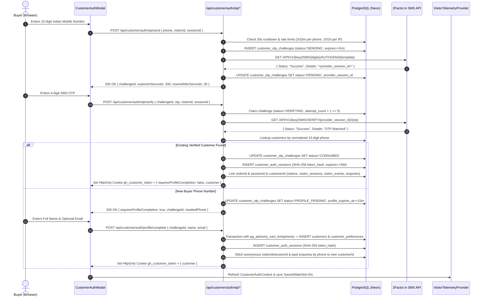
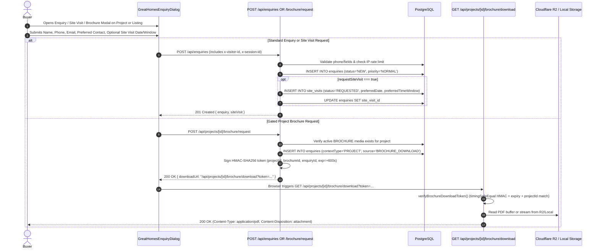
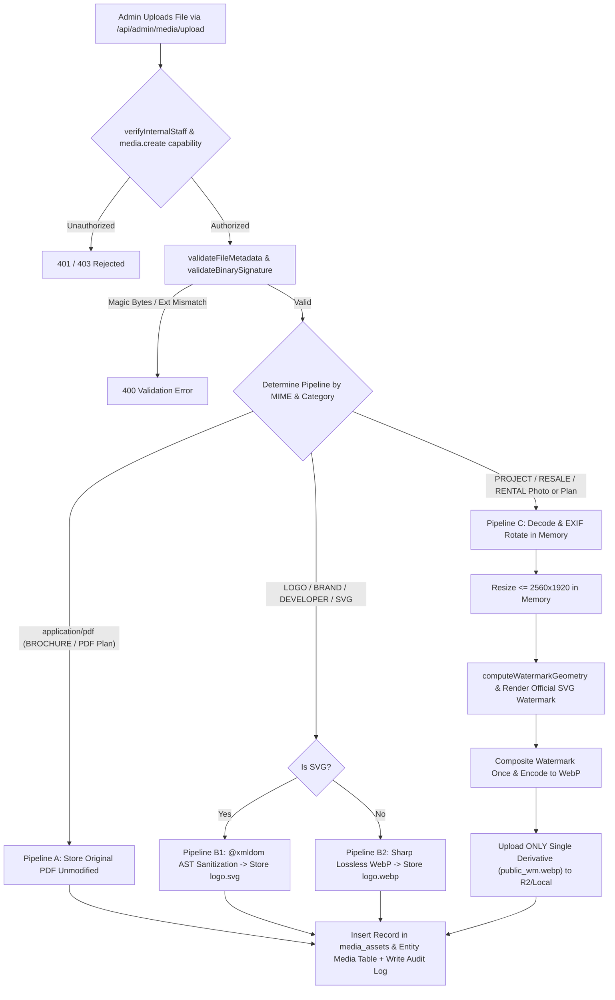
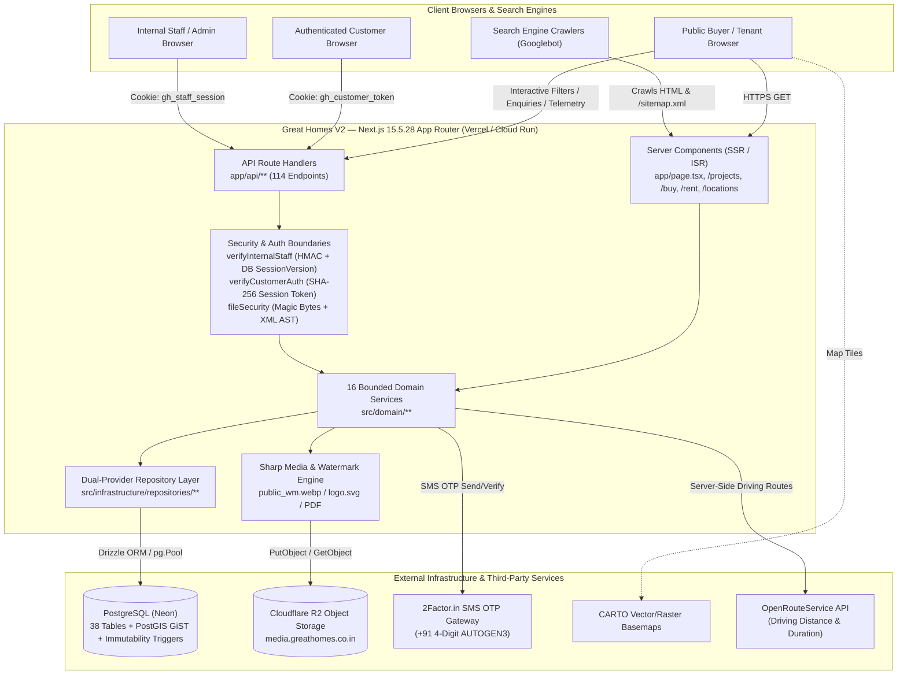

# PROJECT MASTER KNOWLEDGE BASE — COMPLETE ENGINEERING HANDOVER FOR CHATGPT

**Repository**: `Greathomesworld/greathomes-v2` `[VERIFIED]`  
**Canonical Production Domain**: `https://greathomes.co.in` `[VERIFIED]`  
**Google AI Studio Dev Preview URL**: `https://ais-dev-joa2oqrhi6vckh7rbg6rjc-118859849686.asia-southeast1.run.app` `[PREVIEW VERIFIED]`  
**Google AI Studio Shared Preview URL**: `https://ais-pre-joa2oqrhi6vckh7rbg6rjc-118859849686.asia-southeast1.run.app` `[PREVIEW VERIFIED]`  
**Framework & Runtime**: Next.js `15.5.28` (App Router) + React `19.0.0` + TypeScript `5.7.3` + PostgreSQL (Drizzle ORM `0.39.3`) `[VERIFIED]`

---

## 1. Executive Project Overview

**Great Homes V2** (`greathomes-v2`) is a production-grade, full-stack residential real estate intelligence, property discovery, lead management, and advisory platform purpose-built for the **Kolkata metropolitan residential market** `[VERIFIED]`.

Unlike classified listing aggregators that rely on unverified broker uploads and paid ranking slots, Great Homes V2 operates as a **curated residential intelligence and advisory platform** `[VERIFIED]`. It unifies:
1. **Primary Residential Projects** (`projects`): New launches, under-construction developments, and ready-to-move residential complexes with RERA verification (`project_rera`), multi-BHK typologies (`project_configurations`), floor plans, structured editorial pros/cons (`project_considerations`: *"Why Consider"* / *"Things to Keep in Mind"*), and gated PDF brochure downloads `[VERIFIED]`.
2. **Verified Resale Inventory** (`resale_listings` under `/buy` and `/projects/[slug]/resale`): Individual residential units available on the secondary market with verification workflows (`UNVERIFIED`, `PENDING`, `VERIFIED`, `REJECTED`) and lifecycle states (`DRAFT`, `SUBMITTED`, `UNDER_REVIEW`, `APPROVED`, `PUBLISHED`, `PAUSED`, `ARCHIVED`) `[VERIFIED]`.
3. **Verified Rental Inventory** (`rental_listings` under `/rent` and `/projects/[slug]/rent`): Individual residential units for lease with monthly rent, maintenance, security deposit, lease duration, and notice period `[VERIFIED]`.
4. **Hyper-Local Location & Market Intelligence** (`locations`, `location_market_snapshots`, `market_events`): Hierarchical spatial taxonomy covering Kolkata's 6 macro discovery regions (`East Kolkata`, `North Kolkata`, `South Kolkata`, `Central Kolkata`, `West Kolkata`, `Howrah`) and micro-markets (New Town, Rajarhat, Salt Lake, EM Bypass, Ballygunge, Alipore, Tollygunge, Joka, etc.), complete with historical price/supply snapshots, CARTO interactive maps, and road-routing / geodesic distance engines `[VERIFIED]`.
5. **Editorial & Advisory Publishing** (`editorial_articles` under `/guides` and `/reviews`): Structured editorial buying guides, location guides, developer stories, and independent project reviews with fact-check governance `[VERIFIED]`.
6. **Customer Workspace & 360° Behavioral Telemetry** (`customers`, `visitors`, `visitor_sessions`, `visitor_events`): Passwordless 2Factor SMS OTP customer login, saved properties, project/location watchlists, alert preferences, site-visit scheduling, and first-party visitor telemetry linking anonymous pre-signup sessions to authenticated buyer accounts `[VERIFIED]`.
7. **Enterprise Staff & Admin Back-Office** (`/admin/*` and `/api/admin/*`): Role-based operational workspace supporting 9 staff roles (5 canonical enterprise roles: `SUPER_ADMIN`, `ADMIN`, `SALES_MANAGER`, `SALES_EXECUTIVE`, `TELECALLER`, plus 4 specialized legacy roles: `CONTENT_MANAGER`, `PROPERTY_MANAGER`, `SALES`, `ANALYST`), capability-level authorization (`src/domain/auth/capabilityModel.ts`), full CRM enquiry & site-visit pipelines, server-enforced media watermarking (`sharp` + Cloudflare R2/S3), and append-only audit logs `[VERIFIED]`.

---

## 2. Business Purpose and Application Scope

### 2.1 Core Business Model
- **Primary Market**: Residential real estate buyers, tenants, property owners, and channel partners in Kolkata, West Bengal, India `[VERIFIED]`.
- **Revenue & Conversion Funnel**: High-intent buyer acquisition via contextual property enquiries (`enquiries`), gated project brochure downloads (`/api/projects/[id]/brochure/request`), and scheduled in-person or video site visits (`site_visits`) managed by an internal sales & telecalling team `[VERIFIED]`.
- **Differentiators Implemented in Code**:
  - **Transparent Area Pricing Basis**: Every project configuration and listing explicitly tracks `CARPET_AREA`, `BUILT_UP_AREA`, and `SUPER_BUILT_UP_AREA`, allowing buyers to toggle area calculation basis dynamically across pages while tracking area-basis preference via telemetry `[VERIFIED]`.
  - **Honest Spatial & Routing Disclosure**: The road-routing engine (`src/domain/places/routing/roadRoutingService.ts`) strictly distinguishes `VERIFIED_PROJECT_LOCATION` coordinates from `APPROXIMATE_LOCATION` locality centroids, refusing to fabricate road distances when only locality centroids exist and explicitly labeling straight-line geodesic distances `[VERIFIED]`.
  - **Mandatory Server-Side Image Watermarking**: Property photographs, floor plans, master plans, and location maps uploaded through the admin pipeline are automatically oriented, watermarked once in memory with the official Great Homes vector watermark (`public/assets/aistudio/GH_wm_17aa72b0.svg`), encoded to WebP, and persisted as a single permanent asset (`public_wm.webp`), while developer/brand logos and PDF brochures are strictly exempted from watermarking `[VERIFIED]`.

### 2.2 Application Scope Breakdown
| Subsystem | Scope Status | Evidence Tag |
| :--- | :--- | :--- |
| Public Discovery (`/`, `/projects`, `/buy`, `/rent`, `/locations`, `/developers`) | Complete & Active | `[VERIFIED]` `[PREVIEW VERIFIED]` |
| Side-by-Side Comparison (`/compare/projects`, `/compare/resale`, `/compare/rent`, `/compare/locations`) | Complete & Active | `[VERIFIED]` `[PREVIEW VERIFIED]` |
| Market Intelligence Hub (`/market`, `/locations/[slug]/activity`) | Complete & Active | `[VERIFIED]` `[PREVIEW VERIFIED]` |
| Editorial Guides & Reviews (`/guides`, `/reviews`, `/locations/[slug]/guide`, `/developers/[slug]/stories`) | Complete & Active | `[VERIFIED]` `[PREVIEW VERIFIED]` |
| Customer Auth (2Factor SMS OTP + Password Login + Session Management) | Complete & Active | `[VERIFIED]` |
| Customer Portal (`/account`, Saved, Recently Viewed, Enquiries, Site Visits, Watchlists, Preferences) | Complete & Active | `[VERIFIED]` |
| Admin CRM & Operations (`/admin/*` — Projects, Listings, RERA, Media, SEO, Enquiries, Site Visits, Staff, Audit, Customer 360) | Complete & Active | `[VERIFIED]` |
| Phase 2C Owner/Partner Property Submissions (`property_submissions`, `customer_partner_profiles`, `partner_attestations`) | Database Schema & Triggers Installed; UI/API Pending | `[PARTIALLY VERIFIED]` |
| Google Search Console Inspector (`/admin/seo/search-console`, `searchConsoleService.ts`) | Simulated Local Structural Preview Mode (`SIMULATED_PREVIEW`) | `[VERIFIED]` |

---

## 3. Technology Stack

All versions below are verified directly from `/package.json` and `/bun.lock` `[VERIFIED]`:

| Layer | Technology | Version | Purpose |
| :--- | :--- | :--- | :--- |
| **Framework** | Next.js (App Router) | `15.5.28` | Full-stack React framework, SSR/ISR, Route Handlers (`app/api/*`), Metadata/Sitemap generation `[VERIFIED]` |
| **UI Library** | React / React DOM | `^19.0.0` (`19.0.0`) | Server & Client Components `[VERIFIED]` |
| **Language** | TypeScript | `^5.7.3` | Strict static typing across frontend, domain, and database layers `[VERIFIED]` |
| **Styling** | Tailwind CSS v4 | `^4.0.6` (`@tailwindcss/postcss`) | Utility-first styling with `@theme` tokens in `src/index.css` `[VERIFIED]` |
| **Typography** | `next/font/google` | Built-in | Locked 3-font system: `Fjalla One` (`--font-fjalla`), `Plus Jakarta Sans` (`--font-plus-jakarta`), `Inter` (`--font-inter`) `[VERIFIED]` |
| **Database** | PostgreSQL (Neon in Prod) | `pg` `^8.13.3` | Primary relational & spatial data store `[VERIFIED]` |
| **ORM & Migrations** | Drizzle ORM / Drizzle Kit | `^0.39.3` / `^0.30.4` | Type-safe schema definition (`src/db/schema.ts`), SQL queries, and idempotent startup DDL (`src/db/client.ts`) `[VERIFIED]` |
| **Object Storage** | AWS SDK S3 Client | `^3.750.0` (`@aws-sdk/client-s3`) | Cloudflare R2 / S3-compatible media storage (`S3StorageProvider`) + Local disk fallback (`LocalStorageProvider`) `[VERIFIED]` |
| **Image Processing** | Sharp | `^0.33.5` | Server-side image decoding, EXIF auto-rotation, SVG watermark compositing, WebP/AVIF encoding `[VERIFIED]` |
| **XML/SVG Sanitizer** | `@xmldom/xmldom` | `^0.8.11` | Strict AST-based SVG logo validation & XSS/XXE sanitization (`src/lib/fileSecurity.ts`) `[VERIFIED]` |
| **Animations** | Motion (`motion/react`) | `^12.4.3` | UI transitions, modals, carousels, and drawer animations `[VERIFIED]` |
| **Charts** | Recharts | `^2.15.1` | Market intelligence supply/price visualizations `[VERIFIED]` |
| **Icons** | Lucide React | `^0.475.0` | Canonical icon library across public, customer, and admin interfaces `[VERIFIED]` |
| **Test Runner** | Vitest | `^3.0.7` | Unit, integration, and governance test suites (`bun run test`) `[VERIFIED]` |
| **Package Manager** | Bun (`bun.lock`) / npm | Bun 1.x / Node 22 | Dependency management and script execution `[VERIFIED]` |

---

## 4. Complete Directory Structure

```text
/
├── .env.example                              # Canonical environment variable template [VERIFIED]
├── AGENTS.md                                 # Locked typography & design governance rules [VERIFIED]
├── drizzle.config.ts                         # Drizzle Kit configuration pointing to ./src/db/schema.ts [VERIFIED]
├── metadata.json                             # AI Studio applet metadata [VERIFIED]
├── next.config.mjs                           # Next.js configuration (security headers, redirects, custom imageLoader) [VERIFIED]
├── package.json                              # Dependencies and scripts (Next.js 15.5.28) [VERIFIED]
├── bun.lock                                  # Locked dependency graph [VERIFIED]
├── postcss.config.mjs                        # Tailwind v4 PostCSS plugin (@tailwindcss/postcss) [VERIFIED]
├── tsconfig.json                             # TypeScript configuration [VERIFIED]
├── public/
│   ├── assets/
│   │   ├── GH_watermark.svg                  # Fallback Great Homes watermark SVG [VERIFIED]
│   │   └── aistudio/GH_wm_17aa72b0.svg       # Official Great Homes watermark SVG [VERIFIED]
│   └── uploads/                              # Local storage fallback directory for media assets [VERIFIED]
├── scripts/
│   ├── audit-amenities-db.ts                 # CLI script to audit amenity taxonomy in DB [VERIFIED]
│   ├── audit-locations-forensic.ts           # CLI script for forensic location hierarchy verification [VERIFIED]
│   ├── backup-locations.ts                   # CLI backup utility for locations table [VERIFIED]
│   ├── cleanup-amenities-db.ts               # CLI script to normalize/deduplicate amenities [VERIFIED]
│   ├── migrate-kolkata-hierarchy.ts          # CLI migration for Kolkata 6-region discovery taxonomy [VERIFIED]
│   ├── seed-amenities-canonical.ts           # CLI canonical amenity seeder [VERIFIED]
│   ├── seed-locations.ts                     # CLI location seeder [VERIFIED]
│   ├── seed-places.ts                        # CLI POI places seeder [VERIFIED]
│   ├── seed-projects-v2.ts                   # CLI residential projects seeder [VERIFIED]
│   ├── seed-rental-listings.ts               # CLI rental inventory seeder [VERIFIED]
│   ├── seed-resale-listings.ts               # CLI resale inventory seeder [VERIFIED]
│   ├── test-seo-governance.ts                # Automated SEO & sitemap governance verification script [VERIFIED]
│   ├── verify-deployment.ts                  # Pre/post-deployment verification script [VERIFIED]
│   └── verify-locations-state.ts             # Location state integrity checker [VERIFIED]
├── app/
│   ├── layout.tsx                            # Root HTML layout, Google Fonts, Providers, Header, Footer, Trays [VERIFIED]
│   ├── page.tsx                              # Public Homepage (SSR/ISR revalidate=3600) [VERIFIED]
│   ├── error.tsx                             # App-level error boundary [VERIFIED]
│   ├── global-error.tsx                      # Root layout crash boundary [VERIFIED]
│   ├── not-found.tsx                         # Custom 404 page [VERIFIED]
│   ├── robots.ts                             # Dynamic /robots.txt generator [VERIFIED]
│   ├── sitemap.ts                            # Dynamic /sitemap.xml generator [VERIFIED]
│   ├── buy/
│   │   ├── page.tsx                          # Resale Properties Discovery Hub (/buy) [VERIFIED]
│   │   └── [slug]/
│   │       ├── page.tsx                      # Individual Resale Listing Detail Page (/buy/[slug]) [VERIFIED]
│   │       └── components/ResaleGallery.tsx  # Interactive lightbox gallery for resale units [VERIFIED]
│   ├── rent/
│   │   ├── page.tsx                          # Rental Properties Discovery Hub (/rent) [VERIFIED]
│   │   └── [slug]/page.tsx                   # Individual Rental Listing Detail Page (/rent/[slug]) [VERIFIED]
│   ├── projects/
│   │   ├── page.tsx                          # Primary Residential Projects Directory (/projects) [VERIFIED]
│   │   └── [slug]/
│   │       ├── page.tsx                      # Flagship Project Dossier Page (/projects/[slug]) [VERIFIED]
│   │       ├── components/MobileStickyCTA.tsx# Mobile sticky enquiry/brochure bar [VERIFIED]
│   │       ├── resale/
│   │       │   ├── page.tsx                  # Project-specific Resale Inventory (/projects/[slug]/resale) [VERIFIED]
│   │       │   └── error.tsx                 # Error boundary [VERIFIED]
│   │       └── rent/
│   │           ├── page.tsx                  # Project-specific Rental Inventory (/projects/[slug]/rent) [VERIFIED]
│   │           └── error.tsx                 # Error boundary [VERIFIED]
│   ├── locations/
│   │   ├── page.tsx                          # Kolkata Locations & Micro-Markets Hub (/locations) [VERIFIED]
│   │   ├── loading.tsx                       # Skeleton loader [VERIFIED]
│   │   └── [slug]/
│   │       ├── page.tsx                      # Location Intelligence & Projects Page (/locations/[slug]) [VERIFIED]
│   │       ├── activity/page.tsx             # Location Market Activity & Timeline (/locations/[slug]/activity) [VERIFIED]
│   │       └── guide/page.tsx                # Location Editorial Buying Guide (/locations/[slug]/guide) [VERIFIED]
│   ├── developers/
│   │   ├── (directory)/
│   │   │   ├── page.tsx                      # Verified Developers Directory (/developers) [VERIFIED]
│   │   │   └── loading.tsx                   # Skeleton loader [VERIFIED]
│   │   └── [slug]/
│   │       ├── page.tsx                      # Developer Profile & Portfolio Page (/developers/[slug]) [VERIFIED]
│   │       └── stories/page.tsx              # Developer Editorial Stories (/developers/[slug]/stories) [VERIFIED]
│   ├── market/
│   │   └── page.tsx                          # Kolkata Real Estate Market Intelligence Hub (/market) [VERIFIED]
│   ├── compare/
│   │   ├── projects/page.tsx                 # Side-by-side Project Comparison (/compare/projects) [VERIFIED]
│   │   ├── resale/page.tsx                   # Side-by-side Resale Comparison (/compare/resale) [VERIFIED]
│   │   ├── rent/page.tsx                     # Side-by-side Rental Comparison (/compare/rent) [VERIFIED]
│   │   └── locations/page.tsx                # Side-by-side Location Comparison (/compare/locations) [VERIFIED]
│   ├── guides/
│   │   ├── page.tsx                          # Buyer Guides & Intelligence Hub (/guides) [VERIFIED]
│   │   └── [slug]/page.tsx                   # Editorial Guide Article Page (/guides/[slug]) [VERIFIED]
│   ├── reviews/
│   │   ├── page.tsx                          # Editorial Project Reviews Hub (/reviews) [VERIFIED]
│   │   └── [slug]/page.tsx                   # Individual Project Review Page (/reviews/[slug]) [VERIFIED]
│   ├── account/
│   │   ├── layout.tsx                        # Customer Account Shell & Navigation [VERIFIED]
│   │   ├── page.tsx                          # Customer Overview Dashboard (/account) [VERIFIED]
│   │   ├── saved/page.tsx                    # Saved Projects & Listings (/account/saved) [VERIFIED]
│   │   ├── recently-viewed/page.tsx          # Recently Viewed History (/account/recently-viewed) [VERIFIED]
│   │   ├── enquiries/page.tsx                # Customer Submitted Enquiries (/account/enquiries) [VERIFIED]
│   │   ├── site-visits/page.tsx              # Customer Scheduled Site Visits (/account/site-visits) [VERIFIED]
│   │   ├── preferences/page.tsx              # Personalization & Alert Preferences (/account/preferences) [VERIFIED]
│   │   └── profile/page.tsx                  # Customer Profile Management (/account/profile) [VERIFIED]
│   ├── admin/
│   │   ├── layout.tsx                        # Admin Workspace Layout wrapping <AdminShell> [VERIFIED]
│   │   ├── login/page.tsx                    # Staff Authentication Login Page (/admin/login) [VERIFIED]
│   │   ├── page.tsx                          # Admin Operational Dashboard (/admin) [VERIFIED]
│   │   ├── projects/                         # Admin Project CRUD (/admin/projects, /new, /[id], /[id]/edit) [VERIFIED]
│   │   ├── listings/
│   │   │   ├── resale/                       # Admin Resale CRUD (/admin/listings/resale, /new, /[id], /[id]/edit) [VERIFIED]
│   │   │   └── rent/                         # Admin Rental CRUD (/admin/listings/rent, /new, /[id], /[id]/edit) [VERIFIED]
│   │   ├── locations/                        # Admin Location CRUD (/admin/locations, /create, /[id], /[id]/edit) [VERIFIED]
│   │   ├── developers/                       # Admin Developer CRUD (/admin/developers, /create, /[id], /[id]/edit) [VERIFIED]
│   │   ├── rera/page.tsx                     # RERA Verification Queue (/admin/rera) [VERIFIED]
│   │   ├── media/                            # Unified Media Library (/admin/media, /admin/media/projects) [VERIFIED]
│   │   ├── enquiries/                        # CRM Enquiries Pipeline (/admin/enquiries, /[id]) [VERIFIED]
│   │   ├── site-visits/page.tsx              # Site Visits Operations (/admin/site-visits) [VERIFIED]
│   │   ├── content/                          # Editorial CMS (/admin/content, /new, /[id]) [VERIFIED]
│   │   ├── seo/                              # SEO Governance Suite (overview, projects, listings, locations, developers, sitemap, search-console) [VERIFIED]
│   │   ├── intelligence/                     # Intelligence Management (customers, configurations, amenities, faqs, media, rera) [VERIFIED]
│   │   ├── staff/page.tsx                    # Staff User & Role Management (/admin/staff) [VERIFIED]
│   │   └── audit/page.tsx                    # Immutable Security & Operations Audit Log Viewer (/admin/audit) [VERIFIED]
│   ├── uploads/[...path]/route.ts            # Local media serving & fallback asset proxy route [VERIFIED]
│   └── api/                                  # 114 RESTful API Route Handlers (documented in Section 15) [VERIFIED]
└── src/
    ├── index.css                             # Global Tailwind v4 theme variables & utility animations [VERIFIED]
    ├── context/SearchContext.tsx             # Global search modal & filter state context [VERIFIED]
    ├── db/
    │   ├── schema.ts                         # Canonical Drizzle PostgreSQL schema (33 tables, 8 enums) [VERIFIED]
    │   └── client.ts                         # PG Pool singleton, safety gates, and ensureSchemaUpdates() DDL [VERIFIED]
    ├── domain/                               # 16 Bounded Domain Modules (DDD Architecture) [VERIFIED]
    │   ├── audit/                            # Staff action auditing, PII sanitization, correlation IDs [VERIFIED]
    │   ├── auth/                             # Staff HMAC session cookies, 9 roles, capability matrix [VERIFIED]
    │   ├── comparison/                       # Project, resale, and rental comparison matrices [VERIFIED]
    │   ├── customer/                         # Customer scrypt/session auth, 2Factor OTP, watchlists, notifications [VERIFIED]
    │   ├── developers/                       # Developer entities, media, portfolio aggregation [VERIFIED]
    │   ├── editorial/                        # Guides & reviews workflow, structured sections, fact-checking [VERIFIED]
    │   ├── enquiry/                          # Lead capture, CRM assignment, follow-ups, metrics [VERIFIED]
    │   ├── google/                           # Simulated Google Search Console inspection service [VERIFIED]
    │   ├── locationComparison/               # Multi-locality comparison engine & validation [VERIFIED]
    │   ├── locations/                        # Kolkata spatial hierarchy, region mapping, location SEO [VERIFIED]
    │   ├── marketIntelligence/               # Market snapshots, price/supply metrics, data quality checker [VERIFIED]
    │   ├── media/                            # S3/R2 & local storage providers, Sharp processing, watermarkEngine [VERIFIED]
    │   ├── places/                           # Nearby POIs, geodesic math, OpenRouteService road-routing [VERIFIED]
    │   ├── projects/                         # Projects, configurations, resale, rental, recommendations, viewModels [VERIFIED]
    │   ├── repositories/                     # Core repository TypeScript interfaces [VERIFIED]
    │   ├── search/                           # Natural language search parser, intent detector, universal search [VERIFIED]
    │   ├── seo/                              # Canonical URL validator, metadata & JSON-LD schema audit engine [VERIFIED]
    │   ├── siteVisit/                        # Site visit scheduling, status transitions, staff assignment [VERIFIED]
    │   └── visitorIntelligence/              # First-party anonymous visitor tracking & Customer 360 identitystitching [VERIFIED]
    ├── infrastructure/
    │   ├── data/locations.ts                 # Seed data for Kolkata locations [VERIFIED]
    │   ├── maps/carto/                       # CARTO basemap configuration & tile provider [VERIFIED]
    │   ├── repositories/
    │   │   ├── memory/                       # In-memory repository implementations (dev/test fallback) [VERIFIED]
    │   │   ├── postgres/                     # PostgreSQL Drizzle repository implementations [VERIFIED]
    │   │   ├── projectProvider.ts            # Singleton provider for project repositories [VERIFIED]
    │   │   ├── locationProvider.ts           # Singleton provider for location repository [VERIFIED]
    │   │   └── developerProvider.ts          # Singleton provider for developer repositories [VERIFIED]
    │   └── seed.ts                           # Idempotent in-memory/dev seed initializer [VERIFIED]
    └── lib/
        ├── adminAuth.ts                      # Client-side staff context builder & legacy storage cleanup [VERIFIED]
        ├── apiError.ts                       # Standardized API error envelope builder [VERIFIED]
        ├── auth.ts                           # Server-side verifyInternalStaff wrapper [VERIFIED]
        ├── backupRecovery.ts                 # JSON snapshot backup/restore utility [VERIFIED]
        ├── brochureToken.ts                  # HMAC-SHA256 signed 10-minute brochure download token [VERIFIED]
        ├── config.ts                         # Fail-fast environment variable validator [VERIFIED]
        ├── fileSecurity.ts                   # Binary magic-byte inspector & XML/SVG AST sanitizer [VERIFIED]
        ├── imageLoader.ts                    # Custom Next.js image loader for R2/CDN/local assets [VERIFIED]
        ├── logger.ts                         # Structured JSON server logger [VERIFIED]
        ├── mediaUtils.ts                     # Media URL normalizer [VERIFIED]
        ├── rateLimit.ts                      # In-memory sliding window rate limiter for public endpoints [VERIFIED]
        ├── requestContext.ts                 # x-request-id correlation & IP extractor [VERIFIED]
        ├── revalidateListingPaths.ts         # Next.js on-demand path & sitemap cache revalidator [VERIFIED]
        ├── testIsolationContext.ts           # AsyncLocalStorage test sandbox isolation guard [VERIFIED]
        ├── validation.ts                     # Input validation primitives [VERIFIED]
        └── videoUtils.ts                     # Video embed URL parser [VERIFIED]
```

---

## 5. System Architecture

### 5.1 Layered Domain-Driven Design (DDD)
Great Homes V2 is structured as a modular monolith inside a Next.js App Router application `[VERIFIED]`. It separates concerns into 4 strict architectural layers:
1. **Presentation & Routing Layer (`app/` & `src/components/`)**:
   - Next.js Server Components fetch data directly from Domain Services during SSR/ISR without making self-referential HTTP calls `[VERIFIED]`.
   - Next.js Route Handlers (`app/api/**`) expose JSON REST endpoints for Client Components, interactive filters, customer actions, telemetry ingestion, and admin mutations `[VERIFIED]`.
2. **Domain Layer (`src/domain/*`)**:
   - Encapsulates all business entities, validation rules, view models, capability checks, and orchestration services across 16 bounded contexts `[VERIFIED]`.
3. **Infrastructure & Repository Layer (`src/infrastructure/*`)**:
   - Implements domain repository interfaces in two interchangeable modes:
     - **PostgreSQL Mode (`PERSISTENCE_PROVIDER=postgres`)**: Executes SQL queries via Drizzle ORM against the singleton `pg.Pool` in `src/db/client.ts` `[VERIFIED]`.
     - **In-Memory Mode (`PERSISTENCE_PROVIDER=memory`)**: Uses in-memory arrays seeded by `ensureSeedData()` (`src/infrastructure/seed.ts`) when running in local/preview environments without a PostgreSQL connection `[VERIFIED]`.
4. **Cross-Cutting Security & Utilities Layer (`src/lib/*`)**:
   - Provides request correlation (`x-request-id`), binary file signature verification, SVG AST sanitization, HMAC token signing, rate limiting, and fail-closed configuration checks `[VERIFIED]`.

### 5.2 Persistence Provider Switching & Fail-Closed Production Guard
In `src/db/client.ts` (lines 840–914) and `src/lib/config.ts` `[VERIFIED]`:
- `isPostgresRequired()` evaluates to `true` whenever `PERSISTENCE_PROVIDER === 'postgres'` OR `NODE_ENV === 'production'` `[VERIFIED]`.
- During `next build` (`process.env.NEXT_PHASE === 'phase-production-build'`), `getDb()` returns `null` gracefully if `DATABASE_URL` is absent in the build container so static route compilation succeeds `[VERIFIED]`.
- At **production runtime**, if `DATABASE_URL` is missing, `getDb()` throws `FATAL: DATABASE_URL is not set. PostgreSQL persistence is strictly required in production.` This guarantees zero silent fallback to in-memory storage in production `[VERIFIED]`.

---

## 6. Frontend Architecture

### 6.1 Global Provider Hierarchy (`app/layout.tsx`)
Every page render wraps children in the following client/server composition tree `[VERIFIED]`:
```tsx
<html lang="en" className={`${inter.variable} ${plusJakartaSans.variable} ${fjallaOne.variable}`}>
  <body>
    <CustomerAuthProvider>          {/* Manages customer auth state, Saved IDs, Watchlist IDs, Auth Modal */}
      <VisitorTelemetryProvider>    {/* First-party session/visitor tracking & page_view / dwell_time beacons */}
        <SearchProvider>            {/* Controls ImmersiveSearchModal & global search state */}
          <Header />                {/* Sticky top navigation bar with category pills & CustomerNavControl */}
          <ImmersiveSearchModal />  {/* Full-screen natural language & filter search overlay */}
          <main>{children}</main>   {/* Route content */}
          <Footer />                {/* Comprehensive directory & legal footer */}
          <ComparisonTray />        {/* Floating bottom dock for comparing up to 4 items */}
          <MobileBottomNav />       {/* Mobile sticky bottom navigation bar */}
        </SearchProvider>
      </VisitorTelemetryProvider>
    </CustomerAuthProvider>
  </body>
</html>
```

### 6.2 Rendering Strategies
- **ISR / Time-Based Revalidation (`export const revalidate = 3600`)**: Used on `/` (`app/page.tsx`) and `/guides` (`app/guides/page.tsx`) to cache rendered HTML for 1 hour while refreshing automatically `[VERIFIED]`.
- **Dynamic Server Rendering (`export const dynamic = 'force-dynamic'`)**: Used on `/sitemap.ts` (with `revalidate = 86400`), search/filter discovery pages (`/projects`, `/buy`, `/rent`, `/locations`), and detail pages that depend on live query parameters or fresh inventory states `[VERIFIED]`.
- **Client-Side Interactive Leaves (`'use client'`)**:
  - **Maps**: `src/components/map/LocationsDiscoveryMap.tsx` and `src/components/projects/ProjectLocationMap.tsx` render interactive Leaflet/CARTO maps dynamically on the client `[VERIFIED]`.
  - **Comparison Tray**: `src/components/comparison/ComparisonTray.tsx` persists up to 4 selected IDs per mode (`projects`, `resale`, `rent`, `locations`) in `localStorage` (`gh_compare_projects`, `gh_compare_resale`, `gh_compare_rent`, `gh_compare_locations`) and synchronizes across components via a custom `window` event (`gh-comparison-updated`) `[VERIFIED]`.
  - **Enquiry & Brochure Dialog**: `src/components/enquiry/GreatHomesEnquiryDialog.tsx` handles lead submission, site-visit scheduling toggles, and signed brochure token redemption `[VERIFIED]`.

### 6.3 Custom Image Loader (`src/lib/imageLoader.ts`)
Next.js is configured with `images: { loader: 'custom', loaderFile: './src/lib/imageLoader.ts' }` in `next.config.mjs` `[VERIFIED]`. This allows `<Image>` components to serve pre-optimized watermarked WebP assets directly from Cloudflare R2 (`media.greathomes.co.in` or `*.r2.dev`) and local `/uploads/...` paths without double-compressing already-watermarked WebP derivatives `[VERIFIED]`.

---

## 7. Backend Architecture

### 7.1 API Route Handler Architecture
All backend endpoints live under `app/api/**/route.ts` and follow a uniform processing pipeline `[VERIFIED]`:
1. **Request Correlation**: `extractRequestContext(req)` (`src/lib/requestContext.ts`) extracts or generates a UUID `x-request-id`, captures client IP (`x-forwarded-for` / `x-real-ip`), and attaches `x-request-id` to the response via `withCorrelationHeaders()` `[VERIFIED]`.
2. **Authentication & Capability Gate**:
   - Admin routes call `verifyInternalStaff(req)` (`src/domain/auth/authorizationBoundary.ts`) and `hasCapability(staff.role, '...')` (`src/domain/auth/capabilityModel.ts`) `[VERIFIED]`.
   - Customer routes call `verifyCustomerAuth(req)` (`src/domain/customer/customerAuth.ts`) `[VERIFIED]`.
3. **Rate Limiting**:
   - Public mutation routes (`/api/enquiries`, `/api/site-visits`, `/api/telemetry/events`) enforce IP-based sliding-window rate limits via `checkRateLimit()` (`src/lib/rateLimit.ts`) `[VERIFIED]`.
   - Customer OTP routes (`/api/customer/auth/otp/*`) enforce PostgreSQL-backed fixed-window rate limits in `customer_auth_rate_limits` so limits persist across serverless instances `[VERIFIED]`.
4. **Domain Service Execution**: Route handlers delegate business logic to singleton domain services (`projectService`, `resaleListingService`, `rentalListingService`, `enquiryService`, `siteVisitService`, `mediaProcessingService`, `editorialService`, `customerIntelligenceService`) `[VERIFIED]`.
5. **Audit Logging**: Staff mutations write structured before/after diffs to `audit_logs` via `auditService.logAction()` (`src/domain/audit/auditService.ts`), automatically scrubbing sensitive keys (`passwordHash`, `token`, `secret`) via `auditSanitizer.ts` `[VERIFIED]`.
6. **Cache Revalidation**: Inventory mutations call `revalidateListingPaths()` (`src/lib/revalidateListingPaths.ts`) to bust Next.js page caches for `/`, `/projects`, `/buy`, `/rent`, and `/sitemap.xml` `[VERIFIED]`.

---

## 8. Complete Page and Route Inventory

### 8.1 Public Customer-Facing Pages
| Route Pattern | Source File | Rendering | Purpose & Data Dependencies | Status |
| :--- | :--- | :--- | :--- | :--- |
| `/` | `app/page.tsx` | SSR (`revalidate=3600`) | Flagship homepage: Hero search, 4 Explore Pillars, Featured Project Spotlight, Project Stages, Explore Projects, Verified Resale (`HomeResaleSection`), Curated Rentals (`HomeRentalSection`), Kolkata Micro-Markets (`HomeLocationSection`), Personalized Recommendations, Why Great Homes, Trust & Credibility, Intelligence Guides, Expert Assistance CTA | `[VERIFIED]` `[PREVIEW VERIFIED]` |
| `/projects` | `app/projects/page.tsx` | Dynamic SSR | Primary residential project discovery directory with filters (location, region, BHK, status, propertyType, price range, RERA verified, keyword) | `[VERIFIED]` `[PREVIEW VERIFIED]` |
| `/projects/[slug]` | `app/projects/[slug]/page.tsx` | Dynamic SSR | Comprehensive Project Dossier: Hero gallery, RERA badge & modal, Typologies & Floor Plan viewer (Carpet/Built-up/SBUA toggle), *"Know Before You Buy"* (`project_considerations`), Amenities taxonomy, Interactive Location & Nearby Connectivity Map (CARTO + road-routing/geodesic distances), In-project Resale & Rental carousels, Developer summary, FAQs, Editorial Reviews, Gated Brochure Download, Sticky Enquiry CTA | `[VERIFIED]` `[PREVIEW VERIFIED]` |
| `/projects/[slug]/resale` | `app/projects/[slug]/resale/page.tsx` | Dynamic SSR | Dedicated indexable page of verified resale units inside a specific project | `[VERIFIED]` |
| `/projects/[slug]/rent` | `app/projects/[slug]/rent/page.tsx` | Dynamic SSR | Dedicated indexable page of verified rental units inside a specific project | `[VERIFIED]` |
| `/buy` | `app/buy/page.tsx` | Dynamic SSR | Verified Resale Properties hub with multi-facet filtering & sorting | `[VERIFIED]` `[PREVIEW VERIFIED]` |
| `/buy/[slug]` | `app/buy/[slug]/page.tsx` | Dynamic SSR | Individual Resale Listing detail page (`ResaleGallery`, unit specs, price/sq.ft breakdown, project context, nearby places, enquiry dialog). Note: `/resale/:slug` permanently redirects (308) to `/buy/:slug` in `next.config.mjs` | `[VERIFIED]` `[PREVIEW VERIFIED]` |
| `/rent` | `app/rent/page.tsx` | Dynamic SSR | Verified Rental Properties hub with rent/deposit/furnishing filters | `[VERIFIED]` `[PREVIEW VERIFIED]` |
| `/rent/[slug]` | `app/rent/[slug]/page.tsx` | Dynamic SSR | Individual Rental Listing detail page (monthly rent, maintenance, security deposit, lease terms, furnishing, gallery, enquiry dialog) | `[VERIFIED]` `[PREVIEW VERIFIED]` |
| `/locations` | `app/locations/page.tsx` | Dynamic SSR | Interactive Kolkata Micro-Markets & Discovery Regions hub with split-screen CARTO map (`LocationsDiscoveryMap`) and region cards | `[VERIFIED]` `[PREVIEW VERIFIED]` |
| `/locations/[slug]` | `app/locations/[slug]/page.tsx` | Dynamic SSR | Micro-market dossier: Supply/price metrics, projects in locality, resale/rental inventory, connectivity, nearby localities, watchlist toggle | `[VERIFIED]` `[PREVIEW VERIFIED]` |
| `/locations/[slug]/activity` | `app/locations/[slug]/activity/page.tsx` | Dynamic SSR | Historical market events feed (new launches, price changes, RERA updates) for a locality | `[VERIFIED]` |
| `/locations/[slug]/guide` | `app/locations/[slug]/guide/page.tsx` | Dynamic SSR | Editorial locality buying guide linked to `locations` and `editorial_articles` | `[VERIFIED]` |
| `/developers` | `app/developers/(directory)/page.tsx` | Dynamic SSR | Verified Builders & Developers directory with project counts and status breakdown | `[VERIFIED]` `[PREVIEW VERIFIED]` |
| `/developers/[slug]` | `app/developers/[slug]/page.tsx` | Dynamic SSR | Developer portfolio page: Brand story, logo, delivered/ongoing/upcoming projects, RERA track record | `[VERIFIED]` `[PREVIEW VERIFIED]` |
| `/developers/[slug]/stories` | `app/developers/[slug]/stories/page.tsx` | Dynamic SSR | Editorial developer stories & analysis | `[VERIFIED]` |
| `/market` | `app/market/page.tsx` | Dynamic SSR | Kolkata Market Intelligence Hub: Macro supply breakdown, price trends, locality comparisons, recent market events | `[VERIFIED]` `[PREVIEW VERIFIED]` |
| `/compare/projects` | `app/compare/projects/page.tsx` | Dynamic SSR + Client | Side-by-side comparison matrix for up to 4 residential projects | `[VERIFIED]` `[PREVIEW VERIFIED]` |
| `/compare/resale` | `app/compare/resale/page.tsx` | Dynamic SSR + Client | Side-by-side comparison matrix for up to 4 resale listings | `[VERIFIED]` `[PREVIEW VERIFIED]` |
| `/compare/rent` | `app/compare/rent/page.tsx` | Dynamic SSR + Client | Side-by-side comparison matrix for up to 4 rental listings | `[VERIFIED]` `[PREVIEW VERIFIED]` |
| `/compare/locations` | `app/compare/locations/page.tsx` | Dynamic SSR + Client | Side-by-side comparison matrix for up to 4 Kolkata localities | `[VERIFIED]` `[PREVIEW VERIFIED]` |
| `/guides` | `app/guides/page.tsx` | SSR (`revalidate=3600`) | Editorial Buying Guides, Location Guides, Market Guides, and Developer Stories hub | `[VERIFIED]` `[PREVIEW VERIFIED]` |
| `/guides/[slug]` | `app/guides/[slug]/page.tsx` | Dynamic SSR | Individual Editorial Guide reader with structured sections, key takeaways, FAQs, and contextual CTAs | `[VERIFIED]` |
| `/reviews` | `app/reviews/page.tsx` | Dynamic SSR | Independent Editorial Project Reviews hub | `[VERIFIED]` `[PREVIEW VERIFIED]` |
| `/reviews/[slug]` | `app/reviews/[slug]/page.tsx` | Dynamic SSR | Individual Project Review article linked to the reviewed project dossier | `[VERIFIED]` |
| `/robots.txt` | `app/robots.ts` | Metadata Route | Allows `/`, disallows `/api/`, `/admin/`, `/account/`, links `https://greathomes.co.in/sitemap.xml` | `[VERIFIED]` |
| `/sitemap.xml` | `app/sitemap.ts` | Dynamic (`revalidate=86400`) | Generates deduplicated canonical URLs for static pages, published projects, `/projects/[slug]/resale`, `/projects/[slug]/rent`, developers, canonical locations, verified resale/rental listings, and published editorial articles | `[VERIFIED]` |
| `/uploads/[...path]` | `app/uploads/[...path]/route.ts` | Route Handler | Serves local media uploads from `public/uploads/` with path-traversal sanitization and graceful WebP fallback for ephemeral preview records | `[VERIFIED]` |

### 8.2 Customer Account Routes (`/account/*`)
Protected by client/server customer session (`gh_customer_token` cookie verified against `customer_auth_sessions` in PostgreSQL) `[VERIFIED]`:
- `/account` (`app/account/page.tsx`): Buyer dashboard overview (counts of saved properties, active watchlists, recent enquiries, upcoming site visits, unread notifications) `[VERIFIED]`.
- `/account/saved` (`app/account/saved/page.tsx`): Saved projects, resale listings, and rental listings `[VERIFIED]`.
- `/account/recently-viewed` (`app/account/recently-viewed/page.tsx`): Last 20 viewed properties with view counts and timestamps `[VERIFIED]`.
- `/account/enquiries` (`app/account/enquiries/page.tsx`): History of submitted enquiries and current CRM status `[VERIFIED]`.
- `/account/site-visits` (`app/account/site-visits/page.tsx`): Scheduled site visits with self-service reschedule and cancellation controls `[VERIFIED]`.
- `/account/preferences` (`app/account/preferences/page.tsx`): Preferred buying mode (`BUY`/`RENT`/`ALL`), preferred localities, BHKs, budget range, project/location watchlists, and alert toggles `[VERIFIED]`.
- `/account/profile` (`app/account/profile/page.tsx`): Customer name, email, verified phone display, and sign-out `[VERIFIED]`.

### 8.3 Staff & Admin Routes (`/admin/*`)
Wrapped in `AdminShell` (`src/components/admin/AdminShell.tsx`) and gated by `gh_staff_session` HttpOnly HMAC cookie `[VERIFIED]`:
- `/admin/login` (`app/admin/login/page.tsx`): Staff email + password authentication form `[VERIFIED]`.
- `/admin` (`app/admin/page.tsx`): Executive & operational KPI dashboard `[VERIFIED]`.
- `/admin/projects`, `/admin/projects/new`, `/admin/projects/[id]`, `/admin/projects/[id]/edit`: End-to-end project lifecycle management, typologies, RERA, amenities, FAQs, considerations (`Why Consider` / `Things to Keep in Mind`), PDF brochure upload, and SEO overrides `[VERIFIED]`.
- `/admin/listings/resale` (`new`, `[id]`, `[id]/edit`) & `/admin/listings/rent` (`new`, `[id]`, `[id]/edit`): Resale and rental inventory management, owner/broker private contact details, verification workflow, and lifecycle publishing `[VERIFIED]`.
- `/admin/locations` (`create`, `[id]`, `[id]/edit`): Spatial hierarchy management (State -> District -> City -> Discovery Region -> Area -> Neighbourhood) `[VERIFIED]`.
- `/admin/developers` (`create`, `[id]`, `[id]/edit`): Builder profile & logo management `[VERIFIED]`.
- `/admin/rera` & `/admin/intelligence/rera`: RERA registration verification and revocation queue `[VERIFIED]`.
- `/admin/media`, `/admin/media/projects`, `/admin/intelligence/media`: Unified media asset manager (upload, watermark preview, reprocess, replace, reorder, set featured) `[VERIFIED]`.
- `/admin/enquiries` & `/admin/enquiries/[id]`: Full CRM lead management (status transitions, priority, staff assignment, internal notes, follow-up date scheduling) `[VERIFIED]`.
- `/admin/site-visits`: Site visit scheduling, confirmation, assignment, rescheduling, and completion tracking `[VERIFIED]`.
- `/admin/content`, `/admin/content/new`, `/admin/content/[id]`: Editorial CMS for guides and reviews (`DRAFT` -> `IN_REVIEW` -> `APPROVED` -> `PUBLISHED` -> `ARCHIVED`) `[VERIFIED]`.
- `/admin/seo/*` (`overview`, `projects`, `listings`, `locations`, `developers`, `sitemap`, `search-console`): SEO audit engine, missing meta/schema detector, sitemap health, and Search Console simulator `[VERIFIED]`.
- `/admin/intelligence/customers`: **Visitor & Customer 360 Intelligence Workspace** (`CustomerIntelligenceWorkspace.tsx`) showing anonymous visitor sessions, UTM attribution, dwell time, area-basis preferences, and stitched customer timelines `[VERIFIED]`.
- `/admin/intelligence/configurations`, `/admin/intelligence/amenities`, `/admin/intelligence/faqs`: Cross-project catalog management `[VERIFIED]`.
- `/admin/staff`: Staff account creation, password reset, role assignment, and account enable/disable (restricted to `SUPER_ADMIN` / `staff.*` capabilities) `[VERIFIED]`.
- `/admin/audit`: Immutable audit log inspector with filters by actor, resource type, action, and success/failure `[VERIFIED]`.

---

## 9. Complete Feature Inventory

| # | Feature Name | Target User | Key Source Files | APIs Called | DB Tables Used | Completeness Status |
| :--- | :--- | :--- | :--- | :--- | :--- | :--- |
| 1 | **Universal Natural Language & Faceted Search** | Public Buyers / Tenants | `UniversalSearch.tsx`, `ImmersiveSearchModal.tsx`, `src/domain/search/searchParser.ts`, `searchService.ts` | `/api/search`, `/api/search/suggestions`, `/api/discovery/*` | `projects`, `resale_listings`, `rental_listings`, `locations`, `developers` | **Complete** `[VERIFIED]` `[PREVIEW VERIFIED]` |
| 2 | **Primary Project Dossier & Intelligence** | Public Buyers | `app/projects/[slug]/page.tsx`, `projectIntelligenceService.ts`, `projectSectionEligibility.ts` | `/api/projects/slug/[slug]`, `/api/projects/slug/[slug]/nearby` | `projects`, `project_configurations`, `project_rera`, `project_media`, `project_amenities`, `project_faqs`, `project_considerations`, `project_seo` | **Complete** `[VERIFIED]` `[PREVIEW VERIFIED]` |
| 3 | **Dynamic Area-Basis Switcher (Carpet / Built-Up / SBUA)** | Public Buyers | `PropertyDetailTabs.tsx`, `ProjectConfigurationsSection.tsx` | `/api/telemetry/events` (`area_basis_changed`) | `project_configurations`, `visitor_events` | **Complete** `[VERIFIED]` `[PREVIEW VERIFIED]` |
| 4 | **Gated Project Brochure Download (HMAC Token)** | Public Buyers | `GreatHomesEnquiryDialog.tsx`, `src/lib/brochureToken.ts` | `POST /api/projects/[id]/brochure/request`, `GET /api/projects/[id]/brochure/download` | `enquiries`, `media_assets`, `project_media` | **Complete** `[VERIFIED]` |
| 5 | **Verified Resale & Rental Marketplaces** | Buyers / Tenants | `app/buy/*`, `app/rent/*`, `resaleService.ts`, `rentalService.ts` | `/api/discovery/buy`, `/api/discovery/rent`, `/api/resale/*`, `/api/rent/*` | `resale_listings`, `resale_listing_media`, `resale_listing_amenities`, `rental_listings`, `rental_listing_media`, `rental_listing_amenities` | **Complete** `[VERIFIED]` `[PREVIEW VERIFIED]` |
| 6 | **Multi-Mode Side-by-Side Comparison Engine** | Buyers / Tenants | `ComparisonTray.tsx`, `AddToCompareButton.tsx`, `comparisonService.ts`, `locationComparisonService.ts` | `/api/compare/projects`, `/api/compare/resale`, `/api/compare/rent`, `/api/compare/locations` | `projects`, `resale_listings`, `rental_listings`, `locations`, `location_market_snapshots` | **Complete** `[VERIFIED]` `[PREVIEW VERIFIED]` |
| 7 | **Spatial Connectivity & Road-Routing Engine** | Buyers / Tenants | `ProjectLocationMap.tsx`, `roadRoutingService.ts`, `openRouteServiceAdapter.ts`, `distance.ts` | `/api/places/nearby`, `/api/projects/slug/[slug]/nearby`, `/api/locations/[slug]/connectivity` | `places`, `projects`, `locations` | **Complete** `[VERIFIED]` `[PREVIEW VERIFIED]` |
| 8 | **2Factor SMS OTP Passwordless Customer Auth** | Customers | `CustomerAuthModal.tsx`, `CustomerAuthContext.tsx`, `customerOtp.ts`, `customerAuth.ts` | `/api/customer/auth/otp/send`, `/api/customer/auth/otp/verify`, `/api/customer/auth/profile/complete`, `/api/customer/auth/me`, `/api/customer/auth/logout` | `customers`, `customer_otp_challenges`, `customer_auth_rate_limits`, `customer_auth_sessions`, `customer_preferences` | **Complete** `[VERIFIED]` |
| 9 | **First-Party Visitor Telemetry & Customer 360 Stitching** | Anonymous Visitors / Customers / Admin Analysts | `VisitorTelemetryProvider.tsx`, `customerIntelligenceService.ts`, `CustomerIntelligenceWorkspace.tsx` | `POST /api/telemetry/events`, `GET /api/admin/customer-intelligence/*` | `visitors`, `visitor_sessions`, `visitor_events`, `customers`, `enquiries`, `saved_items`, `recently_viewed` | **Complete** `[VERIFIED]` `[PREVIEW VERIFIED]` |
| 10 | **Customer Watchlists, Saved Items & Alert Engine** | Authenticated Customers | `SaveButton.tsx`, `WatchLocationButton.tsx`, `watchlistService.ts`, `alertEvaluationService.ts`, `notificationService.ts` | `/api/customer/saved`, `/api/customer/watchlist/*`, `/api/customer/notifications/*`, `/api/customer/alert-preferences` | `saved_items`, `recently_viewed`, `project_watchlists`, `location_watchlists`, `notifications`, `alert_delivery_attempts` | **Complete** `[VERIFIED]` |
| 11 | **CRM Lead Capture & Site Visit Lifecycle** | Buyers / Sales Staff / Telecallers | `GreatHomesEnquiryDialog.tsx`, `enquiryService.ts`, `siteVisitService.ts` | `/api/enquiries`, `/api/site-visits`, `/api/admin/enquiries/*`, `/api/admin/site-visits/*`, `/api/customer/site-visits/*` | `enquiries`, `site_visits`, `staff_users`, `audit_logs` | **Complete** `[VERIFIED]` |
| 12 | **Mandatory Watermark Media Pipeline (Sharp + R2/S3)** | Admin / Content / Property Managers | `mediaProcessingService.ts`, `watermarkEngine.ts`, `storageProvider.ts`, `fileSecurity.ts` | `/api/admin/media/upload`, `/api/admin/media/[id]/reprocess`, `/api/admin/media/[id]/replace` | `media_assets`, `project_media`, `developer_media`, `resale_listing_media`, `rental_listing_media` | **Complete** `[VERIFIED]` |
| 13 | **Editorial Guides & Reviews CMS** | Public Readers / Content Managers | `app/guides/*`, `app/reviews/*`, `editorialService.ts` | `/api/content`, `/api/content/[slug]`, `/api/admin/content/*` | `editorial_articles` | **Complete** `[VERIFIED]` `[PREVIEW VERIFIED]` |
| 14 | **SEO Governance & Sitemap Engine** | Search Engines / Admin SEO Managers | `app/sitemap.ts`, `app/robots.ts`, `src/domain/seo/auditEngine.ts`, `searchConsoleService.ts` | `/api/admin/google/search-console/*` | `project_seo`, `developer_seo`, `projects`, `locations`, `developers`, `editorial_articles` | **Complete** (Search Console API is `SIMULATED_PREVIEW`) `[VERIFIED]` |
| 15 | **Phase 2C Owner/Partner Property Submissions** | Property Owners / Channel Partners | `src/db/schema.ts` (lines 858–943), `src/db/client.ts` (lines 701–825) | None exposed yet | `customer_partner_profiles`, `customer_partner_audit_history`, `property_submissions`, `property_submission_reviews`, `partner_attestations` | **Database Schema & Immutability Triggers Only** (UI & API routes not yet built) `[PARTIALLY VERIFIED]` |

---

## 10. Business Logic

### 10.1 Public Visibility & Eligibility Rules (`src/domain/projects/viewModels/projectSectionEligibility.ts`)
1. **Projects**: Only projects with `lifecycleStatus === 'PUBLISHED'` (or `isPublished === true`) are visible on public discovery pages, public APIs, and `/sitemap.xml` `[VERIFIED]`.
2. **Resale & Rental Listings**: Public discovery (`/buy`, `/rent`, `/projects/[slug]/resale`, `/projects/[slug]/rent`, and `/sitemap.xml`) strictly requires **both** `lifecycleStatus === 'PUBLISHED'` AND `verificationStatus === 'VERIFIED'` (`isVerified === true`) `[VERIFIED]`. Unverified, draft, paused, or archived listings are hidden from public buyers and search engines `[VERIFIED]`.
3. **Contact Privacy**: Owner and broker phone numbers (`ownerPhone`, `brokerPhone`, `privatePhone`, `ownerEmail`, `brokerEmail`, `privateEmail`, `internalNotes`, `crmId`) stored on `resale_listings` and `rental_listings` are **stripped** by public DTO mappers (`resaleDto.ts`, `rentalDto.ts`) and are never sent to public browsers `[VERIFIED]`. All buyer contact flows through Great Homes' mediated enquiry & site-visit pipeline `[VERIFIED]`.

### 10.2 Spatial & Coordinate Integrity Rules (`src/domain/places/routing/roadRoutingService.ts`)
1. **Three-State Coordinate Classification**:
   - `VERIFIED_PROJECT_LOCATION`: Project has its own verified `latitude` and `longitude` distinct from the parent locality centroid `[VERIFIED]`.
   - `APPROXIMATE_LOCATION`: Project lacks exact site coordinates and falls back to its parent `locations` centroid `[VERIFIED]`.
   - `LOCATION_UNAVAILABLE`: Neither project nor locality coordinates are available `[VERIFIED]`.
2. **Road-Routing Eligibility**:
   - Exact driving route distances (`ROAD_ROUTE`) via OpenRouteService are **only** computed when origin status is `VERIFIED_PROJECT_LOCATION` `[VERIFIED]`.
   - If origin is `APPROXIMATE_LOCATION`, `evaluateProjectRouteEligibility()` rejects road-route calculation with `ORIGIN_APPROXIMATE_NOT_ELIGIBLE` and displays a transparent disclosure message so locality centroid distances are never misrepresented as exact project-site road distances `[VERIFIED]`.
   - Physical sanity check (`validateProviderRouteMetrics`): Rejects any provider response where road distance is shorter than straight-line geodesic distance (beyond a `0.15 km` snapping tolerance) or exceeds `500 km` / `24 hours` `[VERIFIED]`.

### 10.3 Media Processing & Mandatory Watermark Policy (`src/domain/media/services/mediaProcessingService.ts`)
Every file uploaded through `/api/admin/media/upload` passes through a 3-pipeline classifier `[VERIFIED]`:
- **Pipeline A — PDF Documents (`application/pdf`, `BROCHURE`, PDF `FLOOR_PLANS`)**:
  - Validated for `%PDF-` magic header (`validateBinarySignature`) and max size `25 MB` `[VERIFIED]`.
  - Stored untouched as `original_{filename}`, never watermarked (`Cache-Control: private, no-cache, no-store, max-age=0` for immutable originals) `[VERIFIED]`.
- **Pipeline B — Logos & Brand Identity (`LOGO`, `DEVELOPER_LOGO`, `BRAND`, `OFFICE`, `EDITORIAL`, or `entityType === 'DEVELOPER'`)**:
  - **Never watermarked** (`isNeverWatermarkCategory() === true`) `[VERIFIED]`.
  - **SVG Logos (`image/svg+xml`)**: Max `5 MB`. Parsed into an XML AST via `@xmldom/xmldom` (`validateAndSanitizeSvgBuffer` in `src/lib/fileSecurity.ts`), blocking `<!DOCTYPE>`, `<!ENTITY>` (XXE), `<script>`, `<foreignObject>`, `onload`/`onerror` handlers, external `href` URLs, and `@import` CSS, while enforcing a max depth of `32` and max node count of `2500` `[VERIFIED]`. Saved as `logo.svg` `[VERIFIED]`.
  - **Raster Logos (PNG/WebP/JPG)**: Preserves alpha channel transparency, encodes to lossless WebP (`quality: 95, alphaQuality: 100`), saved as `logo.webp` `[VERIFIED]`.
- **Pipeline C — Property Photos, Floor Plans, Master Plans, Location Maps (`PROJECT`, `RESALE`, `RENTAL`)**:
  - **Mandatory Server-Enforced Watermark** (`isMandatoryWatermarkCategory() === true`), overriding any client `watermarkOptions.mode = 'OFF'` flag `[VERIFIED]`.
  - Decoded in memory via `sharp`, auto-rotated via EXIF, resized inside `2560x1920`, composited **once** with `public/assets/aistudio/GH_wm_17aa72b0.svg` using aspect-ratio-safe bounding box math (`computeWatermarkGeometry`), encoded to WebP (`quality: 92` for floor/master/location plans, `85` for photos), and stored as a **single permanent derivative** (`public_wm.webp`) `[VERIFIED]`.
  - Unwatermarked originals are **never persisted to disk or R2/S3** for Pipeline C images `[VERIFIED]`.
  - `isSingleDerivativeWatermarkedAsset()` prevents double-watermarking if an admin triggers `/api/admin/media/[id]/reprocess` on an already-watermarked `public_wm.webp` asset `[VERIFIED]`.

### 10.4 Kolkata Location Taxonomy Governance (`src/domain/locations/locationRegionMapper.ts`)
Locations are organized into a 6-level hierarchy (`STATE` -> `DISTRICT` -> `CITY` -> `DISCOVERY_REGION` -> `AREA` -> `NEIGHBOURHOOD`) `[VERIFIED]`.
- Only `AREA` and `NEIGHBOURHOOD` nodes with `status === 'PUBLISHED'` qualify as public canonical indexable locations (`isPublicCanonicalLocation()`) for `/locations/[slug]` and `/sitemap.xml` `[VERIFIED]`.
- Macro container nodes (`West Bengal`, `Kolkata`, `East Kolkata`, etc.) are used for regional grouping and filtering but are excluded from standalone locality detail indexing `[VERIFIED]`.

---

## 11. User Workflows

### 11.1 Passwordless Customer Authentication & Identity Stitching Workflow
Implemented in `src/domain/customer/customerOtp.ts`, `src/domain/customer/customerAuth.ts`, and `src/domain/visitorIntelligence/services/customerIntelligenceService.ts` `[VERIFIED]`:



### 11.2 Lead Enquiry, Site Visit & Gated Brochure Workflow
Implemented in `GreatHomesEnquiryDialog.tsx`, `app/api/enquiries/route.ts`, `app/api/projects/[id]/brochure/request/route.ts`, and `app/api/projects/[id]/brochure/download/route.ts` `[VERIFIED]`:



### 11.3 Admin Media Upload & Watermarking Workflow
Implemented in `app/api/admin/media/upload/route.ts`, `src/domain/media/services/mediaProcessingService.ts`, and `src/domain/media/services/watermarkEngine.ts` `[VERIFIED]`:



---

## 12. Database Architecture

### 12.1 Database Engine & Connection Management (`src/db/client.ts`)
- **Engine**: PostgreSQL (hosted on Neon Serverless Postgres in production, pooled via `pg.Pool`) `[VERIFIED]`.
- **Singleton Pool**: `globalThis.__ghPgPool` and `globalThis.__ghDbInstance` prevent connection exhaustion across Next.js hot reloads and warm serverless invocations `[VERIFIED]`.
- **Migration Safety Gate (`isMigrationAuthorizedForDatabase` in `src/db/client.ts`)**:
  - `ensureSchemaUpdates()` executes idempotent `CREATE TABLE IF NOT EXISTS` and `ALTER TABLE ... ADD COLUMN IF NOT EXISTS` DDL statements **only** if `ALLOW_DB_MIGRATIONS === 'true'` `[VERIFIED]`.
  - Queries `SELECT current_database() AS db_name` first and fails closed if the query fails `[VERIFIED]`.
  - If `db_name` contains `'production'`, it additionally requires `ALLOW_PRODUCTION_MIGRATIONS === 'true'` (`options.force` can never bypass this production check) `[VERIFIED]`.

### 12.2 PostgreSQL Enums (`src/db/schema.ts`)
1. `project_status`: `'UPCOMING'`, `'NEW_LAUNCH'`, `'UNDER_CONSTRUCTION'`, `'READY_TO_MOVE'`, `'COMPLETED'`, `'SOLD_OUT'` `[VERIFIED]`
2. `project_lifecycle_status`: `'DRAFT'`, `'PUBLISHED'`, `'ARCHIVED'` `[VERIFIED]`
3. `property_type`: `'APARTMENT'`, `'FLAT'`, `'VILLA'`, `'INDEPENDENT_HOUSE'`, `'PLOT'`, `'DUPLEX'`, `'PENTHOUSE'` `[VERIFIED]`
4. `price_basis`: `'CARPET_AREA'`, `'BUILT_UP_AREA'`, `'SUPER_BUILT_UP_AREA'` `[VERIFIED]`
5. `rera_status`: `'NOT_PROVIDED'`, `'PROVIDED'`, `'VERIFIED'` `[VERIFIED]`
6. `location_type`: `'STATE'`, `'DISTRICT'`, `'CITY'`, `'DISCOVERY_REGION'`, `'AREA'`, `'NEIGHBOURHOOD'` `[VERIFIED]`
7. `location_status`: `'DRAFT'`, `'PUBLISHED'`, `'ARCHIVED'` `[VERIFIED]`
8. `developer_status`: `'DRAFT'`, `'PUBLISHED'`, `'ARCHIVED'` `[VERIFIED]`
9. `customer_status`: `'ACTIVE'`, `'DISABLED'`, `'DELETED'` `[VERIFIED]`

### 12.3 Complete Table Inventory (33 Tables)
Every table below is verified from `src/db/schema.ts` (30 Drizzle table definitions) and `src/db/client.ts` (3 additional auth/OTP tables created in `ensureSchemaUpdates()`) `[VERIFIED]`:

| # | Table Name | Primary Key | Foreign Keys & Cascade Rules | Key Columns & Purpose | Indexes & Constraints |
| :--- | :--- | :--- | :--- | :--- | :--- |
| 1 | `developers` | `id` (`uuid`) | — | `name`, `slug` (unique), `short_description`, `description`, `website_url`, `status` (`developer_status`), `featured` | Unique on `slug` |
| 2 | `developer_media` | `id` (`uuid`) | `developer_id` -> `developers.id` | `media_type`, `category` (`LOGO`, `BRAND`, `OFFICE`, `EDITORIAL`), `url`, `sort_order`, `is_featured` | FK on `developer_id` |
| 3 | `developer_seo` | `id` (`uuid`) | `developer_id` -> `developers.id` | `meta_title`, `meta_description`, `canonical_url` | FK on `developer_id` |
| 4 | `locations` | `id` (`uuid`) | `parent_id` -> `locations.id` (self-ref) | `name`, `slug` (unique), `type` (`location_type`), `latitude`, `longitude`, `geometry`, `status` (`location_status`), `featured` | Unique on `slug` |
| 5 | `projects` | `id` (`uuid`) | `developer_id` -> `developers.id`, `location_id` -> `locations.id` | `name`, `slug` (unique), `status` (`project_status`), `lifecycle_status`, `property_type`, `starting_price` (`numeric(19,4)`), `project_area`, `tower_count`, `total_units`, `floors`, `possession`, `latitude`, `longitude`, `featured`, `is_published` | Unique on `slug` |
| 6 | `project_configurations` | `id` (`uuid`) | `project_id` -> `projects.id` | `name`, `bedroom_count`, `carpet_area`, `built_up_area`, `super_built_up_area`, `price` (`numeric(19,4)`), `price_basis` (`price_basis`), `floor_plan_media_id` | FK on `project_id` |
| 7 | `project_rera` | `id` (`uuid`) | `project_id` -> `projects.id` | `status` (`rera_status`), `authority`, `registration_number`, `verified_at`, `verified_by`, `internal_notes` | FK on `project_id` |
| 8 | `project_media` | `id` (`uuid`) | `project_id` -> `projects.id`, `configuration_id` -> `project_configurations.id` | `media_id`, `media_type`, `category`, `url`, `alt_text`, `caption`, `sort_order`, `is_featured` | FK on `project_id` |
| 9 | `amenities` | `id` (`uuid`) | — | `name`, `slug` (unique), `category`, `icon` | Unique on `slug` |
| 10 | `project_amenities` | `id` (`uuid`) | `project_id` -> `projects.id`, `amenity_id` -> `amenities.id` | `is_featured`, `sort_order` | FKs on `project_id`, `amenity_id` |
| 11 | `project_faqs` | `id` (`uuid`) | `project_id` -> `projects.id` | `question`, `answer`, `sort_order`, `is_published` | FK on `project_id` |
| 12 | `project_seo` | `id` (`uuid`) | `project_id` -> `projects.id` | `meta_title`, `meta_description`, `canonical_url` | FK on `project_id` |
| 13 | `project_considerations` | `id` (`uuid`) | `project_id` -> `projects.id` (`ON DELETE CASCADE`) | `section` (`WHY_CONSIDER` \| `THINGS_TO_KEEP_IN_MIND`), `title`, `description`, `source_type` (`GENERATED` \| `EDITORIAL`), `sort_order`, `is_visible` | `idx_project_considerations_project_id`, `_section`, `_is_visible` |
| 14 | `places` | `id` (`uuid`) | — | `name`, `category`, `category_display`, `latitude`, `longitude`, `address`, `locality`, `city`, `is_verified` | Spatial coordinates |
| 15 | `resale_listings` | `id` (`text`) | `project_id` -> `projects.id`, `location_id` -> `locations.id` | `slug`, `property_type`, `configuration`, `bedroom_count`, `carpet_area`, `built_up_area`, `super_built_up_area`, `asking_price`, `furnishing`, `facing`, `floor_category`, `possession`, `listing_party_type`, private owner/broker fields, `lifecycle_status`, `verification_status`, `latitude`, `longitude`, `geometry` | `idx_resale_listings_location_id`, PostGIS GiST index `idx_resale_listings_spatial` |
| 16 | `resale_listing_media` | `id` (`text`) | `resale_listing_id` -> `resale_listings.id` | `media_type`, `category`, `url`, `alt_text`, `caption`, `sort_order`, `is_featured` | FK on `resale_listing_id` |
| 17 | `resale_listing_amenities` | `id` (`text`) | `resale_listing_id` -> `resale_listings.id`, `amenity_id` -> `amenities.id` | Join table for resale unit amenities | FKs on listing & amenity |
| 18 | `rental_listings` | `id` (`text`) | `project_id` -> `projects.id`, `location_id` -> `locations.id` | `slug`, `property_type`, `configuration`, `bedroom_count`, `monthly_rent`, `maintenance`, `security_deposit`, `furnishing`, `facing`, `floor_category`, `possession`, `availability_date`, `lease_duration`, `notice_period`, private owner/broker fields, `lifecycle_status`, `verification_status`, `latitude`, `longitude` | `idx_rental_listings_location_id`, PostGIS GiST index `idx_rental_listings_spatial` |
| 19 | `rental_listing_media` | `id` (`text`) | `rental_listing_id` -> `rental_listings.id` | `media_type`, `category`, `url`, `alt_text`, `caption`, `sort_order`, `is_featured` | FK on `rental_listing_id` |
| 20 | `rental_listing_amenities` | `id` (`text`) | `rental_listing_id` -> `rental_listings.id`, `amenity_id` -> `amenities.id` | Join table for rental unit amenities | FKs on listing & amenity |
| 21 | `staff_users` | `id` (`text`) | — | `email` (unique), `name`, `role`, `password_hash`, `session_version` (integer default 0), `enabled`, `avatar_url` | `idx_staff_users_email`, `_role`, `_enabled` |
| 22 | `enquiries` | `id` (`text`) | `customer_id` -> `customers.id` (`SET NULL`), `visitor_id` -> `visitors.id` (`SET NULL`), `session_id` -> `visitor_sessions.id` (`SET NULL`), `project_id` -> `projects.id` | `context_type`, `project_slug`, `project_name`, `configuration_id`, `listing_id`, `buyer_name`, `buyer_phone`, `buyer_email`, `preferred_contact`, `request_site_visit`, `message`, `status`, `priority`, `assigned_to`, `source`, `source_page`, `internal_notes`, `last_contacted_at`, `next_follow_up_at`, `site_visit_id`, `metadata` | 13 indexes covering status, priority, context_type, customer_id, visitor_id, session_id, buyer_phone, created_at, assigned_to, project_id, listing_id, next_follow_up_at |
| 23 | `audit_logs` | `id` (`text`) | `actor_staff_id` -> `staff_users.id` (`SET NULL`) | `actor_role`, `action`, `resource_type`, `resource_id`, `resource_label`, `timestamp`, `request_id`, `ip_address`, `user_agent`, `before` (`jsonb`), `after` (`jsonb`), `metadata` (`jsonb`), `success`, `failure_reason` | 7 indexes on timestamp, actor, resource, action, success, request_id |
| 24 | `media_assets` | `id` (`text`) | — | `entity_type`, `entity_id`, `filename`, `mime_type`, `category`, `media_type`, `width`, `height`, `file_size_bytes`, `storage_provider` (`local`\|`s3`), `storage_key`, `url`, `original_url`, `thumbnail_url`, `webp_url`, `watermarked_url`, `watermark_applied`, `variants` (`jsonb`), `processing_status` | `idx_media_assets_entity`, `_category`, `_created` |
| 25 | `customers` | `id` (`text`) | — | `email`, `phone`, `name`, `password_hash`, `avatar_url`, `status` (`customer_status`), `email_verified_at`, `phone_verified_at`, `last_login_at` | `idx_customers_email_unique_non_null` (`LOWER(email) WHERE email IS NOT NULL`), `idx_customers_phone`, `idx_customers_status` |
| 26 | `customer_otp_challenges` *(in `client.ts`)* | `id` (`text`) | `customer_id` -> `customers.id` (`SET NULL`) | `phone`, `phone_hash`, `ip_hash`, `provider_session_id`, `status` (`SENDING`\|`PENDING`\|`VERIFYING`\|`PROFILE_PENDING`\|`CONSUMED`\|`FAILED`), `attempt_count`, `expires_at`, `verified_at`, `profile_expires_at` | `idx_customer_otp_phone_created`, `idx_customer_otp_status_expiry` |
| 27 | `customer_auth_rate_limits` *(in `client.ts`)* | `id` (`text`) | — | `window_start`, `request_count`, `updated_at` | Primary key on hashed bucket `id` |
| 28 | `customer_auth_sessions` *(in `client.ts`)* | `token_hash` (`text`) | `customer_id` -> `customers.id` (`CASCADE`) | `expires_at`, `revoked_at`, `created_at`, `last_seen_at` | `idx_customer_auth_sessions_customer`, `_expiry` |
| 29 | `saved_items` | `id` (`text`) | `customer_id` -> `customers.id` (`CASCADE`) | `resource_type` (`PROJECT`\|`RESALE_LISTING`\|`RENTAL_LISTING`), `resource_id` | Unique `(customer_id, resource_type, resource_id)` |
| 30 | `recently_viewed` | `id` (`text`) | `customer_id` -> `customers.id` (`CASCADE`) | `resource_type`, `resource_id`, `first_viewed_at`, `last_viewed_at`, `view_count` | Unique `(customer_id, resource_type, resource_id)` |
| 31 | `customer_preferences` | `id` (`text`) | `customer_id` -> `customers.id` (`CASCADE`, unique) | `preferred_mode`, `preferred_locations` (`jsonb`), `preferred_bhk` (`jsonb`), `preferred_property_types` (`jsonb`), `budget_min`, `budget_max`, 11 alert boolean flags | Unique on `customer_id` |
| 32 | `project_watchlists` & `location_watchlists` | `id` (`text`) | `customer_id` -> `customers.id` (`CASCADE`), `project_id` / `location_id` (`CASCADE`) | `enabled`, `last_evaluated_at`, `last_alerted_at` | Unique `(customer_id, project_id)` and `(customer_id, location_id)` |
| 33 | `notifications` & `alert_delivery_attempts` | `id` (`text`) | `customer_id` -> `customers.id` (`CASCADE`), `notification_id` -> `notifications.id` (`CASCADE`) | Notification `type`, `title`, `message`, `resource_type`, `resource_id`, `is_read`, `read_at`, delivery `channel`, `status`, `attempts` | 4 composite indexes on `notifications` |
| 34 | `location_market_snapshots`, `market_events`, `data_quality_issues` | `id` (`text`) | `location_id` -> `locations.id` (`CASCADE`), `project_id` -> `projects.id` (`SET NULL`) | Daily locality supply/price snapshots (`snapshot_date`), fingerprinted market events (`change_fingerprint`), and automated data quality warnings | Unique `(location_id, snapshot_date)` and unique event fingerprint |
| 35 | `editorial_articles` | `id` (`uuid`) | `project_id`, `developer_id`, `location_id` (`SET NULL`) | `type` (`PROJECT_REVIEW`\|`BUYING_GUIDE`\|`LOCATION_GUIDE`\|`DEVELOPER_STORY`\|`MARKET_GUIDE`), `title`, `slug` (unique), `excerpt`, `body`, `status`, `author_name`, `reading_time_minutes`, `fact_check_status`, `structured_sections` (`jsonb`) | 6 indexes on type, slug, status, project, developer, location |
| 36 | `site_visits` | `id` (`text`) | `enquiry_id` -> `enquiries.id` (`CASCADE`), `customer_id` -> `customers.id` (`SET NULL`), `project_id` -> `projects.id` (`SET NULL`) | `configuration_id`, `listing_id`, `visit_type` (`IN_PERSON`\|`VIDEO_CALL`), `preferred_date`, `preferred_time_window`, `status` (`REQUESTED`\|`CONFIRMED`\|`RESCHEDULED`\|`COMPLETED`\|`CANCELLED`\|`NO_SHOW`), `assigned_to`, `reschedule_reason`, `cancel_reason` | 7 indexes on enquiry, customer, project, listing, status, date, created |
| 37 | `visitors`, `visitor_sessions`, `visitor_events` | `id` (`text`) | `customer_id` -> `customers.id` (`SET NULL`), `visitor_id` -> `visitors.id` (`CASCADE`), `session_id` -> `visitor_sessions.id` (`CASCADE`) | First/last UTM attribution, device class, browser family, `ip_hash`, session duration/event counts, event `area_basis`, `client_event_id` | Unique `(visitor_id, client_event_id)` on `visitor_events` |
| 38 | `customer_partner_profiles`, `customer_partner_audit_history`, `property_submissions`, `property_submission_reviews`, `partner_attestations` | `id` (`text`) | `customer_id` -> `customers.id` (`RESTRICT`), `staff_user_id` -> `staff_users.id` (`SET NULL`) | Phase 2C owner/partner submission tables. Protected by PostgreSQL PL/pgSQL triggers (`prevent_modification()` and `prevent_truncate()`) prohibiting `UPDATE`, `DELETE`, or `TRUNCATE` on `partner_attestations`, `property_submission_reviews`, and `customer_partner_audit_history` | Composite FK `(submission_id, partner_customer_id)` & partial unique indexes on approved listing IDs |

*(Note: Total table count in PostgreSQL is 38 tables when counting all sub-tables in groups 32–38: 35 in `schema.ts` + 3 OTP/session tables in `client.ts`)* `[VERIFIED]`.

---

## 13. Database Relationships (Entity Relationship Diagram)

```mermaid
erDiagram
    DEVELOPERS ||--o{ PROJECTS : builds
    DEVELOPERS ||--o{ DEVELOPER_MEDIA : has
    DEVELOPERS ||--o| DEVELOPER_SEO : has
    DEVELOPERS ||--o{ EDITORIAL_ARTICLES : featured_in

    LOCATIONS ||--o{ LOCATIONS : parent_of
    LOCATIONS ||--o{ PROJECTS : situates
    LOCATIONS ||--o{ RESALE_LISTINGS : situates
    LOCATIONS ||--o{ RENTAL_LISTINGS : situates
    LOCATIONS ||--o{ LOCATION_MARKET_SNAPSHOTS : tracks
    LOCATIONS ||--o{ MARKET_EVENTS : records
    LOCATIONS ||--o{ LOCATION_WATCHLISTS : watched_by
    LOCATIONS ||--o{ EDITORIAL_ARTICLES : covered_in

    PROJECTS ||--o{ PROJECT_CONFIGURATIONS : offers
    PROJECTS ||--o| PROJECT_RERA : verified_by
    PROJECTS ||--o{ PROJECT_MEDIA : displays
    PROJECTS ||--o{ PROJECT_AMENITIES : includes
    PROJECTS ||--o{ PROJECT_FAQS : answers
    PROJECTS ||--o| PROJECT_SEO : optimizes
    PROJECTS ||--o{ PROJECT_CONSIDERATIONS : evaluates
    PROJECTS ||--o{ RESALE_LISTINGS : contains
    PROJECTS ||--o{ RENTAL_LISTINGS : contains
    PROJECTS ||--o{ ENQUIRIES : receives
    PROJECTS ||--o{ SITE_VISITS : hosts
    PROJECTS ||--o{ PROJECT_WATCHLISTS : watched_by
    PROJECTS ||--o{ EDITORIAL_ARTICLES : reviewed_in

    AMENITIES ||--o{ PROJECT_AMENITIES : linked_to
    AMENITIES ||--o{ RESALE_LISTING_AMENITIES : linked_to
    AMENITIES ||--o{ RENTAL_LISTING_AMENITIES : linked_to

    RESALE_LISTINGS ||--o{ RESALE_LISTING_MEDIA : displays
    RESALE_LISTINGS ||--o{ RESALE_LISTING_AMENITIES : includes
    RENTAL_LISTINGS ||--o{ RENTAL_LISTING_MEDIA : displays
    RENTAL_LISTINGS ||--o{ RENTAL_LISTING_AMENITIES : includes

    CUSTOMERS ||--o{ CUSTOMER_AUTH_SESSIONS : authenticates
    CUSTOMERS ||--o{ CUSTOMER_OTP_CHALLENGES : verifies
    CUSTOMERS ||--o| CUSTOMER_PREFERENCES : configures
    CUSTOMERS ||--o{ SAVED_ITEMS : saves
    CUSTOMERS ||--o{ RECENTLY_VIEWED : views
    CUSTOMERS ||--o{ PROJECT_WATCHLISTS : watches
    CUSTOMERS ||--o{ LOCATION_WATCHLISTS : watches
    CUSTOMERS ||--o{ NOTIFICATIONS : receives
    CUSTOMERS ||--o{ ENQUIRIES : submits
    CUSTOMERS ||--o{ SITE_VISITS : schedules
    CUSTOMERS ||--o{ VISITORS : linked_to
    CUSTOMERS ||--o| CUSTOMER_PARTNER_PROFILES : enrolls
    CUSTOMERS ||--o{ PROPERTY_SUBMISSIONS : submits

    VISITORS ||--o{ VISITOR_SESSIONS : starts
    VISITOR_SESSIONS ||--o{ VISITOR_EVENTS : emits
    VISITORS ||--o{ ENQUIRIES : attributes

    ENQUIRIES ||--o{ SITE_VISITS : triggers
    NOTIFICATIONS ||--o{ ALERT_DELIVERY_ATTEMPTS : logs

    STAFF_USERS ||--o{ AUDIT_LOGS : generates
    STAFF_USERS ||--o{ PROPERTY_SUBMISSION_REVIEWS : reviews
    PROPERTY_SUBMISSIONS ||--o{ PROPERTY_SUBMISSION_REVIEWS : undergoes
    PROPERTY_SUBMISSIONS ||--o{ PARTNER_ATTESTATIONS : attests
```



---

## 14. Authentication and Authorization

Great Homes V2 enforces a **strict cryptographic and logical separation** between **Customer Authentication** and **Staff/Admin Authentication** `[VERIFIED]`.

### 14.1 Customer Authentication (`src/domain/customer/customerAuth.ts` & `customerOtp.ts`)
- **Primary Method**: Passwordless 4-digit SMS OTP via 2Factor (`TWOFACTOR_API_KEY`, `TWOFACTOR_OTP_TEMPLATE="Greathomes"`) `[VERIFIED]`.
- **Secondary Method**: Email + scrypt password hash (`hashPassword` / `verifyPassword` using `crypto.scryptSync` with 16-byte random salt and `crypto.timingSafeEqual`) via `/api/customer/auth/login` and `/api/customer/auth/register` `[VERIFIED]`.
- **Session Storage**:
  - `createCustomerSession(customerId)` generates a 32-byte cryptographically random `base64url` token `[VERIFIED]`.
  - Only the **SHA-256 hash** (`token_hash`) is stored in the `customer_auth_sessions` PostgreSQL table (`expires_at = now() + interval '30 days'`) `[VERIFIED]`.
  - The raw token is set in the browser as an `HttpOnly`, `SameSite=Lax`, `Secure` (in production) cookie named `gh_customer_token` `[VERIFIED]`.
- **Boundary Enforcement**: `verifyCustomerAuth()` explicitly rejects any request carrying `x-staff-role` headers (`403 Staff credentials cannot access customer endpoints`) `[VERIFIED]`.

### 14.2 Staff & Admin Authentication (`src/domain/auth/authorizationBoundary.ts`)
- **Login Endpoint**: `POST /api/admin/auth` verifies staff email and scrypt password hash against `staff_users`, checks `enabled === true`, and issues an HMAC-SHA256 signed token stored in the `gh_staff_session` cookie (TTL: 8 hours / `28800` seconds) `[VERIFIED]`.
- **Signing Secret**: Requires `GH_STAFF_SESSION_SECRET` with a minimum length of 32 characters `[VERIFIED]`.
- **Live Database Verification & Instant Session Revocation**:
  - On **every** protected request, `verifyInternalStaff()` verifies the HMAC signature using `timingSafeEqual`, decodes `{ sub, ver, iat, exp, iss: 'greathomes-admin' }`, and queries `staffRepository.findById(claims.sub)` `[VERIFIED]`.
  - If the staff account has been disabled (`!staff.enabled`) or its `sessionVersion` in PostgreSQL has been incremented (which happens automatically when a role or password is changed), the session is immediately rejected with `401 Unauthorized` `[VERIFIED]`.
- **Role & Capability Matrix (`src/domain/auth/capabilityModel.ts`)**:
  - **Canonical 5 Enterprise Roles**:
    1. `SUPER_ADMIN`: All capabilities including `staff.create`, `staff.update`, `staff.disable`, `staff.assignRole`, `staff.managePermissions` `[VERIFIED]`.
    2. `ADMIN`: All operational capabilities (Projects, Developers, Locations, RERA, Media, SEO, Resale, Rental, Enquiries, Customer 360 PII, Audit read, Staff read), but cannot mutate `SUPER_ADMIN` or manage staff permissions `[VERIFIED]`.
    3. `SALES_MANAGER`: Full Enquiry CRM (`enquiry.assign`, `enquiry.changeStatus`, `enquiry.manageNotes`, `enquiry.manageFollowUp`, `enquiry.manageSiteVisit`), Resale/Rental creation & review, Customer 360 + PII access `[VERIFIED]`.
    4. `SALES_EXECUTIVE`: Enquiry updates, notes, follow-ups, site visits, Resale/Rental submission, Customer 360 + PII access (cannot reassign enquiries across team) `[VERIFIED]`.
    5. `TELECALLER`: Calling & follow-up workflow (`enquiry.read`, `enquiry.create`, `enquiry.changeStatus`, `enquiry.manageNotes`, `enquiry.manageFollowUp`), explicitly restricted from `enquiry.assign`, site-visit reassignment, and `customer_intelligence.pii` `[VERIFIED]`.
  - **Legacy/Specialized Roles Supported**: `CONTENT_MANAGER`, `PROPERTY_MANAGER`, `SALES`, `ANALYST` `[VERIFIED]`.

---

## 15. API Documentation

All 114 Route Handlers under `app/api/` are grouped below by domain `[VERIFIED]`:

### 15.1 System Health & Readiness
- `GET /api/health` (`app/api/health/route.ts`): Returns `{ status: 'ok', service: 'Great Homes V2', uptimeSeconds, env }` with `x-request-id` `[VERIFIED]`.
- `GET /api/ready` (`app/api/ready/route.ts`): Executes `SELECT 1` heartbeat against PostgreSQL when `PERSISTENCE_PROVIDER=postgres`; returns `200 ready` or `503 not_ready` `[VERIFIED]`.

### 15.2 Public Discovery, Search & Comparison APIs
- `GET /api/discovery/projects`: Paginated, filtered primary residential projects `[VERIFIED]`.
- `GET /api/discovery/buy`: Paginated, filtered verified resale listings `[VERIFIED]`.
- `GET /api/discovery/rent`: Paginated, filtered verified rental listings `[VERIFIED]`.
- `GET /api/discovery/search`: Unified multi-entity discovery search `[VERIFIED]`.
- `GET /api/search` & `GET /api/search/suggestions`: Natural language query parser (`searchParser.ts`) returning intent-aware suggestions and results `[VERIFIED]`.
- `GET /api/recommendations`: Personalized or context-based residential recommendations `[VERIFIED]`.
- `GET /api/compare/projects`, `/api/compare/resale`, `/api/compare/rent`, `/api/compare/locations`: Returns normalized comparison matrices for up to 4 entity IDs/slugs `[VERIFIED]`.

### 15.3 Public & Staff Entity Resource APIs
- **Projects**:
  - `GET, POST /api/projects`
  - `GET, PATCH, DELETE /api/projects/[id]`
  - `GET /api/projects/slug/[slug]` & `GET /api/projects/slug/[slug]/nearby`
  - `POST /api/projects/[id]/publish`
  - `GET, POST /api/projects/[id]/configurations` & `PATCH, DELETE /api/projects/[id]/configurations/[configId]`
  - `PUT, DELETE /api/projects/[id]/configurations/[configId]/floor-plan`
  - `GET, PUT /api/projects/[id]/rera`
  - `GET, POST /api/projects/[id]/media` & `PATCH, DELETE /api/projects/[id]/media/[mediaId]`
  - `GET, PUT /api/projects/[id]/amenities`
  - `GET, POST /api/projects/[id]/faqs` & `PATCH, DELETE /api/projects/[id]/faqs/[faqId]`
  - `GET, POST /api/projects/[id]/considerations`, `PATCH, DELETE .../[considerationId]`, `PUT .../reorder`
  - `GET, PUT /api/projects/[id]/seo`
  - `GET /api/projects/[id]/resale` & `GET /api/projects/[id]/rent`
  - `GET, POST /api/projects/[id]/new-booking` & `PATCH, DELETE .../[availabilityId]`
  - `POST /api/projects/[id]/brochure/request` & `GET /api/projects/[id]/brochure/download`
- **Resale & Rental Inventory**:
  - `GET, POST /api/resale`, `GET, PATCH, DELETE /api/resale/[id]`, `PATCH /api/resale/[id]/status`, `GET, PUT /api/resale/[id]/amenities`, `GET, POST /api/resale/[id]/media`, `DELETE /api/resale/[id]/media/[mediaId]`
  - `GET, POST /api/rent`, `GET, PATCH, DELETE /api/rent/[id]`, `PATCH /api/rent/[id]/status`, `PATCH /api/rent/[id]/lifecycle`, `PATCH /api/rent/[id]/verification`, `GET, PUT /api/rent/[id]/amenities`, `GET, POST /api/rent/[id]/media`, `DELETE /api/rent/[id]/media/[mediaId]`
- **Locations, Places & Market Intelligence**:
  - `GET, POST /api/locations`, `GET /api/locations/[slug]`
  - `GET /api/locations/[slug]/market`, `/market/history`, `/prices`, `/supply`, `/connectivity`, `/activity`
  - `GET /api/market`
  - `GET /api/places/nearby`
- **Developers & Editorial Content**:
  - `GET, POST /api/developers`, `GET, PATCH, DELETE /api/developers/[id]`, `GET /api/developers/slug/[slug]`, `GET /api/developers/[id]/projects`, `GET, POST /api/developers/[id]/media`, `DELETE /api/developers/[id]/media/[mediaId]`
  - `GET /api/content` & `GET /api/content/[slug]`
- **Public Lead Capture & Telemetry**:
  - `POST /api/enquiries`: Public buyer enquiry submission `[VERIFIED]`.
  - `POST /api/site-visits`: Public site-visit booking request `[VERIFIED]`.
  - `POST /api/telemetry/events`: Batched first-party behavioral event ingestion (`page_view`, `dwell_time`, `property_view`, `area_basis_changed`, `search_performed`, `comparison_added`, `brochure_requested`, `enquiry_submitted`, `site_visit_requested`) `[VERIFIED]`.

### 15.4 Customer Portal APIs (`/api/customer/*`)
- **Auth**: `POST /api/customer/auth/otp/send`, `POST /api/customer/auth/otp/verify`, `POST /api/customer/auth/profile/complete`, `POST /api/customer/auth/login`, `POST /api/customer/auth/register`, `POST /api/customer/auth/logout`, `GET /api/customer/auth/me` `[VERIFIED]`.
- **Profile & Personalization**: `GET, PATCH /api/customer/profile`, `GET, PUT /api/customer/preferences`, `GET, PUT /api/customer/alert-preferences`, `GET /api/customer/personalized` `[VERIFIED]`.
- **Saved, Recently Viewed & Watchlists**: `GET, POST, DELETE /api/customer/saved`, `GET /api/customer/saved/check`, `GET, POST /api/customer/recently-viewed`, `GET, POST, DELETE /api/customer/watchlist/projects`, `GET /api/customer/watchlist/projects/check`, `GET, POST, DELETE /api/customer/watchlist/locations`, `GET /api/customer/watchlist/locations/check` `[VERIFIED]`.
- **Enquiries, Site Visits & Notifications**: `GET /api/customer/enquiries`, `GET /api/customer/site-visits`, `POST /api/customer/site-visits/[id]/reschedule`, `POST /api/customer/site-visits/[id]/cancel`, `GET /api/customer/notifications`, `GET /api/customer/notifications/unread-count`, `POST /api/customer/notifications/[id]/read`, `POST /api/customer/notifications/read-all` `[VERIFIED]`.

### 15.5 Admin & Staff Back-Office APIs (`/api/admin/*`)
- **Staff Auth & RBAC**: `GET, POST, DELETE /api/admin/auth`, `GET, POST /api/admin/staff`, `GET, PATCH /api/admin/staff/[id]`, `PATCH /api/admin/staff/[id]/role`, `PATCH /api/admin/staff/[id]/status`, `GET /api/admin/staff/capabilities` `[VERIFIED]`.
- **Dashboard & Audit**: `GET /api/admin/dashboard`, `GET /api/admin/audit`, `GET /api/admin/audit/[id]` `[VERIFIED]`.
- **CRM Enquiries & Site Visits**: `GET, POST /api/admin/enquiries`, `GET /api/admin/enquiries/metrics`, `GET, PATCH, DELETE /api/admin/enquiries/[id]`, `PATCH /api/admin/enquiries/[id]/assign`, `PATCH /api/admin/enquiries/[id]/status`, `PATCH /api/admin/enquiries/[id]/notes`, `PATCH /api/admin/enquiries/[id]/follow-up`, `GET, POST /api/admin/site-visits`, `GET, PATCH /api/admin/site-visits/[id]`, `PATCH /api/admin/site-visits/[id]/assign`, `PATCH /api/admin/site-visits/[id]/status` `[VERIFIED]`.
- **Media Pipeline**: `GET /api/admin/media`, `POST /api/admin/media/upload`, `GET, PATCH, DELETE /api/admin/media/[id]`, `POST /api/admin/media/[id]/replace`, `POST /api/admin/media/[id]/reprocess`, `PATCH /api/admin/media/[id]/featured`, `PUT /api/admin/media/reorder`, `POST, DELETE /api/admin/projects/[id]/brochure` `[VERIFIED]`.
- **Catalog, RERA & Content Governance**: `GET, POST /api/admin/developers` (`[id]`, `publish`, `archive`), `GET, POST /api/admin/locations` (`[id]`, `publish`, `archive`), `GET /api/admin/rera`, `POST /api/admin/rera/[projectId]/verify`, `POST /api/admin/rera/[projectId]/revoke`, `GET, POST /api/admin/amenities` (`[id]`), `GET /api/admin/configurations`, `GET /api/admin/faqs`, `GET, POST /api/admin/content` (`[id]`, `submit`, `approve`, `publish`, `archive`), `GET /api/admin/market-intelligence/data-quality` `[VERIFIED]`.
- **Customer 360 Intelligence**: `GET /api/admin/customer-intelligence/overview`, `GET /api/admin/customer-intelligence/customers`, `GET /api/admin/customer-intelligence/customers/[id]`, `GET /api/admin/customer-intelligence/visitors`, `GET /api/admin/customer-intelligence/visitors/[id]` `[VERIFIED]`.
- **SEO & Search Console Simulator**: `POST /api/admin/google/search-console/inspect`, `POST, DELETE /api/admin/google/search-console/sitemap` `[VERIFIED]`.

---

## 16. Third-Party Integrations

| Integration | Purpose | Configuration Env Vars | Implementation File | Operational Status |
| :--- | :--- | :--- | :--- | :--- |
| **Neon / PostgreSQL** | Primary relational database | `DATABASE_URL`, `PERSISTENCE_PROVIDER="postgres"` | `src/db/client.ts` | **Live in Production** `[VERIFIED]` |
| **Cloudflare R2 / S3** | Permanent media object storage (`greathomes-media`, served via `https://media.greathomes.co.in`) | `STORAGE_PROVIDER="s3"`, `S3_ENDPOINT`, `S3_REGION`, `S3_BUCKET`, `S3_ACCESS_KEY_ID`, `S3_SECRET_ACCESS_KEY`, `MEDIA_PUBLIC_BASE_URL` | `src/domain/media/storage/storageProvider.ts` | **Live in Production**; falls back to `LocalStorageProvider` (`public/uploads`) when unconfigured `[VERIFIED]` |
| **2Factor.in SMS OTP** | Passwordless 4-digit SMS OTP delivery & verification for Indian mobile numbers (`+91`) | `TWOFACTOR_API_KEY`, `TWOFACTOR_OTP_TEMPLATE="Greathomes"`, `TWOFACTOR_OTP_LENGTH="4"` | `src/domain/customer/customerOtp.ts` | **Live in Production**; fails closed with `503 OTP_PROVIDER_NOT_CONFIGURED` if key is absent `[VERIFIED]` |
| **CARTO Basemaps** | Interactive vector/raster map tiles (`voyager` style) for `/locations` and project maps | `NEXT_PUBLIC_CARTO_API_KEY`, `NEXT_PUBLIC_CARTO_BASEMAP_STYLE="voyager"` | `src/infrastructure/maps/carto/cartoProvider.ts` | **Live in Preview & Production** `[VERIFIED]` `[PREVIEW VERIFIED]` |
| **OpenRouteService (HeiGIT)** | Server-side driving distance & duration calculation (`DRIVING_CAR`) | `ROAD_ROUTING_PROVIDER="openrouteservice"`, `OPENROUTESERVICE_API_KEY`, `OPENROUTESERVICE_BASE_URL`, `ROAD_ROUTING_TIMEOUT_MS`, `ROAD_ROUTING_CACHE_TTL_SECONDS`, `ROAD_ROUTING_DAILY_BUDGET` | `src/domain/places/routing/openRouteServiceAdapter.ts`, `roadRoutingService.ts` | **Configurable Server-Side**; defaults safely to `NONE` (geodesic straight-line fallback) when `ROAD_ROUTING_PROVIDER` is unset `[VERIFIED]` |
| **Google Search Console** | URL inspection & sitemap feed diagnostics in Admin SEO panel | `GOOGLE_SEARCH_CONSOLE_PROPERTY` | `src/domain/google/searchConsoleService.ts` | **Simulated Local Structural Preview Only** (`SIMULATED_PREVIEW`) `[VERIFIED]` |

---

## 17. Admin and Customer Architecture

### 17.1 Admin Workspace (`src/components/admin/AdminShell.tsx`)
- **Authentication Gate**: On mount, `AdminShell` calls `GET /api/admin/auth` (which reads the `gh_staff_session` HttpOnly cookie) to hydrate the staff user's role, display name, and capability list `[VERIFIED]`. Unauthenticated users visiting any `/admin/*` route are redirected to `/admin/login` `[VERIFIED]`.
- **Capability-Driven Navigation**: Sidebar links and action buttons inside admin modules check `hasCapability(role, capability)` so a `TELECALLER` or `CONTENT_MANAGER` only sees permitted workflows `[VERIFIED]`.
- **PII Masking in Customer 360**: In `src/domain/visitorIntelligence/services/customerIntelligenceService.ts`, staff roles that have `customer_intelligence.read` but lack `customer_intelligence.pii` (such as `ANALYST`) receive masked customer emails/phones, whereas `SUPER_ADMIN`, `ADMIN`, `SALES_MANAGER`, and `SALES_EXECUTIVE` receive full contact details `[VERIFIED]`.

### 17.2 Customer Workspace (`src/components/customer/*` & `app/account/*`)
- **State Synchronization**: `CustomerAuthContext` (`src/components/customer/CustomerAuthContext.tsx`) loads the current customer via `GET /api/customer/auth/me` and fetches all saved project/listing IDs (`/api/customer/saved`) and watched project/location IDs (`/api/customer/watchlist/*`) into React `Set`s for $O(1)$ heart/bookmark button rendering across all cards `[VERIFIED]`.
- **Unauthenticated Prompting**: Clicking any `<SaveButton />` or `<WatchLocationButton />` while logged out opens `<CustomerAuthModal />` with a contextual message, completes OTP login in-place, and automatically executes the pending save/watch action upon authentication `[VERIFIED]`.

---

## 18. UI and Design System

### 18.1 Canonical Typography Lock (`AGENTS.md` & `src/index.css`)
The typography system is strictly locked by `AGENTS.md` and configured in `app/layout.tsx` and `src/index.css` `[VERIFIED]`:
1. **`font-editorial` / `font-serif` (`Fjalla One`, `--font-fjalla`)**:
   - **Allowed**: Project Hero title, major editorial headlines, high-impact storytelling moments, *"Know Before You Buy"*, featured project spotlight `[VERIFIED]`.
   - **Forbidden**: Body text, navigation, buttons, badges, metadata, forms, dense information `[VERIFIED]`.
2. **`font-display` (`Plus Jakarta Sans`, `--font-plus-jakarta`)**:
   - **Allowed**: Section headings, UI headings, navigation, buttons, CTA labels, badges, filters, tabs, project status, pricing labels & numbers, card headings, form controls `[VERIFIED]`.
3. **`font-body` / `font-sans` (`Inter`, `--font-inter`)**:
   - **Allowed**: Body copy, project descriptions, supporting text, metadata, location information, explanatory text, FAQ content, small utility text, form inputs `[VERIFIED]`.

### 18.2 Color & Theme Tokens (`src/index.css`)
- `--color-background`: `#FAFAF8` (Warm editorial off-white canvas) `[VERIFIED]`
- `--color-foreground`: `#111111` (Deep charcoal ink) `[VERIFIED]`
- `--color-accent`: `#E85D3F` (Great Homes terracotta/vermilion brand orange) `[VERIFIED]`
- `--color-success`: `#218C5A` (Verification & RERA emerald green) `[VERIFIED]`
- `--color-border`: `rgba(17, 17, 17, 0.1)` `[VERIFIED]`
- Dark theme overrides (`.dark`) and desktop CTA shine animation (`@keyframes gh-cta-shine`) are defined in `src/index.css` `[VERIFIED]`.

---

## 19. Production Infrastructure

- **Primary Hosting**: Vercel (connected to GitHub repository `Greathomesworld/greathomes-v2`, branch `main`) `[VERIFIED]`.
- **Next.js Security Version**: Upgraded from `15.1.7` to `15.5.28` in `package.json` and `bun.lock` to resolve Vercel's vulnerable Next.js deployment blocker `[VERIFIED]`.
- **Build & Runtime Commands (`package.json`)**:
  - `npm run build` / `bun run build`: Runs `next build` (outputs to `.next` in production, `.next-dev` in development per `next.config.mjs`) `[VERIFIED]`.
  - `npm run start`: Runs `next start` `[VERIFIED]`.
- **HTTP Security Headers (`next.config.mjs`)**:
  - `X-Content-Type-Options: nosniff`
  - `Referrer-Policy: strict-origin-when-cross-origin`
  - `Permissions-Policy: camera=(), microphone=(), geolocation=(), payment=()`
  - `Strict-Transport-Security: max-age=31536000; includeSubDomains` `[VERIFIED]`
- **Environment Variable Inventory (Names Only — Secrets Never Exposed)**:
  - Core & Runtime: `NODE_ENV`, `APP_URL`, `NEXT_PUBLIC_SITE_URL`, `GEMINI_API_KEY` `[VERIFIED]`
  - Database & Migration Safety: `DATABASE_URL`, `PERSISTENCE_PROVIDER`, `ALLOW_DB_MIGRATIONS`, `ALLOW_PRODUCTION_MIGRATIONS`, `DEBUG_MIGRATIONS` `[VERIFIED]`
  - Customer Auth & 2Factor OTP: `CUSTOMER_AUTH_SECRET`, `TWOFACTOR_API_KEY`, `TWOFACTOR_OTP_TEMPLATE`, `TWOFACTOR_OTP_LENGTH` `[VERIFIED]`
  - Staff Auth & Brochure Signing: `GH_STAFF_SESSION_SECRET`, `BROCHURE_TOKEN_SECRET`, `CUSTOMER_SESSION_SECRET`, `ADMIN_JWT_SECRET` `[VERIFIED]`
  - Cloudflare R2 / S3 Media: `STORAGE_PROVIDER`, `S3_ENDPOINT` (or `R2_ENDPOINT`), `S3_REGION`, `S3_BUCKET` (or `R2_BUCKET`), `S3_ACCESS_KEY_ID` (or `R2_ACCESS_KEY_ID`), `S3_SECRET_ACCESS_KEY` (or `R2_SECRET_ACCESS_KEY`), `MEDIA_PUBLIC_BASE_URL` (or `S3_PUBLIC_URL`) `[VERIFIED]`
  - Maps & Road Routing: `NEXT_PUBLIC_CARTO_API_KEY`, `NEXT_PUBLIC_CARTO_BASEMAP_STYLE`, `ROAD_ROUTING_PROVIDER`, `OPENROUTESERVICE_API_KEY`, `OPENROUTESERVICE_BASE_URL`, `OSRM_BASE_URL`, `GOOGLE_ROUTES_API_KEY`, `ROAD_ROUTING_TIMEOUT_MS`, `ROAD_ROUTING_CACHE_TTL`, `ROAD_ROUTING_CACHE_TTL_SECONDS`, `ROAD_ROUTING_DAILY_BUDGET` `[VERIFIED]`
  - SEO / Testing: `GOOGLE_SEARCH_CONSOLE_PROPERTY`, `MEDIA_TEST_ISOLATED` `[VERIFIED]`

---

## 20. Preview vs Production Differences

| Dimension | Google AI Studio Preview (`*.run.app`) | Production (`greathomes.co.in` on Vercel) | Evidence Tag |
| :--- | :--- | :--- | :--- |
| **Next.js Build Output Dir** | `.next-dev` (`PHASE_DEVELOPMENT_SERVER` in `next.config.mjs`) | `.next` (Production build) | `[VERIFIED]` |
| **Database Persistence** | Uses PostgreSQL if `DATABASE_URL` & `PERSISTENCE_PROVIDER=postgres` are injected; otherwise can fall back to in-memory seed data (`ensureSeedData()`) in dev mode | Strictly enforces `PERSISTENCE_PROVIDER=postgres` and throws fatal error if `DATABASE_URL` is missing at runtime | `[VERIFIED]` |
| **Media Upload Storage** | Uses `S3StorageProvider` if R2 credentials are set, or `LocalStorageProvider` (`public/uploads` + `/uploads/[...path]` fallback route) | Uses `S3StorageProvider` backed by Cloudflare R2 (`https://media.greathomes.co.in`) | `[VERIFIED]` |
| **2Factor SMS OTP** | Requires `TWOFACTOR_API_KEY` and `CUSTOMER_AUTH_SECRET` in environment; returns `503` if unset in preview | Live SMS OTP delivery to Indian `+91` numbers | `[VERIFIED]` |
| **Google Search Console** | `SIMULATED_PREVIEW` (`searchConsoleService.ts`) | Also `SIMULATED_PREVIEW` (no live Google OAuth Search Console API client is wired) | `[VERIFIED]` |

---

## 21. Security Architecture

1. **Zero Client-Side Secret Exposure Guard (`src/lib/config.ts`)**:
   - `validateAndGetConfig()` iterates over `process.env` at startup and throws a `SECURITY VIOLATION` error if any variable prefixed with `NEXT_PUBLIC_` contains `secret`, `password`, `database_url`, `openrouteservice_api_key`, or `google_routes_api_key` `[VERIFIED]`.
2. **Cryptographic Session & Token Hardening**:
   - Customer sessions use 32-byte random opaque tokens with only SHA-256 hashes stored in PostgreSQL (`customer_auth_sessions`) `[VERIFIED]`.
   - Staff sessions use HMAC-SHA256 signed cookies (`gh_staff_session`) paired with live database `sessionVersion` and `enabled` checks on every request `[VERIFIED]`.
   - Brochure download links use short-lived (10-minute) HMAC-SHA256 tokens bound to `projectId`, `brochureId`, and `enquiryId`, verified with `crypto.timingSafeEqual` (`src/lib/brochureToken.ts`) `[VERIFIED]`.
3. **Multi-Layer File Upload & SVG Security (`src/lib/fileSecurity.ts`)**:
   - Blocks path traversal (`..`, `/`, `\`, null bytes) and double extensions (e.g. `shell.php.jpg`) `[VERIFIED]`.
   - Verifies binary magic bytes (`0xFFD8FF` for JPEG, `0x89504E47` for PNG, `RIFF....WEBP` for WebP, `ftypavif` for AVIF, `%PDF-` for PDF) `[VERIFIED]`.
   - Parses SVGs via `@xmldom/xmldom` AST traversal with a strict tag/attribute allowlist, blocking XXE (`<!ENTITY>`), XSS (`<script>`, `onload`, `javascript:`), external SSRF URLs, and XML bomb nesting (`MAX_SVG_DEPTH = 32`, `MAX_SVG_NODE_COUNT = 2500`) `[VERIFIED]`.
4. **Database Immutability & Migration Guards (`src/db/client.ts`)**:
   - Production DDL migrations require both `ALLOW_DB_MIGRATIONS="true"` and `ALLOW_PRODUCTION_MIGRATIONS="true"` `[VERIFIED]`.
   - Append-only audit/compliance tables (`partner_attestations`, `property_submission_reviews`, `customer_partner_audit_history`) have PostgreSQL `BEFORE UPDATE OR DELETE` and `BEFORE TRUNCATE` triggers raising exceptions on any modification attempt `[VERIFIED]`.

---

## 22. Performance Architecture

1. **Single-Derivative WebP Media Storage**:
   - By compositing the Great Homes watermark in memory and storing only a single WebP derivative (`public_wm.webp`) with `Cache-Control: public, max-age=31536000, immutable`, storage footprint is reduced by ~75% and CDN cache hit ratios are maximized `[VERIFIED]`.
2. **LRU Caching & In-Flight Request Deduplication (`roadRoutingService.ts`)**:
   - Road-routing requests are deduplicated in-flight (`this.inFlight` Map) and cached in a bounded LRU map (`maxCacheEntries = 500`) keyed by 6-decimal-place canonical coordinates (`buildRouteCacheKey`), respecting provider ToS cache TTL limits (`24h` for OpenRouteService) `[VERIFIED]`.
3. **Database Indexing & Bounded Writes**:
   - Over 80 B-Tree, Partial Unique, and PostGIS GiST spatial indexes are defined across `src/db/schema.ts` and `src/db/client.ts` `[VERIFIED]`.
   - `verifyCustomerAuth()` throttles `last_seen_at` session updates to once every 5 minutes (`last_seen_at < now() - interval '5 minutes'`) to avoid write amplification on read-heavy customer page loads `[VERIFIED]`.
   - `recently_viewed` is capped at 20 items per customer, and stale rows in `customer_otp_challenges` (>1 day) and `customer_auth_rate_limits` (>30 days) are automatically pruned `[VERIFIED]`.

---

## 23. Development Conventions

1. **Typography Discipline (`AGENTS.md`)**: Never introduce new font families or use `font-editorial` (`Fjalla One`) on buttons, badges, navigation, or body copy `[VERIFIED]`.
2. **Icons**: Import all icons exclusively from `lucide-react` (except the official Great Homes brand logo/watermark SVGs) `[VERIFIED]`.
3. **Repository Pattern**: Never import Drizzle `db` directly inside React components. Route all reads/writes through `src/domain/*/services/*` and `src/infrastructure/repositories/*` `[VERIFIED]`.
4. **Test Isolation (`src/lib/testIsolationContext.ts`)**: Automated tests run with `AsyncLocalStorage` test isolation (`MEDIA_TEST_ISOLATED=true`), routing media writes to `/tmp/gh-media-test-sandbox/storage` so tests never pollute Cloudflare R2 or local `public/uploads` `[VERIFIED]`.
5. **Testing & Verification Commands**:
   - `bun run lint` (`next lint`)
   - `bun run test` (`vitest run`)
   - `bun run build` (`next build`) `[VERIFIED]`

---

## 24. Critical Files and Dependencies

| File Path | Why It Is Critical |
| :--- | :--- |
| `/src/db/schema.ts` | Canonical Drizzle ORM schema defining core tables, enums, foreign keys, and indexes `[VERIFIED]` |
| `/src/db/client.ts` | Singleton PostgreSQL connection pool, production fail-closed guard (`isPostgresRequired`), migration safety gate (`isMigrationAuthorizedForDatabase`), and idempotent schema initializer (`ensureSchemaUpdates`) `[VERIFIED]` |
| `/src/lib/config.ts` | Startup configuration validator and `NEXT_PUBLIC_` secret leak detector `[VERIFIED]` |
| `/src/domain/auth/authorizationBoundary.ts` | Staff HMAC session token signing, verification, and live DB `sessionVersion` check `[VERIFIED]` |
| `/src/domain/auth/capabilityModel.ts` | Role-to-capability RBAC matrix for all 9 staff roles `[VERIFIED]` |
| `/src/domain/customer/customerAuth.ts` | Customer opaque session creation, SHA-256 verification, and scrypt password helpers `[VERIFIED]` |
| `/src/domain/customer/customerOtp.ts` | 2Factor SMS OTP challenge state machine, Postgres rate limiting, and advisory-locked profile creation `[VERIFIED]` |
| `/src/domain/media/services/mediaProcessingService.ts` | 3-pipeline media processor enforcing mandatory watermarking on property photos/plans and clean pass-through on logos/PDFs `[VERIFIED]` |
| `/src/domain/media/services/watermarkEngine.ts` | Aspect-ratio-safe watermark geometry calculator and Sharp SVG compositor `[VERIFIED]` |
| `/src/lib/fileSecurity.ts` | Binary magic-byte inspector and `@xmldom/xmldom` SVG AST sanitizer `[VERIFIED]` |
| `/src/domain/places/routing/roadRoutingService.ts` | Coordinate eligibility verifier, OpenRouteService adapter orchestrator, and geodesic fallback engine `[VERIFIED]` |
| `/app/sitemap.ts` | Canonical XML sitemap generator governing search engine indexability `[VERIFIED]` |

---

## 25. Technical Debt and Existing Limitations

1. **In-Memory Rate Limiter & Routing Cache on Serverless Instances (`MEDIUM`)** `[VERIFIED]`:
   - While Customer OTP rate limiting (`customer_auth_rate_limits`) is persisted in PostgreSQL, general public API rate limiting (`src/lib/rateLimit.ts`) and the `RoadRoutingService` route cache/daily budget counter (`src/domain/places/routing/roadRoutingService.ts`) use process-local `Map` instances. Across horizontally scaled Vercel serverless workers, each cold instance maintains its own counter.
2. **Counterintuitive Repository Export Path Naming (`LOW`)** `[VERIFIED]`:
   - `src/infrastructure/repositories/projectProvider.ts`, `locationProvider.ts`, and `developerProvider.ts` re-export singletons from `./memory/projectRepositoryMemory`, `./memory/locationRepositoryMemory`, and `./memory/developerRepositoryMemory`. Despite the `memory/` folder name, those files actually instantiate `Postgres` repositories when `PERSISTENCE_PROVIDER === 'postgres'`. Future developers should not be misled by the file path name.
3. **Phase 2C Property Submissions UI & API Pending (`INFORMATIONAL`)** `[PARTIALLY VERIFIED]`:
   - The database tables and immutability triggers for owner/partner property submissions (`property_submissions`, `property_submission_reviews`, `partner_attestations`, `customer_partner_profiles`, `customer_partner_audit_history`) are fully provisioned in `src/db/schema.ts` and `src/db/client.ts`, but the corresponding frontend submission wizard and `/api/customer/submissions` / `/api/admin/submissions` routes have not yet been wired.
4. **Google Search Console Live OAuth Not Connected (`INFORMATIONAL`)** `[VERIFIED]`:
   - `src/domain/google/searchConsoleService.ts` operates in `SIMULATED_PREVIEW` mode using local canonical/robots rules rather[...]` than live Google OAuth credentials.
5. **Historical Audit Markdown Files in `/app/applet/` (`LOW`)** `[VERIFIED]`:
   - Five historical audit markdown files (`part_4_forensic_audit_report.md`, `part_5_forensic_audit_report.md`, etc.) and a duplicate script (`app/applet/scripts/test-seo-governance.ts`) exist under `app/applet/`. Because Next.js App Router only exposes routes for files named `page.tsx` or `route.ts`, these do not create broken public routes, but they should eventually be cleaned up or moved to a `/docs` folder.

---

## 26. Known Bugs and Risks

All previously identified runtime/build bugs (Next.js `15.1.7` CVE block, static build `DATABASE_URL` check, React hook dependency warnings, and SSR hydration mismatch on `layout.tsx`/`HomeHero.tsx`/`Footer.tsx`/`UniversalSearch.tsx`) have been **resolved and verified** (`bun run build`, `bun run lint`, `bun run test` all exit `0`) `[VERIFIED]`.

Remaining architectural/operational risks are classified below:

| Severity | Issue / Risk | Location | Type | Details & Mitigation |
| :--- | :--- | :--- | :--- | :--- |
| **MEDIUM** | **Fallback Secret in `brochureToken.ts`** | `src/lib/brochureToken.ts` (lines 11–18) | Potential Risk `[VERIFIED]` | Unlike `GH_STAFF_SESSION_SECRET` and `CUSTOMER_AUTH_SECRET` (which fail closed if unset), `getSigningSecret()` in `brochureToken.ts` falls back to a hardcoded string `'gh-v2-brochure-hmac-secret-key-2026'` if none of `BROCHURE_TOKEN_SECRET`, `CUSTOMER_SESSION_SECRET`, or `ADMIN_JWT_SECRET` are set. Ensure `BROCHURE_TOKEN_SECRET` is explicitly set in production Vercel environment variables. |
| **MEDIUM** | **Process-Local Public Rate Limiter** | `src/lib/rateLimit.ts` | Confirmed Limitation `[VERIFIED]` | `rateLimitStore` is an in-memory `Map`. High-volume distributed traffic across multiple serverless instances can bypass per-instance thresholds on `/api/enquiries` and `/api/telemetry/events`. Consider migrating to `customer_auth_rate_limits` in PostgreSQL or Upstash Redis if spam occurs. |
| **LOW** | **Schema Definition Split Between `schema.ts` and `client.ts`** | `src/db/schema.ts` vs `src/db/client.ts` | Confirmed Technical Debt `[VERIFIED]` | Three tables (`customer_otp_challenges`, `customer_auth_rate_limits`, `customer_auth_sessions`) are created via raw SQL in `ensureSchemaUpdates()` inside `src/db/client.ts` but are not declared as `pgTable` exports in `src/db/schema.ts`. If `drizzle-kit push` is ever run blindly, Drizzle Kit might prompt to drop those 3 tables. Always add those 3 table definitions to `src/db/schema.ts` before running `drizzle-kit push`. |
| **INFORMATIONAL** | **Local Ephemeral Media Fallback in Preview** | `app/uploads/[...path]/route.ts` | Confirmed Behavior `[VERIFIED]` | When running in preview/dev with local storage, if a database row references an image path not present on local disk, `/uploads/[...path]` serves a fallback project or developer WebP image (`Cache-Control: public, max-age=300`) instead of a broken image icon. |

---

## 27. Architecture Diagrams

### 27.1 High-Level System Context & Data Flow Diagram


---

## 28. Unverified Areas and Open Questions

1. **Live Production Environment Variable Values (`[NOT VERIFIED]`)**:
   - Because this inspection was executed inside the Google AI Studio workspace without direct access to the external Vercel dashboard or production Neon console, the exact values configured in Vercel Production (`OPENROUTESERVICE_API_KEY`, `ALLOW_DB_MIGRATIONS`, `BROCHURE_TOKEN_SECRET`, `TWOFACTOR_API_KEY`) cannot be inspected directly and must be verified in the Vercel project settings.
2. **Production Database Row Counts & Live R2 Bucket Contents (`[NOT VERIFIED]`)**:
   - While the codebase scripts (`scripts/verify-deployment.ts`, `scripts/audit-locations-forensic.ts`) and schema are 100% verified, live production row counts in the remote Neon database depend on the production `DATABASE_URL`.
3. **Phase 2C Product Roadmap Timing (`[NOT VERIFIED]`)**:
   - Confirm with product stakeholders when the frontend UI and API endpoints for the already-provisioned Phase 2C tables (`property_submissions`, `customer_partner_profiles`, `partner_attestations`) should be scheduled for implementation.

---

## 29. Future Development Guidelines

To preserve architectural integrity when extending Great Homes V2, adhere strictly to these rules:
1. **Never Bypass the Watermark Pipeline**: Any new image upload endpoint for projects, resale listings, or rental listings **must** call `mediaProcessingService.processUpload()` (`src/domain/media/services/mediaProcessingService.ts`) so binary magic bytes are checked and `public_wm.webp` watermarking is enforced server-side.
2. **Sync `src/db/schema.ts` and `src/db/client.ts`**: Before running `drizzle-kit generate` or `drizzle-kit push`, add `customer_otp_challenges`, `customer_auth_rate_limits`, and `customer_auth_sessions` from `src/db/client.ts` into `src/db/schema.ts` so both files remain 100% identical.
3. **Preserve SSR/Client Hydration Determinism**:
   - Never use `typeof window !== 'undefined'`, `Date.now()`, `Math.random()`, or browser-locale date formatting inside the initial render return path of a `'use client'` component.
   - Defer browser-only calculations or random IDs to `useEffect` or `useId()`.
4. **Enforce Capability Checks & Audit Logs on Admin Routes**:
   - Every new `/api/admin/*` route must call `verifyInternalStaff(req)`, verify the specific capability via `hasCapability(auth.role, '...')`, and record mutations via `auditService.logAction()`.
5. **Respect the Typography Lock (`AGENTS.md`)**:
   - Only use `font-editorial` (`Fjalla One`), `font-display` (`Plus Jakarta Sans`), and `font-body`/`font-sans` (`Inter`).

---

## 30. Instructions for ChatGPT Taking Over This Project

Welcome, ChatGPT. You are taking over as the Principal Software Architect and Lead Full-Stack Engineer for **Great Homes V2** (`Greathomesworld/greathomes-v2`).

### 30.1 Immediate Mental Model of the Codebase
1. **This is a Next.js `15.5.28` (App Router) + React `19.0.0` + TypeScript + PostgreSQL (Drizzle ORM) application**, styled with **Tailwind CSS v4** (`src/index.css`) and governed by a strict 3-font system (`AGENTS.md`).
2. **All business logic lives in `src/domain/<module>/services/`**, not in `app/api/` route handlers or React components. Route handlers only parse requests, verify auth (`verifyInternalStaff` or `verifyCustomerAuth`), call domain services, and return responses with `x-request-id` headers.
3. **Database persistence is dual-mode (`PERSISTENCE_PROVIDER=postgres` vs `memory`)**, but in production (`NODE_ENV=production`) PostgreSQL is mandatory and fails closed if `DATABASE_URL` is missing (`src/db/client.ts`).
4. **Public inventory visibility is strictly gated**:
   - Projects require `lifecycleStatus === 'PUBLISHED'`.
   - Resale and Rental listings require **both** `lifecycleStatus === 'PUBLISHED'` AND `verificationStatus === 'VERIFIED'`.
   - Private owner/broker contact fields (`ownerPhone`, `brokerPhone`, `privatePhone`) must **never** be exposed in public DTOs.

### 30.2 Safe Workflow for Any Future Code Change
Whenever the user asks you to build a feature, fix a bug, or modify a workflow:
1. **Check Domain Boundaries First**: Locate the relevant domain module in `src/domain/` (`projects`, `customer`, `enquiry`, `siteVisit`, `media`, `locations`, `marketIntelligence`, `editorial`, `visitorIntelligence`, `auth`, `audit`, `seo`, `places`, `search`).
2. **Check Role Capabilities**: If adding or modifying an admin feature, check `src/domain/auth/capabilityModel.ts` to ensure the appropriate `StaffCapability` is checked for `SUPER_ADMIN`, `ADMIN`, `SALES_MANAGER`, `SALES_EXECUTIVE`, and `TELECALLER`.
3. **Trigger Cache Revalidation on Content Changes**: If a mutation changes published project, resale, or rental data, call `revalidateListingPaths()` (`src/lib/revalidateListingPaths.ts`) so ISR caches and `/sitemap.xml` update immediately.
4. **Run the Full Verification Suite Before Recommending a Git Push**:
   - `bun install --frozen-lockfile`
   - `bun run lint`
   - `bun run test`
   - `bun run build`
   Ensure all 4 commands exit with code `0`.
