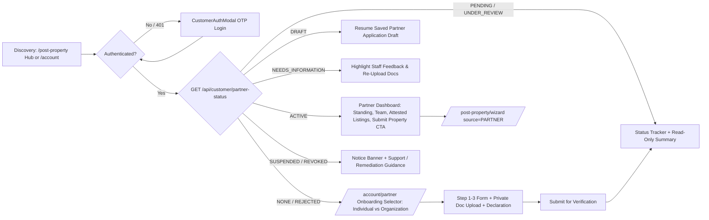
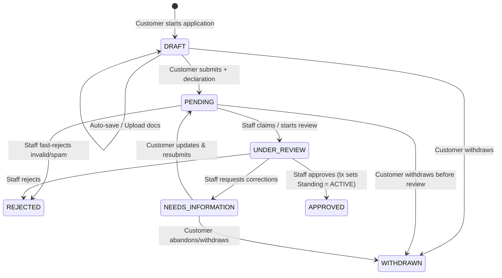
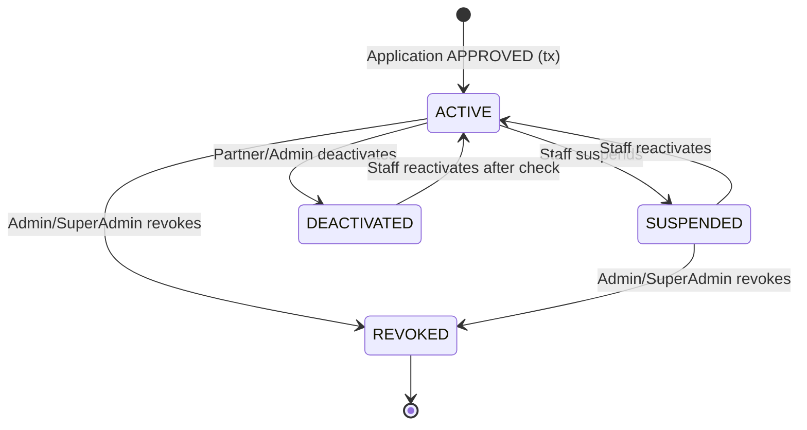
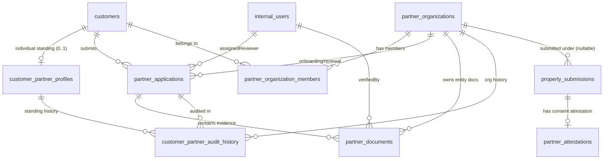

# GREAT HOMES V2 — PM-02: GLOBAL PARTNER MANAGEMENT SYSTEM
## Detailed Technical Design & Implementation Specification

**Phase:** PM-02 — Architecture & Implementation Specification  
**Mode:** 100% READ-ONLY — DESIGN ONLY  
**Project:** Great Homes V2  
**Workspace:** `/app/applet`  
**Supersedes / Builds On:** `PM_01_PARTNER_ARCHITECTURE_RECONCILIATION.md`, `GLOBAL_PARTNER_PROFILE_ELIGIBILITY_AUDIT.md`  

> **Verification & Environment Honesty Notice**
> - Claims marked **`[Source]`** or **`[Config]`** were directly verified by reading repository source files or configuration files in `/app/applet`.
> - Claims marked **`[UNVERIFIED — Live DB Unavailable]`** relate to live staging/production PostgreSQL state (`DATABASE_URL` and `TEST_DATABASE_URL` are `NOT_CONFIGURED` in this sandbox).
> - Items marked **`[Proposed]`** represent the PM-02 target design to be built in PM-03+.
> - Items marked **`[OPEN DECISION]`** preserve unresolved business or operational choices requiring stakeholder sign-off before execution.
> - Workspace Git state: **`NO_GIT`** (no `.git` directory exists in `/app/applet`).

---

## 1. Executive Summary

### 1.1 Purpose & Scope
This specification defines the complete, production-ready technical architecture for the **Great Homes Partner Management System** (`PM-02`). It transforms Great Homes' partner capability from a read-only database stub (`customer_partner_profiles`) into a full, platform-wide onboarding, verification, organization management, staff moderation, and property-publication governance platform.

This design solves the systemic root causes documented in `GLOBAL_PARTNER_PROFILE_ELIGIBILITY_AUDIT.md` and `PM_01_PARTNER_ARCHITECTURE_RECONCILIATION.md`:
1. Customers have no self-service partner application or onboarding flow (`Status: NONE` permanently for new users) `[Source: app/api/customer/partner-status/route.ts, src/domain/propertySubmission/repository.ts:1039-1055]`.
2. Organizations (real estate agencies, brokerages, registered companies, LLPs, partnerships) and multi-member teams have no data model or authorization boundary.
3. Great Homes staff have zero RBAC capabilities (`partner.*`), APIs, or Admin Workspace screens to review, approve, reject, suspend, or revoke partners `[Source: src/domain/auth/capabilityModel.ts, src/components/admin/AdminSidebar.tsx]`.
4. Verification documents cannot safely use the existing `S3StorageProvider` media path because `getSignedUrl()` currently stubs back to `getPublicUrl()` (`MEDIA_PUBLIC_BASE_URL` = `https://media.greathomes.co.in`) `[Source: src/domain/media/storage/storageProvider.ts:286-288]`.
5. Submission approval and publication (`approveSubmission()`, `publishSubmission()` in `src/domain/propertySubmission/repository.ts:3088-3369`) are neither wired into `staffSubmissionRouteHandlers.ts` nor protected by live partner eligibility re-checks, and `publishSubmission()` reads mismatched payload keys with hardcoded `'Verified Owner'` / `'9876543210'` fallbacks.
6. Schema drift exists between `src/db/schema.ts`, runtime DDL in `src/db/client.ts:726-850`, and `/drizzle/0000`–`0011` `[Source: drizzle/meta/_journal.json]`.

### 1.2 Architectural Pillars
- **Strict Six-Concept Separation:** Customer Identity (`customers`), Partner Application (`partner_applications`), Verification Evidence (`partner_documents` + review checklists), Partner Standing (`customer_partner_profiles` / `partner_organizations`), Organization Membership (`partner_organization_members`), and Property Ownership / Authority (`partner_attestations` on `property_submissions`) are decoupled cleanly.
- **Individual & Organization Support:** A customer may register as an **Individual Partner** or represent an **Organization Partner** (Private/Public Company, LLP, Partnership, Real Estate Agency / Sole Proprietorship) with multiple authorized members (`OWNER_ADMIN`, `REPRESENTATIVE`).
- **Fail-Closed Eligibility Engine:** A single `PartnerEligibilityService` evaluates customer standing, organization standing, and membership standing with whitespace/case normalization and strict erroring on unrecognized DB states.
- **Zero-Exposure Document Vault:** Dedicated private Cloudflare R2 bucket (`PRIVATE_DOCS_BUCKET`) isolated from `greathomes-media`, paired with magic-byte verification, EXIF stripping, authenticated streaming / real `GetObjectCommand` presigning, `Cache-Control: private, no-store`, and mandatory audit logging.
- **Reconciled Drizzle Migrations:** Idempotent pre-feature reconciliation (`0012`) followed by additive feature DDL (`0013`), phasing out ad-hoc runtime DDL mutations for partner/submission tables.

---

## 2. PM-01 Findings and Their Disposition

Every finding from `PM_01_PARTNER_ARCHITECTURE_RECONCILIATION.md` was re-verified during PM-02 design and assigned a concrete architectural disposition.

| # | PM-01 Verified Finding | Verification Basis | PM-02 Disposition | Target Section(s) |
|---|---|---|---|---|
| **F-01** | `customer_partner_profiles` & `customer_partner_audit_history` are read-only at runtime (`SELECT` only). | `[Source: repository.ts:1039-1055, schema.ts:905-937]` | Add full transactional write repository (`src/domain/partner/partnerRepository.ts`) driving onboarding, review, activation, suspension, and revocation. | §7, §9, §12 |
| **F-02** | `evaluatePartnerEligibility()` checks `status === 'NONE'` before `.toUpperCase()`, lacks `.trim()`, and collapses unknown strings to `'REVOKED'`. | `[Source: repository.ts:382-438]` | Replace with centralized `PartnerEligibilityService`: `.trim().toUpperCase()`, DB `CHECK` constraint on status, fail-closed `PartnerStateIntegrityError` on unknown values. | §6, §12 |
| **F-03** | Duplicate eligibility logic in `PostPropertyHub.tsx:98-127` & `PostPropertyWizard.tsx:908-915`; `401` on `/api/customer/partner-status` renders `'ERROR'` instead of opening OTP auth modal. | `[Source: PostPropertyHub.tsx, PostPropertyWizard.tsx]` | Standardize structured eligibility response from `/api/customer/partner-status`; handle HTTP `401` cleanly by prompting `openAuthModal('login')` with post-OTP return path. | §4, §9, §12 |
| **F-04** | Drizzle migration drift: `/drizzle/0000`–`0011` contain zero references to `customer_partner_*`, `property_submissions`, `property_submission_reviews`, or `partner_attestations` (all created by `ensureSchemaUpdates()`). | `[Source: drizzle/meta/_journal.json, client.ts:726-850]` | Create idempotent baseline reconciliation migration `0012` (`IF NOT EXISTS` + `NOT VALID` constraints) before additive `0013` feature migration; remove runtime feature DDL drift. | §8 |
| **F-05** | `partner_attestations` composite FK `fk_partner_attestation_ownership` exists in `client.ts:799-802` but is missing in `schema.ts:973-983`; `customer_partner_profiles` has redundant `idx_customer_partner_profiles_customer` alongside `UNIQUE(customer_id)` and no `CHECK` constraint on `status`. | `[Source: schema.ts:905-983, client.ts:726-805]` | Reconcile `schema.ts` with `client.ts`, drop redundant non-unique index, add `CHECK` constraints across all status columns via `NOT VALID` -> `VALIDATE`. | §7, §8 |
| **F-06** | `isMigrationAuthorizedForDatabase()` (`client.ts:53`) allows `ensureSchemaUpdates` with `allowSafeBootstrap: true` on production DB names. | `[Source: client.ts:53-110]` | Phase out runtime `ensureSchemaUpdates()` DDL mutations for partner/submission schema in favor of verified Drizzle migrations (`0012` + `0013`); restrict bootstrap to explicit local/test opt-in. | §8 |
| **F-07** | `S3StorageProvider.getSignedUrl()` returns `this.getPublicUrl(key)` (`MEDIA_PUBLIC_BASE_URL`); `@aws-sdk/s3-request-presigner` is unused (`package.json`). | `[Source: storageProvider.ts:286-288, .env.example:44-50]` | Introduce private bucket (`PRIVATE_DOCS_BUCKET`) and `PrivateDocumentStorageProvider` using authenticated server streaming proxy + real `GetObjectCommand` presigner where needed. Never store KYC docs in `greathomes-media`. | §11 |
| **F-08** | Zero `partner.*` capabilities in `capabilityModel.ts`; zero partner audit resource constants in `auditResources.ts`; `staffSubmissionRouteHandlers.ts` skips `AuditService`. | `[Source: capabilityModel.ts, auditResources.ts, staffSubmissionRouteHandlers.ts]` | Add 10 granular `partner.*` capabilities, add `'PARTNER*'` resource constants to `auditResources.ts`, and mandate dual `customer_partner_audit_history` + `audit_logs` writes. | §10, §9 |
| **F-09** | `approveSubmission()` and `publishSubmission()` never call `getPartnerEligibility()`, are not exposed in `staffSubmissionRouteHandlers.ts` (`215-283`) or `StaffSubmissionDetailWorkspace.tsx` (`371-472`), read wrong flat payload keys, and fall back to `'Verified Owner'` / `'9876543210'`. | `[Source: repository.ts:3088-3369, staffSubmissionRouteHandlers.ts, StaffSubmissionDetailWorkspace.tsx]` | Wire `APPROVE` and `PUBLISH` into staff handlers & workspace (or coordinate with PP remediation), enforce live `PartnerEligibilityService` checks, fix `payload.details.*` / `payload.location.*` & verified contact mapping, block publication on missing contact. | §13 |
| **F-10** | Vocabulary drift: `seed.ts:776,933,983` uses `listingPartyType: 'LISTING_PARTNER'`, while `repository.ts:3258,3314` & `enquiryService.ts:174,242` use `'PARTNER'`. | `[Source: seed.ts, repository.ts, enquiryService.ts]` | Standardize on `'PARTNER'` for partner-listed resale/rental attribution across runtime and seeders; document live DB audit query before normalization. | §8, §13 |
| **F-11** | `NotificationService.deliverEmail()` throws when invoked because SMTP/SendGrid provider integration does not exist beyond env stubs (`notificationService.ts:91-104`). | `[Source: notificationService.ts:44-104]` | Deliver `IN_APP` notifications (`notifications` table) reliably on every partner transition; gracefully record Email/SMS delivery intent in `alert_delivery_attempts` as skipped/unconfigured until provider credentials exist. | §14 |
| **F-12** | `scripts/test-post-property-entry.ts` uses an inline mock `evaluatePartnerStatus` rather than testing production logic. | `[Source: PM-01 §12]` | Replace inline mock with imports from centralized `PartnerEligibilityService` and add PostgreSQL + E2E test suites. | §15 |

### 2.1 Preserved Unresolved Questions from PM-01
PM-01 identified 6 unresolved questions (`PM_01_PARTNER_ARCHITECTURE_RECONCILIATION.md` §16). **None are silently assumed resolved in PM-02**; each is tracked as an explicit `[OPEN DECISION]` in §17 with a recommended default and impact assessment:
1. Dedicated private R2 bucket (`PRIVATE_DOCS_BUCKET`) provisioning (`§17 #1`).
2. Single active organization per customer vs multi-organization membership (`§17 #2`).
3. Grandfathering vs KYC backfill for any pre-existing `customer_partner_profiles` rows (`§17 #3`).
4. Public listing card attribution rules for `listingPartyDisplayName` / `firm_name` (`§17 #4`).
5. Scope of Email/SMS transactional delivery vs `IN_APP` only in initial release (`§17 #5`).
6. Timing of exposing `APPROVE` / `PUBLISH` actions in `staffSubmissionRouteHandlers.ts` (`§17 #6`).

---

## 3. Final Business Model

### 3.1 Strict Six-Concept Separation

```
┌─────────────────────────┐     1:N      ┌──────────────────────────┐
│   1. Customer Identity  │─────────────▶│  2. Partner Application  │
│      (customers)        │              │  (partner_applications)  │
└────────────┬────────────┘              └─────────────┬────────────┘
             │                                         │ triggers review of
             │ 0..1 (Individual) / N (Org Member)      ▼
             │                           ┌──────────────────────────┐
             ▼                           │ 3. Verification Evidence │
┌─────────────────────────┐              │   (partner_documents +   │
│ 4. Partner Standing     │◀──grants────▶│    review checklist)     │
│ - customer_partner_     │              └──────────────────────────┘
│   profiles              │
│ - partner_organizations │◀──1:N──┌────────────────────────────────┐
└────────────┬────────────┘        │ 5. Organization Membership     │
             │                     │ (partner_organization_members) │
             │ gates               └────────────────┬───────────────┘
             ▼                                      │ authorizes
┌───────────────────────────────────────────────────▼───────────────┐
│ 6. Property Ownership / Authority                                 │
│ (property_submissions + partner_attestations via fk composite)    │
└───────────────────────────────────────────────────────────────────┘
```

1. **Customer Identity (`customers`):** Authenticated end-user verified via OTP (`customerAuth.ts`), holding `id`, `name`, `phone`, `email`, `phoneVerified`, `emailVerified`, `status`. A customer always exists *before* becoming a partner.
2. **Partner Application (`partner_applications`):** A time-bound, auditable request submitted by a customer to become an Individual Partner or register an Organization Partner. Supports `DRAFT`, resubmission after `NEEDS_INFORMATION`, and re-application after `REJECTED` without overwriting historical application records.
3. **Verification Evidence (`partner_documents` + checklist):** Private identity, business registration, RERA/tax, and authorization proofs attached to an application or organization, reviewed individually by Great Homes staff (`PENDING`, `VERIFIED`, `REJECTED`).
4. **Partner Standing (`customer_partner_profiles` & `partner_organizations`):** The authoritative operational entitlement (`ACTIVE`, `SUSPENDED`, `REVOKED`, `DEACTIVATED`). Derived exclusively by staff approval transitions.
5. **Organization Membership (`partner_organization_members`):** Links multiple verified `customers` to a `partner_organizations` entity with scoped member roles (`OWNER_ADMIN`, `REPRESENTATIVE`) and independent member status (`INVITED`, `ACTIVE`, `SUSPENDED`, `REMOVED`).
6. **Property Ownership / Authority (`property_submissions` + `partner_attestations`):** Submission-specific authorization proving that a partner has owner consent to market a specific resale/rental property (`fk_partner_attestation_ownership`). Partner standing grants *capability to submit as PARTNER*; attestation records *authority for that specific property*.

### 3.2 Supported Partner Entities (No Single-Framework Bias)

The model supports both **Individual Partners** and **Organization Partners** globally without assuming a single corporate law structure:

| Partner Category | Sub-Types Supported (`organization_type`) | Typical Verification Requirements | Who Can Submit Listings |
|---|---|---|---|
| **Individual Partner** | `INDIVIDUAL` (Independent broker / consultant / property advisor) | Government photo ID (e.g., PAN/Passport/National ID), verified phone & email, primary operating city/localities, optional RERA/license number | The verified individual `customer_id` only |
| **Organization Partner** | `COMPANY` (Private/Public Ltd), `LLP`, `PARTNERSHIP`, `SOLE_PROPRIETORSHIP_AGENCY`, `REAL_ESTATE_AGENCY` | Organization legal name + optional trade/DBA name, registration/incorporation identifier, tax/GST/RERA identifiers (optional per jurisdiction/type), registered address, primary signatory identity + authorization letter/board resolution if signatory differs from sole proprietor | Any `ACTIVE` member (`OWNER_ADMIN` or `REPRESENTATIVE`) of the `ACTIVE` organization |

### 3.3 Dual-Track Eligibility Rules
A customer is eligible to submit or manage `PARTNER` listings when **at least one** verified track is `ACTIVE`:
- **Track A — Active Individual Partner:** `customer_partner_profiles` row exists for `customerId` with `partner_type = 'INDIVIDUAL'` and `status = 'ACTIVE'`, and `customers.status = 'ACTIVE'`.
- **Track B — Active Organization Representative:** `partner_organization_members` row exists for `customerId` with `status = 'ACTIVE'`, linked `partner_organizations.status = 'ACTIVE'`, and `customers.status = 'ACTIVE'`. *(A customer-level `customer_partner_profiles.status` for an org-affiliated customer mirrors or resolves cleanly—see §12.2 for precedence when both exist or when an org is suspended).*

---

## 4. Customer Journey



### 4.1 Discovery & Authentication Continuation (`401` Fix)
- **Entry Points:**
  1. `PostPropertyHub.tsx`: When a user views or selects `PARTNER`, the UI calls `/api/customer/partner-status`. If the API returns **`401 Unauthorized`**, the client must **NOT** render `'ERROR'` (`PM_01` finding in `PostPropertyHub.tsx:98-127`). Instead, it renders a clean unauthenticated state (`Sign in to check your Partner status or register`) and invokes `openAuthModal('login')` on click, automatically refreshing `partner-status` immediately after OTP verification completes.
  2. `CustomerNavControl.tsx` & `app/account/layout.tsx`: Add a dedicated **Partner Profile** navigation item linking to `/account/partner`.
  3. `PostPropertyWizard.tsx` Step 1 (`source=PARTNER`): If ineligible (`NONE`, `DRAFT`, `PENDING`, `UNDER_REVIEW`, `NEEDS_INFORMATION`, `REJECTED`, `SUSPENDED`, `REVOKED`), display a context-aware callout:
     - `NONE`: CTA **"Apply to Become a Partner"** → `/account/partner?next=/post-property/wizard`
     - `DRAFT` / `NEEDS_INFORMATION`: CTA **"Complete Partner Application"** → `/account/partner`
     - `PENDING` / `UNDER_REVIEW`: Read-only review status badge + estimated SLA message
     - `SUSPENDED` / `REVOKED`: Clear compliance message + read-only links to existing drafts/listings; block new `PARTNER` submission creation.

### 4.2 Individual vs Organization Onboarding (`/account/partner`)
1. **Path Selection:** Customer chooses **Individual Partner** or **Organization / Real Estate Agency**.
2. **Draft Auto-Save (`POST /api/customer/partner/applications` & `PATCH .../applications/[id]`):**
   - **Individual Fields:** Legal full name (pre-filled from `customers.name` if present), display/operating name, primary city & operating localities, years of experience, optional RERA/license ID, business contact email/phone, bio.
   - **Organization Fields:** Legal entity name, brand/trade name, organization type (`COMPANY`, `LLP`, `PARTNERSHIP`, `REAL_ESTATE_AGENCY`, `SOLE_PROPRIETORSHIP_AGENCY`), registration/CIN/LLPIN/shop-act identifier, tax/GST ID (optional), RERA agency registration (optional), registered office address & operating cities, applicant's designation (`Director`, `Partner`, `Proprietor`, `Authorized Manager`), official company email/phone.
3. **Private Document Upload (`POST /api/customer/partner/documents`):**
   - Drag-and-drop or file picker supporting PDF, JPEG, PNG, WebP (validated server-side via `fileSecurity.ts` magic bytes).
   - Required doc types clearly labeled by track:
     - Individual: `IDENTITY_PROOF` (required), `ADDRESS_PROOF` (optional/configurable), `RERA_CERTIFICATE` (optional).
     - Organization: `BUSINESS_REGISTRATION` (required), `APPLICANT_IDENTITY_PROOF` (required), `AUTHORIZATION_LETTER` (required if applicant is not named sole proprietor/director on registration), `RERA_CERTIFICATE` / `TAX_CERTIFICATE` (optional).
   - Each upload shows immediate scan/sanitization status, filename, category badge, and delete/replace capability while application is `DRAFT` or `NEEDS_INFORMATION`.
4. **Declaration & Submission (`POST /api/customer/partner/applications/[id]/submit`):**
   - Explicit checkbox attestation confirming accuracy of KYC/business details and acceptance of Great Homes Partner Code of Conduct.
   - Server locks editable fields (transitioning `DRAFT` / `NEEDS_INFORMATION` → `PENDING`), generates correlation reference ID (e.g., `GH-PRT-2026-XXXX`), writes audit history, and dispatches `IN_APP` confirmation notification.

### 4.3 Corrections, Re-Application & Active Partner Dashboard
- **Correction Flow (`NEEDS_INFORMATION`):** Customer sees exact staff feedback (`review_feedback`), highlighted fields/rejected document reasons, can update fields or upload replacement documents, and click **Resubmit for Review** (`NEEDS_INFORMATION` → `PENDING`).
- **Active Partner Dashboard (`/account/partner` when `ACTIVE`):**
  - Displays Partner Badge (`INDIVIDUAL` or Organization Legal/Trade Name + Verified status + Partner ID).
  - Quick CTA: **Post Property as Partner** (`/post-property/wizard?source=PARTNER`) and **View My Submissions** (`/account/listings`).
  - **Organization Team Management Tab (for `OWNER_ADMIN` only):**
    - View current members (`ACTIVE`, `INVITED`, `SUSPENDED`, `REMOVED`).
    - Invite member by verified customer phone/email (`POST /api/customer/partner/organizations/[id]/members`). Invited customer accepts via `/account/partner` notification/invitation banner (cannot silently attach third-party accounts without consent).
    - Suspend or remove a representative (`PATCH /api/customer/partner/organizations/[id]/members/[memberId]`).
  - **Self-Service Voluntary Deactivation:** An active individual partner or `OWNER_ADMIN` may voluntarily deactivate their profile (`ACTIVE` → `DEACTIVATED`), immediately pausing `PARTNER` submission capability while keeping historical records intact.

---

## 5. Admin Journey

Follows the exact visual architecture and UX patterns established in `src/components/admin/AdminSidebar.tsx`, `StaffSubmissionsWorkspace.tsx`, and `StaffSubmissionDetailWorkspace.tsx` `[Source]`.

### 5.1 Navigation & Queue Workspace (`/admin/partners`)
- **Sidebar Integration (`AdminSidebar.tsx`):** Add **"Partners"** navigation group/item gated by `hasCapability(role, 'partner.read')` with live badge count of `PENDING` + `UNDER_REVIEW` applications.
- **Queue Tabs & Filters (`AdminPartnersWorkspace.tsx`):**
  - Tabs: `Action Needed (Pending + Resubmitted)`, `Under Review`, `Needs Info`, `Active Partners`, `Organizations`, `Suspended / Revoked`, `All`.
  - Filters: Partner Type (`INDIVIDUAL`, `ORGANIZATION`), City, Assigned Reviewer (`Unassigned`, `Assigned to Me`, specific staff), Search (Partner Ref ID, Legal Name, Phone, Email, RERA ID).
  - Row Columns: Reference ID, Applicant / Organization Name, Type Badge (`Individual` / `Company` / `Agency`), City, Status Badge, Assigned Reviewer, Submitted Timestamp, SLA age.

### 5.2 Staff Partner Review & Lifecycle Workspace (`/admin/partners/[id]`)
1. **Header & Identity Strip:** Applicant name, linked Customer 360 link (`/admin/intelligence/customers/[customerId]`), application/profile status badge, partner type, assigned reviewer dropdown, claim-review button (`Claim for Review`).
2. **Structured Verification Checklist:** Interactive boolean/tri-state verification checkboxes persisted in `partner_applications.verification_checklist`:
   - `identityVerified` (applicant photo ID matches customer name/phone)
   - `businessRegistrationVerified` (for organizations: registration/CIN/GST/agency proof authentic)
   - `authorizationVerified` (applicant authorized to represent organization)
   - `reraLicenseChecked` (if provided)
   - `contactDetailsVerified`
   - `noDuplicateOrSanctionedEntity`
3. **Secure Document Viewer:**
   - Lists all attached `partner_documents` with status (`PENDING`, `VERIFIED`, `REJECTED`), file size, SHA-256 checksum prefix, and per-document **Verify / Reject (with reason)** actions.
   - Clicking **Inspect Document** opens an inline authenticated preview/download modal fetching via `/api/admin/partners/documents/[docId]` (`Cache-Control: private, no-store`), recording a `DOCUMENT_VIEWED` audit event automatically.
4. **Action Panel (Capability-Gated):**
   - **Start Review** (`partner.review`): `PENDING` → `UNDER_REVIEW`
   - **Request Information** (`partner.request_information`): `UNDER_REVIEW` → `NEEDS_INFORMATION` (mandatory applicant feedback + optional specific document rejection flags)
   - **Approve Partner** (`partner.approve`): `UNDER_REVIEW` → `ACTIVE` (verifies all required checklist items & required docs are `VERIFIED`; atomically activates profile and/or organization + `OWNER_ADMIN` membership)
   - **Reject Application** (`partner.reject`): `PENDING` / `UNDER_REVIEW` / `NEEDS_INFORMATION` → `REJECTED` (mandatory reason visible to applicant + internal note)
   - **Suspend Active Partner** (`partner.suspend`): `ACTIVE` → `SUSPENDED` (mandatory reason; optionally cascades pause to active review-queue submissions)
   - **Reactivate Partner** (`partner.reactivate`): `SUSPENDED` / `DEACTIVATED` → `ACTIVE` (mandatory justification)
   - **Revoke Permanently** (`partner.revoke`): `ACTIVE` / `SUSPENDED` → `REVOKED` (high-privilege action restricted to `SUPER_ADMIN` / `ADMIN`; blocks future applications unless explicitly cleared by `SUPER_ADMIN` exception—policy tracked in §17)
   - **Internal Staff Note** (`partner.review`): Append-only internal note visible only to staff.
5. **Cross-Workspace Integration:**
   - `StaffSubmissionDetailWorkspace.tsx`: Display live Partner Profile / Organization verification badge, Partner Ref ID, and link to `/admin/partners/[id]` whenever `listingSource === 'PARTNER'`. Fix existing misleading fallback where missing partner attestation renders inaccurate copy `[Source: StaffSubmissionDetailWorkspace.tsx]`.
   - `app/admin/intelligence/customers/[id]/page.tsx`: Display Partner Standing badge + quick link to `/admin/partners/[id]`.

---

## 6. Final Lifecycle and Transition Matrix

### 6.1 Canonical Status Reconciliation

The candidate statuses across PM-01 and PM-02 (`NONE`, `DRAFT`, `PENDING`, `UNDER_REVIEW`, `NEEDS_INFORMATION`, `APPROVED`, `ACTIVE`, `REJECTED`, `SUSPENDED`, `REVOKED`, `DEACTIVATED`) represent **two distinct lifecycles**:

1. **Application Review Lifecycle (`partner_applications.status`)** — tracks a specific onboarding/verification submission:
   - `DRAFT`: Customer started onboarding; editable; not yet submitted for staff review.
   - `PENDING`: Submitted (or resubmitted after `NEEDS_INFORMATION`) and awaiting staff pickup.
   - `UNDER_REVIEW`: Claimed/opened by an authorized reviewer.
   - `NEEDS_INFORMATION`: Returned to customer with specific correction feedback; editable by customer.
   - `APPROVED`: Terminal positive resolution of *this application record* (atomically triggers Profile/Organization creation or activation to `ACTIVE`).
   - `REJECTED`: Terminal negative resolution of *this application record* (customer may submit a new application later unless customer/org is `REVOKED`).
   - `WITHDRAWN`: Customer cancelled a `DRAFT` or `PENDING` application before final decision.

2. **Operational Partner Standing Lifecycle (`customer_partner_profiles.status` & `partner_organizations.status`)** — tracks live platform authorization:
   - *(Computed virtual state `NONE`)*: Returned by API/EligibilityService when no `customer_partner_profiles` row and no active org membership exist. **Never stored in `customer_partner_profiles`**.
   - `PENDING`: Legacy/transitional compatibility state only (an approved application transitions directly to `ACTIVE` on standing tables; if an unapproved `customer_partner_profiles` row exists from pre-PM-02 data, it holds `PENDING` and is ineligible for `PARTNER` listings).
   - `ACTIVE`: Verified and authorized to submit `PARTNER` listings, upload partner media, and have listings approved/published.
   - `SUSPENDED`: Temporarily blocked from new `PARTNER` submissions, uploads, approvals, and publications; reversible via `Reactivate`.
   - `REVOKED`: Permanently terminated for policy/fraud breach; ineligible and cannot submit new applications.
   - `DEACTIVATED`: Voluntary offboarding initiated by the partner/org `OWNER_ADMIN`; reversible upon re-verification or reactivation.

> **Why `APPROVED` and `ACTIVE` are separated cleanly:** `APPROVED` is the terminal decision state on `partner_applications` (recording *when and by whom an application passed verification*), whereas `ACTIVE` is the operational state on `customer_partner_profiles` and `partner_organizations`. Because approval atomically sets operational standing to `ACTIVE` inside the same DB transaction, customers never get stuck in an ambiguous half-activated `APPROVED` limbo, while legacy `PENDING`/`ACTIVE`/`SUSPENDED`/`REVOKED` checks in existing code remain 100% compatible.

### 6.2 Application Lifecycle State Diagram



### 6.3 Operational Standing Lifecycle State Diagram



### 6.4 Complete Transition Matrix

| # | Entity | From → To | Actor | Required Capability / Auth | Required Fields / Preconditions | Audit Event (`actionType`) | Notification (`NotificationService`) | Reversible? | Concurrency Guard |
|---|---|---|---|---|---|---|---|---|---|
| **T1** | Application | `[*] → DRAFT` | Customer | `verifyCustomerAuth` | Customer `ACTIVE`; no existing non-terminal app (`DRAFT`/`PENDING`/`UNDER_REVIEW`/`NEEDS_INFORMATION`); customer not `REVOKED` | `APPLICATION_CREATED` | None | Yes (Withdraw) | Partial unique index on `(applicant_customer_id)` for active apps |
| **T2** | Application | `DRAFT → PENDING` | Customer | `verifyCustomerAuth` + owner of app | All required entity fields valid; `declarationAccepted === true`; required docs uploaded & `SANITIZED` | `APPLICATION_SUBMITTED` | `PARTNER_APPLICATION_SUBMITTED` (Customer `IN_APP`) | Yes (Withdraw before `UNDER_REVIEW`) | `UPDATE ... WHERE id=$1 AND applicant_customer_id=$2 AND status='DRAFT'` |
| **T3** | Application | `DRAFT/PENDING/NEEDS_INFO → WITHDRAWN` | Customer | `verifyCustomerAuth` + owner of app | Optional withdrawal note | `APPLICATION_WITHDRAWN` | None | No (must start new app) | `UPDATE ... WHERE status IN (...)` |
| **T4** | Application | `PENDING → UNDER_REVIEW` | Staff | `partner.review` | Staff authenticated (`verifyInternalStaff`) | `REVIEW_STARTED` | None (or optional `IN_APP` update) | Yes (unassign stays `UNDER_REVIEW`) | `SELECT ... FOR UPDATE` + `WHERE status='PENDING'` |
| **T5** | Application | `UNDER_REVIEW → NEEDS_INFORMATION` | Staff | `partner.request_information` | Non-empty `customerFeedback` (`>=10 chars`); optional rejected doc IDs/reasons | `INFORMATION_REQUESTED` | `PARTNER_INFO_REQUESTED` (Customer `IN_APP`) | Yes (Customer resubmits) | `UPDATE ... WHERE status='UNDER_REVIEW'` |
| **T6** | Application | `NEEDS_INFORMATION → PENDING` | Customer | `verifyCustomerAuth` + owner of app | Updated fields/docs; `declarationAccepted === true` | `APPLICATION_RESUBMITTED` | `PARTNER_APPLICATION_RESUBMITTED` (Staff queue / Customer `IN_APP`) | Yes (Withdraw) | `UPDATE ... WHERE status='NEEDS_INFORMATION'` |
| **T7** | Application + Standing | `UNDER_REVIEW → APPROVED` (+ Standing → `ACTIVE`) | Staff | `partner.approve` | All required docs status `VERIFIED`; required checklist items checked; applicant customer not `REVOKED` | `APPLICATION_APPROVED` + `PROFILE_ACTIVATED` | `PARTNER_APPROVED` (Customer `IN_APP`) | Standing reversible via Suspend/Deactivate/Revoke | Single DB TX locking application + customer/org rows; `WHERE status='UNDER_REVIEW'` |
| **T8** | Application | `PENDING / UNDER_REVIEW / NEEDS_INFO → REJECTED` | Staff | `partner.reject` | Non-empty `rejectionReason` (`>=10 chars`) | `APPLICATION_REJECTED` | `PARTNER_REJECTED` (Customer `IN_APP`) | App terminal (new app allowed) | `UPDATE ... WHERE status IN (...)` |
| **T9** | Standing | `ACTIVE → SUSPENDED` | Staff | `partner.suspend` | Non-empty `reason` (`>=10 chars`) | `PARTNER_SUSPENDED` | `PARTNER_SUSPENDED` (Customer / all Org `ACTIVE` members `IN_APP`) | Yes (T10) | `UPDATE ... WHERE status='ACTIVE'` |
| **T10** | Standing | `SUSPENDED / DEACTIVATED → ACTIVE` | Staff | `partner.reactivate` | Non-empty `reason` (`>=10 chars`) | `PARTNER_REACTIVATED` | `PARTNER_REACTIVATED` (Customer / Org `OWNER_ADMIN` `IN_APP`) | Yes (T9/T11/T12) | `UPDATE ... WHERE status IN ('SUSPENDED','DEACTIVATED')` |
| **T11** | Standing | `ACTIVE / SUSPENDED → REVOKED` | Admin / SuperAdmin | `partner.revoke` | Non-empty `reason` (`>=15 chars`) + confirmation flag | `PARTNER_REVOKED` | `PARTNER_REVOKED` (Customer / all Org members `IN_APP`) | **Terminal** (requires `SUPER_ADMIN` DB/policy exception) | `UPDATE ... WHERE status IN ('ACTIVE','SUSPENDED')` |
| **T12** | Standing | `ACTIVE → DEACTIVATED` | Customer / Org `OWNER_ADMIN` or Staff | `verifyCustomerAuth` (owner/`OWNER_ADMIN`) OR `partner.suspend` | Optional reason; confirmation flag | `PARTNER_DEACTIVATED` | `PARTNER_DEACTIVATED` (`IN_APP`) | Yes (via T10 Staff Reactivate) | `UPDATE ... WHERE status='ACTIVE'` |

---

## 7. Database Entity Relationship Design

### 7.1 Design Principles & Table Reuse Check
- **Reuse existing `customer_partner_profiles`, `customer_partner_audit_history`, and `partner_attestations`:** No duplicate `partners` table will be created.
- **Avoid unnecessary `partner_review_assignments` table:** Following the proven pattern in `property_submissions` (`staffSubmissionRouteHandlers.ts` / `repository.ts:3070-3085`), store `assigned_reviewer_staff_id` and `assigned_at` directly on `partner_applications` (and record assignment changes in `customer_partner_audit_history`), eliminating redundant join tables.
- **Reuse `internal_users` / `customers` FKs** from `src/db/schema.ts`.
- **Append-only audit integrity:** Preserve `trg_customer_partner_audit_immutable` and `trg_prevent_truncate_customer_partner_audit` (`client.ts:830-850`).

### 7.2 Entity Relationship Diagram (Mermaid)



### 7.3 Table Specifications

#### A. Existing Table (Extended & Reconciled): `customer_partner_profiles`
Current columns `[Source: schema.ts:905-922]`: `id`, `customer_id` (unique FK → `customers.id`), `status`, `partner_code`, `firm_name`, `verified_by_staff_id`, `verified_at`, `suspended_at`, `revoked_at`, `suspension_reason`, `notes`, `created_at`, `updated_at`.

**Proposed Changes `[Proposed]`:**
- Drop redundant non-unique index `idx_customer_partner_profiles_customer` (duplicate of `UNIQUE(customer_id)`).
- Add columns (all nullable or defaulted for zero-downtime migration):
  - `partner_type varchar(32) NOT NULL DEFAULT 'INDIVIDUAL'` (`CHECK (partner_type IN ('INDIVIDUAL', 'ORGANIZATION_MEMBER'))`)
  - `primary_organization_id varchar(64) REFERENCES partner_organizations(id) ON DELETE SET NULL` (nullable; optional cache/link for primary org)
  - `latest_application_id varchar(64) REFERENCES partner_applications(id) ON DELETE SET NULL`
  - `operating_city varchar(120)`
  - `operating_localities jsonb DEFAULT '[]'`
  - `rera_number varchar(120)`
  - `deactivated_at timestamp`
- Add `CHECK` constraint: `chk_customer_partner_profiles_status CHECK (status IN ('PENDING', 'ACTIVE', 'SUSPENDED', 'REVOKED', 'DEACTIVATED'))`.

#### B. New Table `[Proposed]`: `partner_organizations`
Represents registered companies, LLPs, partnerships, and real estate agencies.
- `id varchar(64) PRIMARY KEY` (prefix `porg_`)
- `partner_code varchar(64) UNIQUE` (generated on approval, e.g., `GH-ORG-000123`)
- `legal_name varchar(255) NOT NULL`
- `trade_name varchar(255)`
- `organization_type varchar(48) NOT NULL` (`CHECK (organization_type IN ('COMPANY', 'LLP', 'PARTNERSHIP', 'SOLE_PROPRIETORSHIP_AGENCY', 'REAL_ESTATE_AGENCY'))`)
- `status varchar(32) NOT NULL DEFAULT 'PENDING'` (`CHECK (status IN ('PENDING', 'ACTIVE', 'SUSPENDED', 'REVOKED', 'DEACTIVATED'))`)
- `registration_number varchar(120)` (CIN / LLPIN / Shop Act / Local Registration)
- `tax_identifier varchar(120)` (GSTIN / Tax ID, optional)
- `rera_agency_number varchar(120)` (optional)
- `official_email varchar(255)`
- `official_phone varchar(32)`
- `registered_address text`
- `operating_city varchar(120) NOT NULL`
- `operating_localities jsonb NOT NULL DEFAULT '[]'`
- `owner_customer_id varchar(64) NOT NULL REFERENCES customers(id) ON DELETE RESTRICT`
- `latest_application_id varchar(64)` (FK added after `partner_applications`)
- `verified_by_staff_id varchar(64) REFERENCES internal_users(id) ON DELETE SET NULL`
- `verified_at timestamp`
- `suspended_at timestamp`
- `revoked_at timestamp`
- `deactivated_at timestamp`
- `suspension_reason text`
- `created_at timestamp NOT NULL DEFAULT now()`
- `updated_at timestamp NOT NULL DEFAULT now()`
- Indexes: `idx_partner_orgs_status`, `idx_partner_orgs_owner`, `idx_partner_orgs_city`, unique partial index on normalized `registration_number` where `status IN ('ACTIVE','SUSPENDED') AND registration_number IS NOT NULL`.

#### C. New Table `[Proposed]`: `partner_organization_members`
Authorizes multiple representatives under a verified organization.
- `id varchar(64) PRIMARY KEY` (prefix `pmem_`)
- `organization_id varchar(64) NOT NULL REFERENCES partner_organizations(id) ON DELETE CASCADE`
- `customer_id varchar(64) NOT NULL REFERENCES customers(id) ON DELETE CASCADE`
- `member_role varchar(32) NOT NULL` (`CHECK (member_role IN ('OWNER_ADMIN', 'REPRESENTATIVE'))`)
- `status varchar(32) NOT NULL` (`CHECK (status IN ('INVITED', 'ACTIVE', 'SUSPENDED', 'REMOVED'))`)
- `designation varchar(120)`
- `invited_by_customer_id varchar(64) REFERENCES customers(id) ON DELETE SET NULL`
- `accepted_at timestamp`
- `suspended_at timestamp`
- `removed_at timestamp`
- `created_at timestamp NOT NULL DEFAULT now()`
- `updated_at timestamp NOT NULL DEFAULT now()`
- Constraints & Indexes:
  - `UNIQUE (organization_id, customer_id)` (prevents duplicate memberships per org; removed user can be reactivated cleanly)
  - `idx_partner_org_members_customer_status (customer_id, status)`
  - If single-org policy (§17 #2) is chosen: partial unique index `uq_member_single_active_org ON partner_organization_members(customer_id) WHERE status IN ('ACTIVE', 'INVITED')`. (Omitted if multi-org is approved).

#### D. New Table `[Proposed]`: `partner_applications`
Stores onboarding & correction applications cleanly separated from standing.
- `id varchar(64) PRIMARY KEY` (prefix `papp_`)
- `reference_code varchar(64) NOT NULL UNIQUE` (e.g., `GH-PRT-2026-XXXXXX`)
- `applicant_customer_id varchar(64) NOT NULL REFERENCES customers(id) ON DELETE CASCADE`
- `application_type varchar(32) NOT NULL` (`CHECK (application_type IN ('INDIVIDUAL', 'ORGANIZATION'))`)
- `target_organization_id varchar(64) REFERENCES partner_organizations(id) ON DELETE SET NULL`
- `status varchar(32) NOT NULL DEFAULT 'DRAFT'` (`CHECK (status IN ('DRAFT', 'PENDING', 'UNDER_REVIEW', 'NEEDS_INFORMATION', 'APPROVED', 'REJECTED', 'WITHDRAWN'))`)
- `applicant_payload jsonb NOT NULL DEFAULT '{}'` (normalized contact, bio, entity name, registration IDs, city/localities, designation)
- `declaration_accepted boolean NOT NULL DEFAULT false`
- `declaration_accepted_at timestamp`
- `declaration_ip_hash varchar(128)`
- `assigned_reviewer_staff_id varchar(64) REFERENCES internal_users(id) ON DELETE SET NULL`
- `assigned_at timestamp`
- `verification_checklist jsonb NOT NULL DEFAULT '{}'`
- `customer_feedback text` (visible to applicant when `NEEDS_INFORMATION` or `REJECTED`)
- `internal_notes text` (staff-only summary; immutable detailed trail in audit table)
- `decided_by_staff_id varchar(64) REFERENCES internal_users(id) ON DELETE SET NULL`
- `submitted_at timestamp`
- `reviewed_at timestamp`
- `decided_at timestamp`
- `created_at timestamp NOT NULL DEFAULT now()`
- `updated_at timestamp NOT NULL DEFAULT now()`
- Constraints & Indexes:
  - Partial unique index `uq_partner_app_active_per_customer ON partner_applications(applicant_customer_id) WHERE status IN ('DRAFT', 'PENDING', 'UNDER_REVIEW', 'NEEDS_INFORMATION')` — prevents duplicate concurrent open applications per customer!
  - `idx_partner_apps_status_submitted (status, submitted_at DESC)`
  - `idx_partner_apps_reviewer (assigned_reviewer_staff_id, status)`

#### E. New Table `[Proposed]`: `partner_documents`
Isolated exclusively from public `media_assets` `[Source: drizzle/0009_submission_media_assets.sql]`.
- `id varchar(64) PRIMARY KEY` (prefix `pdoc_`)
- `application_id varchar(64) NOT NULL REFERENCES partner_applications(id) ON DELETE CASCADE`
- `organization_id varchar(64) REFERENCES partner_organizations(id) ON DELETE SET NULL`
- `uploaded_by_customer_id varchar(64) NOT NULL REFERENCES customers(id) ON DELETE CASCADE`
- `document_type varchar(48) NOT NULL` (`CHECK (document_type IN ('IDENTITY_PROOF', 'ADDRESS_PROOF', 'BUSINESS_REGISTRATION', 'TAX_CERTIFICATE', 'RERA_CERTIFICATE', 'AUTHORIZATION_LETTER', 'OTHER'))`)
- `storage_bucket varchar(128) NOT NULL`
- `storage_key varchar(512) NOT NULL UNIQUE`
- `original_filename varchar(255) NOT NULL`
- `mime_type varchar(128) NOT NULL`
- `byte_size integer NOT NULL`
- `sha256_checksum varchar(64) NOT NULL`
- `sanitization_status varchar(32) NOT NULL DEFAULT 'SANITIZED'` (`CHECK (sanitization_status IN ('PENDING', 'SANITIZED', 'REJECTED'))`)
- `review_status varchar(32) NOT NULL DEFAULT 'PENDING'` (`CHECK (review_status IN ('PENDING', 'VERIFIED', 'REJECTED'))`)
- `review_rejection_reason text`
- `reviewed_by_staff_id varchar(64) REFERENCES internal_users(id) ON DELETE SET NULL`
- `reviewed_at timestamp`
- `deleted_at timestamp` (soft delete only while `DRAFT`/`NEEDS_INFORMATION`, with async R2 cleanup after retention window; never soft-deletable once `APPROVED`)
- `created_at timestamp NOT NULL DEFAULT now()`
- Indexes: `idx_partner_docs_application (application_id, deleted_at)`, `idx_partner_docs_org (organization_id)`.

#### F. Existing Table (Extended, Append-Only Preserved): `customer_partner_audit_history`
Current columns `[Source: schema.ts:924-937]`: `id`, `partner_profile_id`, `customer_id`, `action_type`, `previous_status`, `new_status`, `actor_staff_id`, `reason`, `metadata`, `created_at`.

**Proposed Changes `[Proposed]`:**
- Make `partner_profile_id` nullable (`DROP NOT NULL` if currently nullable/non-nullable — verified `notNull()` in `schema.ts:926`, which blocks auditing pre-profile applications unless relaxed!) so application & organization events before profile creation can log cleanly.
- Add nullable columns:
  - `application_id varchar(64) REFERENCES partner_applications(id) ON DELETE SET NULL`
  - `organization_id varchar(64) REFERENCES partner_organizations(id) ON DELETE SET NULL`
  - `actor_customer_id varchar(64) REFERENCES customers(id) ON DELETE SET NULL`
  - `actor_type varchar(32) NOT NULL DEFAULT 'STAFF'` (`CHECK (actor_type IN ('CUSTOMER', 'STAFF', 'SYSTEM'))`)
- Keep immutability triggers (`trg_customer_partner_audit_immutable` & `trg_prevent_truncate_customer_partner_audit`) **100% intact** (`INSERT`-only forever).

#### G. Existing Table (Reconciled): `partner_attestations` & `property_submissions`
- Reconcile `schema.ts:973-983` to explicitly declare `fk_partner_attestation_ownership` composite FK `(submission_id, partner_customer_id) REFERENCES property_submissions(id, submitter_customer_id)` already present in `client.ts:799-802`.
- Add nullable `partner_organization_id varchar(64) REFERENCES partner_organizations(id) ON DELETE SET NULL` to `property_submissions` so organization-submitted listings record which verified agency/company backed the submission even if an individual representative later leaves the agency!

---

## 8. Schema and Migration Strategy

### 8.1 Resolving Existing Migration Drift Safely
Currently, `/drizzle/meta/_journal.json` ends at `0011`, while `customer_partner_profiles`, `customer_partner_audit_history`, `property_submissions`, `property_submission_reviews`, and `partner_attestations` exist only in `src/db/schema.ts` and `ensureSchemaUpdates()` (`src/db/client.ts:726-850`).

**Step 1 — Mandatory Read-Only Pre-Flight Diagnostic (before running any migration on staging/prod):**
```sql
SELECT table_name FROM information_schema.tables
WHERE table_schema = 'public'
  AND table_name IN ('customer_partner_profiles','customer_partner_audit_history','property_submissions','property_submission_reviews','partner_attestations');

SELECT status, COUNT(*) FROM customer_partner_profiles GROUP BY status;
SELECT listing_party_type, COUNT(*) FROM resale_listings GROUP BY listing_party_type;
SELECT listing_party_type, COUNT(*) FROM rental_listings GROUP BY listing_party_type;
SELECT conname, pg_get_constraintdef(oid) FROM pg_constraint WHERE conrelid = 'partner_attestations'::regclass;
```

**Step 2 — Migration `0012_baseline_submission_partner_reconciliation.sql` (`[Proposed]`):**
- Fully **idempotent** (`CREATE TABLE IF NOT EXISTS`, `CREATE INDEX IF NOT EXISTS`, guarded `DO $$ ... IF NOT EXISTS (SELECT 1 FROM pg_constraint ...) $$`) capturing the exact current definitions of `property_submissions`, `property_submission_reviews`, `partner_attestations` (including `fk_partner_attestation_ownership`), `customer_partner_profiles`, and `customer_partner_audit_history` plus immutability triggers.
- Drops redundant `idx_customer_partner_profiles_customer` (`DROP INDEX IF EXISTS idx_customer_partner_profiles_customer;`).
- Normalizes any whitespace/casing on `customer_partner_profiles.status` if rows exist (`UPDATE ... SET status = UPPER(TRIM(status)) WHERE status <> UPPER(TRIM(status));`), then adds `chk_customer_partner_profiles_status` as **`NOT VALID`** followed by `ALTER TABLE ... VALIDATE CONSTRAINT`.
- Zero `DROP TABLE`, zero destructive truncation.

**Step 3 — Migration `0013_partner_management_system.sql` (`[Proposed]`):**
- Creates `partner_organizations`, `partner_organization_members`, `partner_applications`, `partner_documents` with all indexes and `CHECK` constraints.
- Extends `customer_partner_profiles`, `customer_partner_audit_history` (relaxes `partner_profile_id` `NOT NULL` so application/org audit rows succeed before profile creation), and adds nullable `partner_organization_id` to `property_submissions`.
- Adds foreign key from `partner_organizations.latest_application_id` → `partner_applications(id)`.

**Step 4 — Phasing Out `ensureSchemaUpdates()` Feature DDL:**
- Remove partner & submission `CREATE TABLE` runtime DDL from `ensureSchemaUpdates()` once `0012`/`0013` are applied to PostgreSQL, keeping `ensureSchemaUpdates()` strictly as a non-mutating schema health/readiness check in production (or gated strictly to `NODE_ENV=test` ephemeral DBs).

### 8.2 Rollback Strategy
- Maintain paired down-migration scripts (`0013_rollback.sql`) that drop *only* `0013`-introduced columns/tables in reverse dependency order (`property_submissions.partner_organization_id`, `partner_documents`, `partner_applications`, `partner_organization_members`, `partner_organizations`, and added columns on `customer_partner_profiles`/`customer_partner_audit_history`) **only if invoked before live production adoption**; once live customer KYC documents exist, forward-fix migrations replace destructive rollbacks.
- `0012` is purely reconciliatory and never dropped.

---

## 9. API Contract

All routes use existing correlation headers (`withCorrelationHeaders`), `extractRequestContext(req)`, fail-closed rate limiting (`checkRateLimit()` from `src/lib/rateLimit.ts`), Zod validation, and structured JSON errors (`src/lib/apiError.ts` + `503` on `isPersistenceUnavailableError` or `RateLimitUnavailableError`).

### 9.1 Customer Partner Endpoints (`verifyCustomerAuth`)

| Method & Path | Purpose | Rate Limit (`rateLimit.ts`) | Request Schema (Zod) | Response (`2xx`) & Errors |
|---|---|---|---|---|
| `GET /api/customer/partner-status` *(existing, enriched)* | Canonical eligibility & onboarding status for Hub, Wizard, Header | `60 req / min` per customer | None | `200`: `{ success: true, partnerStatus, partnerType, eligible, eligibilitySource: 'INDIVIDUAL'\|'ORGANIZATION'\|'NONE', organization?, activeApplication?, reasonCode, message }`. **`401`** if unauthenticated (never masked as 200). `503` if DB unavailable. |
| `GET /api/customer/partner` | Full Customer Partner Dashboard payload (standing, active/past applications, orgs & memberships, submitted docs metadata) | `60 req / min` per customer | None | `200`: `{ success: true, profile, organizations, memberships, currentApplication, recentApplications, documents }`. `401`, `503`. |
| `POST /api/customer/partner/applications` | Create a new `DRAFT` application (`INDIVIDUAL` or `ORGANIZATION`) | `10 req / 10 min` per customer | `{ applicationType: 'INDIVIDUAL'\|'ORGANIZATION', applicantPayload?: {...} }` | `201`: `{ success: true, application }`. `409 APPLICATION_ALREADY_ACTIVE` if open app exists; `403 PARTNER_REVOKED` if revoked; `400`, `401`, `429`, `503`. |
| `PATCH /api/customer/partner/applications/[id]` | Auto-save draft / edit fields while `DRAFT` or `NEEDS_INFORMATION` | `30 req / min` per customer | `{ applicantPayload, declarationAccepted?: boolean }` | `200`: `{ success: true, application }`. `403` (IDOR protection: `applicant_customer_id !== auth.customerId`); `409 INVALID_STATE` if `PENDING`/`UNDER_REVIEW`/`APPROVED`; `404`, `422`. |
| `POST /api/customer/partner/applications/[id]/submit` | Lock & submit `DRAFT` or resubmit `NEEDS_INFORMATION` → `PENDING` | `5 req / 15 min` per customer | `{ declarationAccepted: literal(true) }` | `200`: `{ success: true, application }`. `422 MISSING_REQUIRED_DOCUMENTS` or incomplete fields; `409` invalid state; writes `customer_partner_audit_history` + `IN_APP` notification. |
| `POST /api/customer/partner/applications/[id]/withdraw` | Withdraw `DRAFT`, `PENDING`, or `NEEDS_INFORMATION` | `10 req / 15 min` per customer | `{ reason?: string }` | `200`: `{ success: true, status: 'WITHDRAWN' }`. `403` IDOR; `409` if already `UNDER_REVIEW`/`APPROVED`. |
| `POST /api/customer/partner/documents` | Upload private KYC/business verification file (`multipart/form-data`) | `15 req / 10 min` per customer | Form fields: `applicationId`, `documentType`, `file` (PDF/JPEG/PNG/WebP `<=10MB`) | `201`: `{ success: true, document: { id, documentType, originalFilename, mimeType, byteSize, reviewStatus } }` *(never exposes `storageKey` or public URL)*. `400`, `403`, `409` (locked app), `413`, `415`. |
| `GET /api/customer/partner/documents/[id]` | Download/preview own uploaded document (`Cache-Control: private, no-store`) | `60 req / min` per customer | Query: `disposition=inline\|attachment` | `200`: Binary stream with strict `Content-Type`, `X-Content-Type-Options: nosniff`, `Cache-Control: private, no-store`. `403` if not uploader or org `OWNER_ADMIN`. |
| `DELETE /api/customer/partner/documents/[id]` | Soft-delete doc from `DRAFT` / `NEEDS_INFORMATION` app | `20 req / 10 min` per customer | None | `200`: `{ success: true }`. `409` if app locked or doc already `VERIFIED` on approved entity. |
| `POST /api/customer/partner/deactivate` | Voluntary partner self-deactivation (`ACTIVE` → `DEACTIVATED`) | `5 req / hour` per customer | `{ confirmation: literal(true), organizationId?: string, reason?: string }` | `200`: `{ success: true, status: 'DEACTIVATED' }`. `403` if non-`OWNER_ADMIN` tries org deactivation; writes audit + notification. |
| `POST /api/customer/partner/organizations/[id]/members` | Invite verified customer to active org (`OWNER_ADMIN` only) | `15 req / hour` per customer | `{ phoneOrEmail: string, memberRole: 'REPRESENTATIVE'\|'OWNER_ADMIN', designation?: string }` | `201`: `{ success: true, membership }`. `403` if not `OWNER_ADMIN` or org not `ACTIVE`; `404` if invitee customer doesn't exist; `409` duplicate/single-org conflict. |
| `PATCH /api/customer/partner/organizations/[id]/members/[memberId]` | Accept/decline own invite, OR `OWNER_ADMIN` suspends/removes/updates member | `20 req / 10 min` per customer | `{ action: 'ACCEPT_INVITE'\|'DECLINE_INVITE'\|'SUSPEND'\|'REACTIVATE'\|'REMOVE', memberRole? }` | `200`: `{ success: true, membership }`. Prevents removing/demoting the last `OWNER_ADMIN` (`409 LAST_OWNER_ADMIN`). |

### 9.2 Admin Partner Endpoints (`verifyInternalStaff` + `requireCapability`)

| Method & Path | Purpose | Capability Required | Rate Limit | Request / Response & Security Rules |
|---|---|---|---|---|
| `GET /api/admin/partners` | List partner applications, active profiles & organizations with counts | `partner.read` | `120 req / min` per staff | Query: `view=applications\|profiles\|organizations`, `status`, `type`, `city`, `reviewerId`, `search`, `page`, `limit`. `200`: `{ success: true, items, countsByStatus, pagination }`. |
| `GET /api/admin/partners/[id]` | Full review workspace detail (application/profile/org, documents metadata, audit timeline, customer summary, linked submissions count) | `partner.read` (audit list requires `partner.audit.read`) | `120 req / min` per staff | `id` supports `papp_*`, `pp_*`, or `porg_*` or explicitly `?entityType=application\|profile\|organization`. `200`: full hydrated detail (masks raw storage keys). `404`. |
| `POST /api/admin/partners/[id]/action` | Single atomic moderation action endpoint (mirrors `staffSubmissionRouteHandlers.ts` action pattern) | Dynamic per action: `partner.review`, `partner.request_information`, `partner.approve`, `partner.reject`, `partner.suspend`, `partner.reactivate`, `partner.revoke` | `60 req / min` per staff | Body discriminated union on `action`: `CLAIM_REVIEW`, `ASSIGN_REVIEWER`, `UPDATE_CHECKLIST`, `VERIFY_DOCUMENT`, `REJECT_DOCUMENT`, `ADD_NOTE`, `REQUEST_INFORMATION`, `APPROVE`, `REJECT`, `SUSPEND`, `REACTIVATE`, `REVOKE`. All transitions run in DB TX + write `customer_partner_audit_history` + `audit_logs` + `NotificationService`. `409` on stale status. |
| `GET /api/admin/partners/documents/[docId]` | Secure authenticated staff document inspection proxy | `partner.documents.read` | `60 req / min` per staff | Streams decrypted/private R2 object with `Cache-Control: private, no-store`, `X-Content-Type-Options: nosniff`. Mandatory `AuditService.logEvent({ action: 'PARTNER_DOCUMENT_VIEWED' })` before streaming bytes! |

---

## 10. RBAC Matrix

### 10.1 Internal Staff Capabilities (`src/domain/auth/capabilityModel.ts`)
New capabilities added to `StaffCapability` union in `src/domain/auth/capabilityModel.ts`:
- `partner.read` — View partner queue, profiles, organizations, and checklists
- `partner.review` — Claim applications, assign reviewers, update checklist, add internal notes, verify/reject individual docs
- `partner.request_information` — Return application to `NEEDS_INFORMATION` with customer feedback
- `partner.approve` — Approve partner application (activates `customer_partner_profiles` / `partner_organizations`)
- `partner.reject` — Reject partner application
- `partner.suspend` — Suspend `ACTIVE` partner profile or organization
- `partner.reactivate` — Reactivate `SUSPENDED` or `DEACTIVATED` partner/org
- `partner.revoke` — Permanently revoke partner/org standing
- `partner.documents.read` — Stream/inspect private KYC & business verification documents
- `partner.audit.read` — View immutable partner audit history timeline

Mapping across all **9 `StaffRole`s** currently defined in `src/domain/auth/capabilityModel.ts`:

| Capability | `SUPER_ADMIN` | `ADMIN` | `PROPERTY_MANAGER` | `SALES_MANAGER` | `SALES_EXECUTIVE` | `TELECALLER` | `CONTENT_MANAGER` *(legacy)* | `SALES` *(legacy)* | `ANALYST` *(legacy)* |
|---|---|---|---|---|---|---|---|---|---|
| `partner.read` | Allow | Allow | Allow | Allow | Deny (`403`) | Deny (`403`) | Deny (`403`) | Deny (`403`) | Deny (`403`) |
| `partner.review` | Allow | Allow | Allow | Deny (`403`) | Deny (`403`) | Deny (`403`) | Deny (`403`) | Deny (`403`) | Deny (`403`) |
| `partner.request_information` | Allow | Allow | Allow | Deny (`403`) | Deny (`403`) | Deny (`403`) | Deny (`403`) | Deny (`403`) | Deny (`403`) |
| `partner.approve` | Allow | Allow | Allow *(Configurable: §17)* | Deny (`403`) | Deny (`403`) | Deny (`403`) | Deny (`403`) | Deny (`403`) | Deny (`403`) |
| `partner.reject` | Allow | Allow | Allow | Deny (`403`) | Deny (`403`) | Deny (`403`) | Deny (`403`) | Deny (`403`) | Deny (`403`) |
| `partner.suspend` | Allow | Allow | Allow | Deny (`403`) | Deny (`403`) | Deny (`403`) | Deny (`403`) | Deny (`403`) | Deny (`403`) |
| `partner.reactivate` | Allow | Allow | Deny (`403`) | Deny (`403`) | Deny (`403`) | Deny (`403`) | Deny (`403`) | Deny (`403`) | Deny (`403`) |
| `partner.revoke` | Allow | Allow | Deny (`403`) | Deny (`403`) | Deny (`403`) | Deny (`403`) | Deny (`403`) | Deny (`403`) | Deny (`403`) |
| `partner.documents.read` | Allow | Allow | Allow | Deny (`403`) | Deny (`403`) | Deny (`403`) | Deny (`403`) | Deny (`403`) | Deny (`403`) |
| `partner.audit.read` | Allow | Allow | Allow | Deny (`403`) | Deny (`403`) | Deny (`403`) | Deny (`403`) | Deny (`403`) | Deny (`403`) |

> **Rationale:** `PROPERTY_MANAGER` already owns residential verification (`property_submissions.*`) in `capabilityModel.ts`, so onboarding & suspending partners aligns with their operational scope, while permanent revocation (`partner.revoke`) and post-suspension reactivation (`partner.reactivate`) require `ADMIN` / `SUPER_ADMIN` governance. `SALES_MANAGER` gets read-only visibility (`partner.read`, no KYC document PII access). Field sales, telecallers, content, and analytics roles have **zero** access (`403`).

### 10.2 Organization Member Permissions (Customer Scope)
| Action | `OWNER_ADMIN` (`ACTIVE`) | `REPRESENTATIVE` (`ACTIVE`) | `INVITED` / `SUSPENDED` / `REMOVED` |
|---|---|---|---|
| Submit & edit `PARTNER` property drafts for org | Allow | Allow | Deny (`403`) |
| View organization profile & team roster | Allow | Read-only team list | Invite view only (if `INVITED`) |
| Invite / Suspend / Remove org members | Allow | Deny (`403`) | Deny (`403`) |
| Edit org profile / upload org renewal docs | Allow | Deny (`403`) | Deny (`403`) |
| Voluntarily deactivate organization | Allow | Deny (`403`) | Deny (`403`) |

---

## 11. Document Security Architecture

### 11.1 Hard Isolation from Public Media Pipeline
Verified in `src/domain/media/storage/storageProvider.ts:286-288` and `.env.example:44-50`:
- Existing `S3StorageProvider` targets `S3_BUCKET="greathomes-media"` and `MEDIA_PUBLIC_BASE_URL="https://media.greathomes.co.in"`, and its `getSignedUrl()` method currently **returns `this.getPublicUrl(key)`**!
- **Mandatory Rule:** KYC and organization registration documents MUST **NEVER** be written to `greathomes-media`, MUST **NEVER** be inserted into `media_assets`, and MUST **NEVER** call `getPublicUrl()`.

### 11.2 Private R2 Storage & Real Presigning / Streaming
1. **Dedicated Private Bucket Configuration (`.env.example` addition `[Proposed]`):**
   - `PRIVATE_DOCS_BUCKET="greathomes-private-docs"` (must have **no** public `r2.dev` subdomain and **no** Cloudflare custom public CDN domain attached).
   - Object key structure: `partner-docs/{year}/{month}/{applicationId}/{uuid}.{ext}` (unpredictable UUID, zero customer PII in key path).
2. **Primary Delivery Pattern — Authenticated Next.js Streaming Proxy (`GET /api/admin/partners/documents/[docId]` & `GET /api/customer/partner/documents/[id]`):**
   - Authorizes caller (`verifyInternalStaff` + `partner.documents.read` OR `verifyCustomerAuth` + uploader/org-admin ownership check) on **every single request**.
   - Checks revocation/deleted state before reading R2.
   - Fetches object server-to-server via `@aws-sdk/client-s3` `GetObjectCommand` and streams bytes back with headers:
     - `Cache-Control: private, no-store, no-cache, must-revalidate`
     - `Pragma: no-cache`
     - `X-Content-Type-Options: nosniff`
     - `Content-Security-Policy: default-src 'none'; sandbox`
     - `Content-Disposition: inline; filename="..."` (sanitized ASCII filename) or `attachment`
   - Advantage: Zero exposed S3/R2 URLs that could be forwarded outside Great Homes; instant revocation takes effect immediately; every access is strictly audit-logged (`AuditService`).
3. **Fixing `S3StorageProvider.getSignedUrl()` Stub (`storageProvider.ts:286-288`):**
   - Implement real `@aws-sdk/s3-request-presigner` `getSignedUrl(client, new GetObjectCommand({ Bucket, Key }), { expiresIn })` (clamped `60s–300s`), failing closed if `PRIVATE_DOCS_BUCKET` is missing in preview/production. Never fall back to `getPublicUrl()`.

### 11.3 File Validation, Sanitization & Honest Malware Scanning Boundary
- **Type & Size Allowlist (`src/lib/fileSecurity.ts`):** Reuse existing `detectFileSignature()` magic-byte validation supporting PDF (`%PDF-`, max 10 MB for KYC) and JPEG/PNG/WebP (max 10 MB). Reject SVG, HTML, executables, ZIP/DOCX macros, and spoofed extensions (`415 Unsupported Media Type`).
- **Sanitization:**
  - Images (JPEG/PNG/WebP): Re-encode via `sharp` (already installed in `package.json`) with `.rotate()`, stripping all EXIF/GPS/camera metadata, **without** applying property watermarks.
  - PDFs: Validate `%PDF-` header + trailing `%%EOF` structure and reject embedded JavaScript (`/JS`, `/JavaScript`, `/Launch`, `/OpenAction`) heuristic markers where detected.
  - Compute `sha256_checksum` on sanitized buffer prior to R2 upload.
- **Malware Scanning Boundary (Honest Limitation):**
  - Great Homes V2 currently has **no antivirus / ClamAV / external malware scanning daemon** configured in runtime dependencies `[Source: package.json]`.
  - PM-02 defines an explicit `DocumentScanner` interface (`scanBuffer(buf): Promise<'CLEAN' | 'SUSPICIOUS' | 'SCANNER_UNAVAILABLE'>`) invoked during upload:
    - Ships in PM-03+ with magic-byte + Sharp re-encoding + PDF active-content heuristics (marking `sanitization_status = 'SANITIZED'`).
    - Provides a clean drop-in hook for ClamAV / Cloudflare R2 / third-party AV webhook before production KYC scale without claiming full binary AV coverage today.

### 11.4 Retention & Access Expiry
- Documents attached to `WITHDRAWN` or stale `DRAFT` (>90 days) applications are eligible for scheduled R2 deletion; documents tied to `APPROVED`, `REJECTED`, `SUSPENDED`, or `REVOKED` compliance records are retained per legal audit policy and cannot be hard-deleted by customers.
- Staff document access expires automatically when staff role changes or staff account is deactivated (`verifyInternalStaff` checks active status on every request).

---

## 12. Partner Eligibility Architecture

### 12.1 Centralized `PartnerEligibilityService` (`src/domain/partner/eligibility.ts`)
Eliminates duplicated evaluation logic across `PostPropertyHub.tsx`, `PostPropertyWizard.tsx`, `repository.ts`, and test scripts.

```typescript
// Conceptual Contract [Proposed]
export type CanonicalPartnerStatus =
  | 'NONE'
  | 'PENDING'
  | 'ACTIVE'
  | 'SUSPENDED'
  | 'REVOKED'
  | 'DEACTIVATED';

export interface PartnerEligibilityResult {
  eligible: boolean;
  partnerStatus: CanonicalPartnerStatus;
  eligibilitySource: 'INDIVIDUAL' | 'ORGANIZATION' | 'NONE';
  partnerProfileId: string | null;
  organizationId: string | null;
  organizationName: string | null;
  memberRole: 'OWNER_ADMIN' | 'REPRESENTATIVE' | null;
  partnerCode: string | null;
  activeApplication: {
    id: string;
    referenceCode: string;
    applicationType: 'INDIVIDUAL' | 'ORGANIZATION';
    status: string;
    customerFeedback: string | null;
  } | null;
  reasonCode:
    | 'ACTIVE_INDIVIDUAL_PARTNER'
    | 'ACTIVE_ORGANIZATION_MEMBER'
    | 'NO_PARTNER_PROFILE'
    | 'APPLICATION_IN_PROGRESS'
    | 'PARTNER_PENDING_VERIFICATION'
    | 'PARTNER_SUSPENDED'
    | 'PARTNER_REVOKED'
    | 'PARTNER_DEACTIVATED'
    | 'ORGANIZATION_SUSPENDED'
    | 'ORGANIZATION_REVOKED'
    | 'CUSTOMER_NOT_ACTIVE';
  message: string;
}
```

### 12.2 Normalization & Fail-Closed Precedence Rules
1. **Normalize Safely:** Always execute `String(rawStatus ?? '').trim().toUpperCase()`.
2. **Never Silently Downgrade Unknown Values:** Unlike current `evaluatePartnerEligibility()` (`repository.ts:415-437`) which returns `'REVOKED'` on unrecognized strings, unrecognized DB statuses throw a typed `PartnerStateIntegrityError` (`500` / fail-closed) and emit a structured server error log—never misreporting a broken row as `'REVOKED'`!
3. **Evaluation Precedence (inside a single consistent read):**
   - If `customer.status !== 'ACTIVE'` → ineligible (`CUSTOMER_NOT_ACTIVE`).
   - Check `customer_partner_profiles` (`partner_type = 'INDIVIDUAL'`) and `partner_organization_members` joined with `partner_organizations`.
   - If any standing is `REVOKED` (customer profile OR owning org when member is `ACTIVE`/`SUSPENDED`) → `REVOKED` (`eligible: false`) takes safety precedence.
   - Else if Track B (`member.status === 'ACTIVE'` AND `org.status === 'ACTIVE'`) → `eligible: true`, `eligibilitySource: 'ORGANIZATION'`, `organizationId: org.id`, `organizationName: org.trade_name || org.legal_name`.
   - Else if Track A (`profile.partner_type === 'INDIVIDUAL'` AND `profile.status === 'ACTIVE'`) → `eligible: true`, `eligibilitySource: 'INDIVIDUAL'`.
   - Else if member is `ACTIVE` but `org.status === 'SUSPENDED'` → `eligible: false`, `PARTNER_SUSPENDED` / `ORGANIZATION_SUSPENDED`.
   - Else if profile/org is `SUSPENDED` or `DEACTIVATED` or `PENDING` → return exact matching non-eligible status.
   - Else look up latest open `partner_applications` (`DRAFT`, `PENDING`, `UNDER_REVIEW`, `NEEDS_INFORMATION`, `REJECTED`) to enrich `activeApplication` while returning `partnerStatus: 'NONE'`, `eligible: false`.

### 12.3 Five Mandatory Server Revalidation Checkpoints
Every `listingSource === 'PARTNER'` operation MUST invoke `PartnerEligibilityService.assertEligibleForPartnerListing(customerId, requestedOrganizationId?, tx?)`:
1. **`createDraft` (`repository.ts`):** When `listingSource === 'PARTNER'`, validate eligibility and stamp `partner_organization_id` (if Track B) onto `property_submissions`.
2. **`updateDraft` & `uploadMedia` (`repository.ts` & `mediaService.ts`):** Re-verify partner eligibility before updating `PARTNER` draft or accepting Step 4 property photo uploads (`SUSPENDED`/`REVOKED` mid-draft blocks further partner media uploads).
3. **`submitForReview` (`repository.ts`):** Re-verify inside transaction + verify `partner_attestations` record.
4. **`approveSubmission` (`repository.ts`):** **NEW** — inside transaction, re-check `assertEligibleForPartnerListing(sub.submitterCustomerId, sub.partnerOrganizationId, tx)`. If partner or organization became `SUSPENDED`/`REVOKED`/`DEACTIVATED` after submission, **abort approval with `409 PARTNER_NOT_ELIGIBLE`**.
5. **`publishSubmission` (`repository.ts`):** **NEW** — inside transaction, re-check `assertEligibleForPartnerListing(...)` immediately before inserting into `resale_listings` / `rental_listings` and marking `PUBLISHED`.

---

## 13. Property Publication Integration

### 13.1 Authoritative Mapping Fixes in `publishSubmission()` (`repository.ts:3208-3369`)
Verified defects in `repository.ts:3208-3369`:
- Currently checks `payload.askingPrice || payload.monthlyRent` (real wizard schema stores `payload.details.askingPrice`, `payload.details.monthlyRent`, `payload.details.areaSqFt`, `payload.location.city`, `payload.location.locality`, etc. — verified in `PP` wizard & `validation.ts`).
- Currently falls back to `'Verified Owner'` and `'9876543210'` if `payload.submitterName`/`payload.submitterPhone` are absent!
- Currently ignores `resale_listings` / `rental_listings` partner attribution columns (`listing_party_display_name`, `broker_name`, `broker_phone`, `broker_email`, `private_phone`, `private_email`).

**PM-02 Target Publication Resolution Rules:**

| Field on `resale_listings` / `rental_listings` | `OWNER` Submission Resolution | `PARTNER` Submission Resolution | Fallback Behavior |
|---|---|---|---|
| `listing_party_type` | `'OWNER'` | **`'PARTNER'`** *(reconciled standard matching `enquiryService.ts`)* | Never `'LISTING_PARTNER'` |
| `listing_party_display_name` | Verified Owner Display Name (or `'Property Owner'` if masked) | Organization `trade_name \|\| legal_name` (for Track B) OR Verified Partner Name (for Track A) | **Block publication** if missing |
| `broker_name` | `NULL` | Verified Partner Customer Name (`customers.name`) or Org Firm Name | **Block publication** if empty |
| `broker_phone` / `private_phone` | `customers.phone` (server-verified) | Verified Customer `phone` (or Org `official_phone` for public lead routing, keeping personal phone in `private_phone`) | **NEVER `'9876543210'`** — throw `422 MISSING_VERIFIED_CONTACT` |
| `broker_email` / `private_email` | `customers.email` | Verified Customer `email` / Org `official_email` | `NULL` if optional, never fake |
| `partner_code` / `metadata` | `NULL` | `partnerCode` + `partnerOrganizationId` | Recorded for attribution & CRM routing |

### 13.2 Owner vs Partner Workflow Integrity
- **`OWNER` Flow Preserved 100%:** `OWNER` drafts, photo uploads, `OWNER` moderation, and `OWNER` publication bypass `PartnerEligibilityService` completely while sharing the fixed `payload.details.*` / `payload.location.*` + verified `customers` contact extraction (eliminating `'9876543210'` for Owners too).
- **Wiring `APPROVE` & `PUBLISH` in Staff Submission Handlers:**
  - Verify `staffSubmissionRouteHandlers.ts` and `StaffSubmissionDetailWorkspace.tsx` expose `APPROVE` and `PUBLISH` (or combined `APPROVE_AND_PUBLISH` where policy permits) gated by `property_submissions.approve` and `property_submissions.publish` (`capabilityModel.ts`), catching `PARTNER_NOT_ELIGIBLE` (`409`) cleanly with actionable UI feedback for staff.

### 13.3 Standardizing `'PARTNER'` vs `'LISTING_PARTNER'`
- `repository.ts:3258,3314` and `src/domain/enquiry/enquiryService.ts:174,242` already use `'PARTNER'`. Only `src/db/seed.ts:776,933,983` uses `'LISTING_PARTNER'`.
- **Disposition:** Standardize on `'PARTNER'` across `seed.ts` and future writes; inspect live DB counts via §8.1 pre-flight query before normalizing any seeded `'LISTING_PARTNER'` rows.

---

## 14. Notification Design

Reuses `NotificationService` (`src/domain/customer/services/notificationService.ts:44-104`), writing to `notifications` (`IN_APP`) and `alert_delivery_attempts`.

### 14.1 Honest Provider Readiness Boundary
Verified in `src/domain/customer/services/notificationService.ts:91-104`:
- `IN_APP` notifications insert directly into PostgreSQL `notifications` and work in production today.
- `deliverEmail()` explicitly throws when called because `EMAIL_SMTP_HOST` / `SENDGRID_API_KEY` are only config placeholders with no SMTP/API mailer implementation yet; no SMS provider exists beyond OTP (`customerOtp.ts`).
- **Design Rule:** Partner transitions **MUST always create `IN_APP` notifications inside safe try/catch** (never failing a committed partner transaction if notification delivery errors). Email/SMS hooks are invoked conditionally *only* if provider env/implementation is active; otherwise `alert_delivery_attempts` logs `SKIPPED_PROVIDER_UNCONFIGURED` cleanly without throwing.

### 14.2 Lifecycle Notification Matrix

| Trigger Event | Recipients | `IN_APP` Channel (Active) | Email/SMS Hook (Conditional) | Deep Link Target |
|---|---|---|---|---|
| Application Submitted (`PENDING`) | Applicant customer | Yes — Confirmation + Reference ID | Optional confirmation | `/account/partner` |
| Info Requested (`NEEDS_INFORMATION`) | Applicant customer | Yes — Includes staff feedback summary | Priority email alert (when configured) | `/account/partner` |
| Application Approved (`ACTIVE`) | Applicant customer | Yes — Congratulations + Partner Code | Welcome & Partner Guide email | `/account/partner` |
| Application Rejected (`REJECTED`) | Applicant customer | Yes — Decision + reason | Decision email | `/account/partner` |
| Partner Suspended (`SUSPENDED`) | Individual partner OR all `ACTIVE` org members | Yes — Suspension notice + reason | Urgent compliance email | `/account/partner` |
| Partner Reactivated (`ACTIVE`) | Individual partner OR org `OWNER_ADMIN` | Yes — Reactivation notice | Notification email | `/account/partner` |
| Partner Revoked (`REVOKED`) | Individual partner OR all `ACTIVE` org members | Yes — Revocation notice + reason | Formal compliance email | `/account/partner` |
| Voluntary Deactivation (`DEACTIVATED`) | Individual partner OR org `OWNER_ADMIN` | Yes — Confirmation notice | Confirmation email | `/account/partner` |
| Org Member Invited (`INVITED`) | Invited customer | Yes — Agency name + Accept/Decline prompt | Invite email/SMS (future) | `/account/partner` |

---

## 15. Testing Matrix

Explicitly distinguishes **Unit / Contract Tests (Mocked DB)** from **PostgreSQL Integration & Browser E2E Tests (Real PostgreSQL required; cannot be simulated solely in memory)**.

| # | Scenario | Classification | Backend Mode | Key Assertions |
|---|---|---|---|---|
| **T-01** | Status normalization (`' active '`, `'NONE'`, unknown `'FOOBAR'`) | Unit | Pure TS | `' active '` → `'ACTIVE'`; `'NONE'` → `NONE`; unknown throws `PartnerStateIntegrityError` (never `'REVOKED'`). |
| **T-02** | Individual onboarding: `DRAFT → PENDING → UNDER_REVIEW → APPROVED (ACTIVE)` | DB Integration + API | **Real PostgreSQL** | Single TX creates `customer_partner_profiles` (`ACTIVE`), writes immutable audit rows, updates `partner-status` to `eligible: true`. |
| **T-03** | Organization onboarding + multi-member invite/accept/suspend/remove | DB Integration + API | **Real PostgreSQL** | Org `ACTIVE` grants eligibility to `OWNER_ADMIN` & `ACTIVE` `REPRESENTATIVE`; prevents removing last `OWNER_ADMIN` (`409`). |
| **T-04** | `NEEDS_INFORMATION` → customer document replacement → resubmit → approve | DB Integration + API | **Real PostgreSQL** | Old rejected doc preserved or cleanly marked; new doc verified; resubmit locks edits again. |
| **T-05** | Application `REJECTED` → fresh re-application allowed; `REVOKED` → blocked (`403`) | DB Integration | **Real PostgreSQL** | Partial unique index allows new app after `REJECTED`/`WITHDRAWN`, blocks concurrent `DRAFT`/`PENDING`. |
| **T-06** | Concurrent double-submission / double-approval race condition | DB Integration | **Real PostgreSQL** | `Promise.all` of 2 approvals yields exactly 1 success (`200`) and 1 `409` conflict, zero duplicate profiles/audit corruption. |
| **T-07** | Customer IDOR cross-tenant tests (applications, orgs, documents) | API Authorization | Real PG / Isolated | Customer B reading/patching/deleting Customer A's application or doc returns `403`. |
| **T-08** | Cross-organization privilege escalation (`REPRESENTATIVE` inviting/deactivating) | API Authorization | Real PG / Isolated | `REPRESENTATIVE` receives `403`; only `OWNER_ADMIN` permitted. |
| **T-09** | Staff RBAC matrix (`SALES_EXECUTIVE`, `TELECALLER`, `CONTENT_MANAGER`, `ANALYST`, `SALES_MANAGER`) | API Authorization | Real PG / Isolated | Non-authorized roles get `403` on `/api/admin/partners*` and `/api/admin/partners/documents/[id]`; `PROPERTY_MANAGER` gets `403` on `REVOKE` & `REACTIVATE`. |
| **T-10** | Private document security: magic-byte spoof, SVG/script reject, EXIF strip, `Cache-Control: private, no-store`, audit log on staff view | Security Regression | Real PG + Storage stub/R2 | Spoofed `.pdf` (actually HTML/JS) returns `415`; valid JPEG stripped of EXIF; doc key absent from `media_assets`; staff view inserts `PARTNER_DOCUMENT_VIEWED` audit row. |
| **T-11** | Public R2 isolation check: verify `S3StorageProvider.getSignedUrl()` never calls `getPublicUrl()` | Unit + Security | Node | Private provider generates real presigned URL or fails closed without public bucket URL. |
| **T-12** | Partner `SUSPENDED` / `REVOKED` mid-flight while `property_submission` is `DRAFT` or `SUBMITTED` | DB Integration + API | **Real PostgreSQL** | Blocks Step 4 `uploadMedia`, blocks `submitForReview`, **blocks `approveSubmission` (`409`)**, **blocks `publishSubmission` (`409`)**. |
| **T-13** | `PARTNER` publication end-to-end (`resale_listings` & `rental_listings`) | DB Integration + API | **Real PostgreSQL** | Publishes real `payload.details.askingPrice`, real partner/org `listingPartyDisplayName`, real `brokerPhone` — asserts **zero `'Verified Owner'` or `'9876543210'`**. |
| **T-14** | `OWNER` regression suite (Hub → OTP → Draft → Photos → Submit → Review → Approve → Publish) | Browser E2E + API | Real PG + Next.js | 100% pass for `OWNER` path with zero regressions from partner enforcement. |
| **T-15** | Post Property Hub `401` handling & post-OTP continuation | Browser E2E | Real PG + Next.js | Selecting `PARTNER` while signed out triggers `CustomerAuthModal`, not error state; updates live after OTP verification. |
| **T-16** | Drizzle migration `0012` + `0013` idempotency on both empty DB and pre-seeded `ensureSchemaUpdates()` DB | Migration Integration | **Real PostgreSQL** | Both paths converge to identical `pg_tables` & `pg_constraint` state without data loss. |
| **T-17** | Production failover: `RATE_LIMIT_UNAVAILABLE` & DB down returns clean `503` (never leaks internal stack or falls back to memory) | Security / Reliability | Node | All partner customer/admin endpoints return structured JSON `503`. |

---

## 16. Implementation Roadmap

| Phase | Scope | Key Dependencies | Target Files (Create / Modify) | Acceptance Gate | Risks & Rollback |
|---|---|---|---|---|---|
| **PM-03: DB Reconciliation & Private Document Vault** | Run live DB read-only diagnostics; ship `0012` + `0013` migrations & `schema.ts`; provision `PRIVATE_DOCS_BUCKET` & fix `S3StorageProvider.getSignedUrl()` + streaming proxy + `fileSecurity.ts` sanitization | Live DB audit + R2 private bucket provisioned | `src/db/schema.ts`, `src/db/client.ts`, `drizzle/0012_*.sql`, `drizzle/0013_*.sql`, `src/domain/media/storage/storageProvider.ts`, `.env.example`, `src/domain/partner/partnerDocumentService.ts` | `0012`/`0013` pass on empty + pre-seeded PG; zero public URLs for private docs | Drift risk → verify `pg_tables`/`pg_constraint` first; `0013_rollback.sql` pre-adoption |
| **PM-04: Partner Domain, Eligibility & Audit Engine** | Build `src/domain/partner/*`, `PartnerEligibilityService`, RBAC `partner.*` capabilities, `auditResources.ts` constants, `NotificationService` hooks | PM-03 | `src/domain/partner/{entities,eligibility,partnerRepository,partnerService,validation}.ts`, `src/domain/auth/capabilityModel.ts`, `src/domain/audit/auditResources.ts` | Unit + Real PostgreSQL lifecycle/concurrency tests (`T-01`..`T-06`) green | Precedence/concurrency bugs → transaction locks + partial unique indexes |
| **PM-05: Customer Onboarding, Team APIs & `/account/partner` UI** | Build `/api/customer/partner*` APIs, enrich `/api/customer/partner-status`, build `/account/partner` workspace & org team UI, integrate `PostPropertyHub` (`401` OTP fix) & `PostPropertyWizard` | PM-04 | `app/api/customer/partner/**`, `app/api/customer/partner-status/route.ts`, `app/account/partner/page.tsx`, `src/components/partner/*`, `PostPropertyHub.tsx`, `PostPropertyWizard.tsx`, `app/account/layout.tsx`, `CustomerNavControl.tsx` | API auth (`T-07`, `T-08`) + Customer onboarding E2E green | File upload failures → reuse XHR error parser patterns from PP-11 |
| **PM-06: Admin Partner Workspace & Cross-Navigation** | Build `/api/admin/partners*` & streaming doc endpoint, `AdminSidebar.tsx` link, `/admin/partners` & `/admin/partners/[id]`, update `StaffSubmissionDetailWorkspace` & Customer 360 | PM-04 | `app/api/admin/partners/**`, `src/domain/partner/staffPartnerRouteHandlers.ts`, `app/admin/partners/**`, `src/components/admin/{AdminSidebar,AdminPartnersWorkspace,AdminPartnerDetailWorkspace,StaffSubmissionDetailWorkspace}.tsx` | Staff RBAC (`T-09`), doc audit (`T-10`) & admin moderation E2E green | Missing audit on doc view → mandatory pre-stream `AuditService` call |
| **PM-07: Publication Revalidation, Hardening & Full E2E Sign-Off** | Enforce live `PartnerEligibilityService` in `uploadMedia`, `submitForReview`, `approveSubmission`, `publishSubmission`; wire `APPROVE`/`PUBLISH`; fix `publishSubmission()` contact/price mapping & `'PARTNER'` vocabulary; remove mock in `test-post-property-entry.ts`; run full regression | PM-05, PM-06 | `src/domain/propertySubmission/{repository,service,mediaService,staffSubmissionRouteHandlers}.ts`, `src/db/seed.ts`, `scripts/test-pm-*.ts`, `scripts/test-post-property-entry.ts` | All `T-01`..`T-17` green + `npm run lint` + `npm run build` | `OWNER` regression → mandatory `T-14` full E2E run before sign-off |

---

## 17. Open Decisions and Assumptions

All unresolved items from PM-01 and PM-02 are preserved explicitly below without silent assumptions:

1. **`[OPEN DECISION]` Private Cloudflare R2 Bucket Provisioning:**
   - **Options:** (A — *Recommended*) Provision dedicated private R2 bucket `greathomes-private-docs` with zero public custom domain/CDN; vs (B) isolated key prefix inside existing bucket (carries higher misconfiguration risk because `MEDIA_PUBLIC_BASE_URL` points to `greathomes-media`).
2. **`[OPEN DECISION]` Single-Organization vs Multi-Organization Customer Membership:**
   - **Options:** (A — *Recommended for v1*) Enforce 1 active organization per customer (`uq_member_single_active_org`) so `PostPropertyWizard` stays frictionless; vs (B) allow one broker/representative to belong to multiple agencies (requires an `organizationId` selector UI on `PostPropertyWizard` Step 1).
3. **`[OPEN DECISION]` Disposition of Any Pre-Existing `customer_partner_profiles` Rows in Live DB (`[UNVERIFIED — Live DB Unavailable]`):**
   - **Options:** Grandfather any existing `ACTIVE` rows as `partner_type = 'INDIVIDUAL'` with `kyc_backfill_required = true`, OR verify counts first via §8.1 pre-flight SQL before choosing.
4. **`[OPEN DECISION]` Live Listing Attribution Display & Contact Privacy (`resale_listings` / `rental_listings`):**
   - **Question:** Confirm whether public resale/rental cards display the partner's `trade_name || legal_name` / `firm_name` while routing enquiries through Great Homes (`enquiryService.ts`) with `private_phone` hidden, or expose verified agency phone directly.
5. **`[OPEN DECISION]` Transactional Email / SMS Scope in PM-03..PM-07:**
   - **Question:** `NotificationService.deliverEmail()` currently throws without SMTP/SendGrid credentials `[Source: notificationService.ts:91-104]`. Confirm whether initial PM rollout ships `IN_APP` notifications only (recommended) or includes provisioning an email provider before PM-07.
6. **`[OPEN DECISION]` Scope Timing of `APPROVE` / `PUBLISH` Staff Submission Endpoints:**
   - **Question:** Confirm whether wiring `approveSubmission()` and `publishSubmission()` into `staffSubmissionRouteHandlers.ts` & `StaffSubmissionDetailWorkspace.tsx` happens in PM-07 or an earlier PP milestone.
7. **`[OPEN DECISION]` `PROPERTY_MANAGER` Approval Scope & Post-Revocation Exceptions:**
   - **Questions:** (a) Should `PROPERTY_MANAGER` hold `partner.approve` alongside `ADMIN`/`SUPER_ADMIN`, or only `partner.review`/`partner.request_information`? (b) Can a `REVOKED` customer/org ever appeal for a `SUPER_ADMIN` reinstatement, or is `REVOKED` strictly permanent?

### Explicit Architectural Assumptions
- All customer sessions continue using OTP-verified `verifyCustomerAuth()` (`src/domain/customer/customerAuth.ts`).
- All staff sessions continue using `verifyInternalStaff()` and `requireCapability()` (`src/domain/auth/capabilities.ts`).
- Distributed rate limiting uses PostgreSQL-backed `checkRateLimit()` (`src/lib/rateLimit.ts`), failing closed (`503`) in Preview/Production.

---

## 18. Security Risks and Mitigations

| Risk | Severity | Failure Mode Prevented | Concrete Mitigation in PM-02 |
|---|---|---|---|
| **KYC / PAN / Incorporation Doc Exposure via Public CDN** | Critical | `S3StorageProvider.getSignedUrl()` currently returns `MEDIA_PUBLIC_BASE_URL` | Dedicated `PRIVATE_DOCS_BUCKET`, no `media_assets` entry, authenticated streaming proxy (`Cache-Control: private, no-store`), real `GetObjectCommand` presigner. |
| **Customer & Cross-Org IDOR** | Critical | Customer accessing another customer's application/docs or managing another agency's members | `customerId` always derived from `verifyCustomerAuth()`; SQL predicates enforce `applicant_customer_id = $auth` or `ACTIVE` `OWNER_ADMIN` membership. |
| **Stale Eligibility Mid-Flight (Suspended Partner Publishing)** | High | Partner suspended after submitting property, staff still approves/publishes listing | Mandatory live `PartnerEligibilityService` re-check in `uploadMedia`, `submitForReview`, `approveSubmission`, and `publishSubmission` inside DB TX. |
| **Unknown DB Status Mapped to `'REVOKED'`** | High | Typo/whitespace/unexpected DB value misclassifies eligible partner or corrupts audit | Normalized `.trim().toUpperCase()`, PostgreSQL `CHECK` constraints, fail-closed `PartnerStateIntegrityError` on unknown values. |
| **Fake Publication Fallback (`'Verified Owner'` / `'9876543210'`)** | High | Published public listings carry fake placeholder name/phone | Remove literal fallbacks; derive verified `customers` + `partner_organizations` identity; abort publication (`422`) if verified contact is missing. |
| **Duplicate / Concurrent Application Race Conditions** | Medium | Double-click creates 2 pending applications or 2 partner profiles | Partial unique index `uq_partner_app_active_per_customer` + `SELECT ... FOR UPDATE` + conditional `UPDATE ... WHERE status = expected`. |
| **Malicious File Upload (XSS via SVG/HTML, EXIF GPS Leak)** | Medium | Stored XSS or metadata leakage in uploaded KYC images | Strict magic-byte check (`fileSecurity.ts`), SVG/HTML rejection, Sharp re-encoding stripping EXIF, `X-Content-Type-Options: nosniff` + `CSP: sandbox` on stream. |
| **Unconfigured Malware Scanner Gap** | Medium | Infected PDF/binary uploaded without AV scan | Explicitly documented gap; abstract `DocumentScanner` hook defined; strict magic-byte + structural checks active day-one; AV daemon recommended before open public launch. |

---

## 19. Acceptance Criteria

PM-02 is satisfied and subsequent implementation phases (PM-03..PM-07) are complete **only when all criteria below pass**:

1. **Architecture Coverage:** Specification covers Individual Partners, Registered Companies, LLPs, Partnerships, Real Estate Agencies, multi-member authorization, manual staff verification, private document vault, submission integration, and RBAC without schema ambiguity.
2. **Zero-Regression Schema:** Drizzle migrations `0012` and `0013` execute cleanly on both empty PostgreSQL and pre-existing databases with zero data loss and zero `CHECK`/FK errors.
3. **Document Privacy Verified:** Uploaded partner documents never enter `greathomes-media` or `media_assets`, have no public URL, stream with `Cache-Control: private, no-store`, and log `PARTNER_DOCUMENT_VIEWED` on every staff inspection.
4. **Fail-Closed Eligibility:** `PartnerEligibilityService` is the sole authority across `/api/customer/partner-status`, Hub, Wizard, Step 4 media upload, submission review, approval, and publication.
5. **Real Contact & Attribution on Publication:** Published `PARTNER` resale and rental listings contain verified partner/organization identity and verified contact info, with `'Verified Owner'` and `'9876543210'` permanently eradicated.
6. **Verified Test & Build Gate:** All 17 scenarios in §15 pass (with PostgreSQL-backed integration tests run against real PostgreSQL, not memory mocks), and `npm run lint` + `npm run build` succeed cleanly.

---

## 20. PM-03 Recommended Next Steps

Upon approval of `PM_02_PARTNER_MANAGEMENT_TECHNICAL_SPECIFICATION.md` and resolution of Open Decisions §17 (#1–#7), proceed to **PM-03: Database Reconciliation, Schema Migrations & Private Document Storage Foundation**:

1. Run the read-only PostgreSQL pre-flight inspection queries (§8.1) against target staging/production databases and record live counts of `customer_partner_profiles`, `partner_attestations`, and `listing_party_type`.
2. Author and verify `/drizzle/0012_baseline_submission_partner_reconciliation.sql` and `/drizzle/0013_partner_management_system.sql` (+ `0013_rollback.sql`) aligned 1:1 with updated `src/db/schema.ts`.
3. Provision private Cloudflare R2 bucket (`PRIVATE_DOCS_BUCKET`), update `.env.example`, fix `S3StorageProvider.getSignedUrl()` to use `@aws-sdk/s3-request-presigner`, and build `PartnerDocumentService` with magic-byte validation, Sharp EXIF stripping, and `DocumentScanner` hook.
4. Verify migrations and storage isolation in an isolated PostgreSQL test environment before starting **PM-04** (Domain, Eligibility & RBAC).
